<h1 align="center"> Dotfiles</h1>

  <strong>My Arch Linux and Windows configuration, managed with a Rust CLI.</strong>

  
  
  

  <strong><a href="https://dotfiles.stuartneivandt.com/">Read the documentation</a></strong> 
  Setup instructions, everyday commands, and customization guides.

Keep shell, editor, desktop, and system settings together in a repository.
The CLI checks what is already in place, previews the selected work, and
applies the changes. This is a personal setup, not a general-purpose
installer: review it before using it on your machine.

Desired state lives in [conf/](conf/), with application settings under
[symlinks/](symlinks/) and managed system-file fragments under [system/](system/).

  

## What it manages

| Area | Configuration |
|---|---|
| Shell | Zsh, Bash, PowerShell, login shell, tmux, PATH, and completions |
| Editors | Vim/Neovim and VS Code settings, keybindings, and extensions |
| Terminal | Alacritty and Windows Terminal |
| Git | Global settings, aliases, and repository hooks |
| Packages | Arch and AUR packages through pacman/paru, custom Arch packages from dotfiles-managed recipes, and Windows packages through winget |
| Arch desktop | Hyprland, Quickshell bar and menus, mako notifications, fuzzel launcher, locking, wallpaper, and GTK/font settings |
| Services | systemd user and system services, sockets, and timers |
| System configuration | Managed settings under `/etc`, including pacman, PAM, and WSL configuration |
| SSH and GPG | SSH client and GPG agent configuration |
| Agent tooling | Agent packages and plugins, Copilot and Codex settings |
| Windows | Current-user registry values and Developer Mode |
| WSL | Windows-side WSL networking settings and Linux-side integration |

The selected configuration depends on the profile and platform.

The `base` profile covers shell tools and core configuration for servers and
WSL. The `desktop` profile adds GUI apps and desktop services. Both profiles
are available on Linux and Windows; Linux package management and the Linux
desktop setup target Arch.

## Usage

See [Getting started](https://dotfiles.stuartneivandt.com/getting-started.html) for setup and usage.

## Development

See [Contributing](https://dotfiles.stuartneivandt.com/contributing.html) for building, testing, and changing the CLI.
