<h1 align="center">Dotfiles</h1>

<p align="center">
  <strong>Declarative system configuration for Arch Linux and Windows, powered by a Rust CLI.</strong>
</p>

<p align="center">
  <a href="https://github.com/sneivandt/dotfiles/actions/workflows/ci.yml"></a>
  <a href="https://github.com/sneivandt/dotfiles/releases/latest"></a>
  <a href="https://dotfiles.stuartneivandt.com/"></a>
  <a href="LICENSE"></a>
</p>

**[Read the documentation](https://dotfiles.stuartneivandt.com/)** — getting started,
usage, configuration, and troubleshooting.

This is my personal setup. The CLI checks existing state and applies the
required changes, with dry-run previews and structured run logs.

Desired state lives in [conf/](conf/), with app configuration under
[symlinks/](symlinks/) and managed system-file fragments under [system/](system/).

<p align="center">
  
</p>

## What it manages

| Area | Configuration |
|---|---|
| Shell | Zsh, Bash, PowerShell, login shell, tmux, PATH, and completions |
| Editors | Vim/Neovim and VS Code settings, keybindings, and extensions |
| Terminal | Alacritty and Windows Terminal |
| Git | Global settings, aliases, and repository hooks |
| Packages | Arch and AUR packages through pacman/paru, local PKGBUILD recipes, and Windows packages through winget |
| Arch desktop | Hyprland, Quickshell bar and menus, mako notifications, fuzzel launcher, locking, wallpaper, and GTK/font settings |
| Services | systemd user and system services, sockets, and timers |
| System configuration | Managed settings under `/etc`, including pacman, PAM, and WSL configuration |
| SSH and GPG | SSH client and GPG agent configuration |
| Agent tooling | Agent packages and plugins, Copilot and Codex settings |
| Windows | Current-user registry values and Developer Mode |
| WSL | Windows-side WSL networking settings and Linux-side integration |

The selected configuration depends on the profile and platform; see the
[task reference](https://dotfiles.stuartneivandt.com/TASKS.html) for the full set of managed tasks.

The `base` profile covers shell tools and core configuration for servers and
WSL. The `desktop` profile adds GUI apps and desktop services. Both profiles
are available on Linux and Windows; Linux package management and the Linux
desktop setup target Arch. An optional [private overlay](https://dotfiles.stuartneivandt.com/CONFIGURATION.html#overlays)
adds configuration from a separate repository.

## Usage

Start with [Getting started](https://dotfiles.stuartneivandt.com/#getting-started) to clone the
repository into a permanent location, review the configuration, and apply it.
Back up existing configuration before applying: managed symlinks can replace
existing files without a backup or confirmation prompt.

From the checkout, preview the selected profile with the commands below. The
wrapper scripts download and verify the CLI when needed. Pass `--build` to
build from source.

On Linux:

```sh
./dotfiles.sh update --profile base --dry-run
```

On Windows:

```powershell
.\dotfiles.ps1 update --profile desktop --dry-run
```

A preview can still bootstrap the CLI, write logs or selection metadata, and
execute overlay check/preview scripts. See [Dry-run scope](https://dotfiles.stuartneivandt.com/USAGE.html#dry-run-scope).

After installation, `dotfiles` is available directly in a new shell. Running
`dotfiles` without a command defaults to `update`.

| Command | What it does |
|---|---|
| `dotfiles update` | Syncs the repository and applies configured packages, settings, and integrations |
| `dotfiles remove` | Performs partial cleanup of managed configuration, not a full uninstall |
| `dotfiles list` | Lists task selectors and command dependency graphs |
| `dotfiles check` | Checks configuration and runs available script analyzers |
| `dotfiles log` | Shows saved run logs |

Use `--dry-run` to preview changes, `--only <selector>` to select tasks, and
`--no-repo-update` to run against the current checkout without syncing it.

For more detail, see [Usage](https://dotfiles.stuartneivandt.com/USAGE.html), [Profiles](https://dotfiles.stuartneivandt.com/PROFILES.html),
[Configuration](https://dotfiles.stuartneivandt.com/CONFIGURATION.html), and [Troubleshooting](https://dotfiles.stuartneivandt.com/TROUBLESHOOTING.html).

## Development

See [Contributing](https://dotfiles.stuartneivandt.com/CONTRIBUTING.html) for building, testing, and changing the CLI.
