<h1 align="center">
  
</h1>

  My personal Arch Linux and Windows setup, managed with a Rust CLI.

  <a href="https://dotfiles.stuartneivandt.com/">Documentation</a>
  &nbsp;·&nbsp;
  <a href="https://dotfiles.stuartneivandt.com/getting-started">Getting started</a>
  &nbsp;·&nbsp;
  <a href="https://dotfiles.stuartneivandt.com/commands-and-usage">Commands</a>
  &nbsp;·&nbsp;
  <a href="https://dotfiles.stuartneivandt.com/task-reference">Task reference</a>

  
  
  

  

This is a personal setup built around the tools I actually use, not a
general-purpose dotfiles manager. Profiles keep shared terminal basics separate
from my Arch desktop, and a private overlay holds work and machine-specific
settings outside this repository. Feel free to borrow ideas from the configs, or
review the settings and preview changes with a dry run before trying it on your
own machine.

## What's inside

| Area | Included |
|---|---|
| Shells and terminals | Zsh, Bash, and PowerShell setups, plus tmux, Alacritty, and Windows Terminal |
| Editors | Shared Vim and Neovim configuration, plus VS Code settings, keybindings, and extensions |
| Arch desktop | Hyprland window management, a custom Quickshell bar and menus, fuzzel, mako notifications, and screen locking |
| Coding agents | Copilot and Codex preferences, plus skills and plugins managed through Agent Package Manager |
| Packages | Arch packages through pacman, AUR packages through paru, custom Arch recipes, and Windows packages through winget |
| Git | Shared Git settings, aliases, delta diffs, and lazygit |
| System settings | Arch systemd services and `/etc` config merges, plus Windows registry preferences for File Explorer, the taskbar, and the console |