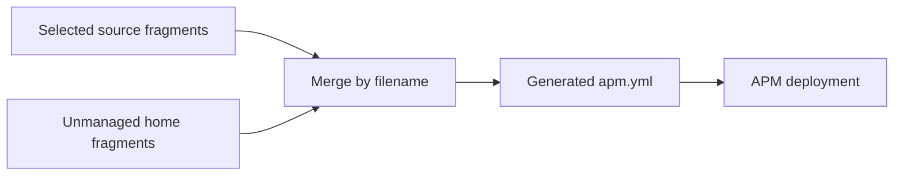

# Agent tooling

Dotfiles keeps agent preferences and reusable agent content in version control.
Two tasks apply them: **Agent settings** (`agent-settings`) manages selected
Copilot/Codex settings; **Agent packages** (`agent-packages`) deploys content through
[Microsoft APM](https://github.com/microsoft/apm). Repository instructions are
a third, separate concern: they guide work on this checkout without deployment.

**Review packages before applying them.** Agent packages can contain executable
hooks, MCP servers, and scheduled workflows—not just text. When the Copilot App
is detected, dotfiles enables its managed workflows in **autopilot** mode.

## Responsibilities

Start with the source that owns your change:

| I want to… | Edit |
|---|---|
| Set a Copilot or Codex preference | [`conf/agent-settings.toml`](../conf/agent-settings.toml) |
| Add an external plugin or MCP server | A fragment in [`symlinks/apm/config/`](../symlinks/apm/config/) |
| Change reusable personal agent behavior | [`symlinks/apm/plugins/dot-agent/`](../symlinks/apm/plugins/dot-agent/) |
| Add a focused reusable skill | [`symlinks/apm/plugins/dot-skill/`](../symlinks/apm/plugins/dot-skill/) |
| Choose which profiles receive a fragment/plugin | [`conf/symlinks.toml`](../conf/symlinks.toml) |
| Guide contributors to this repository | [`AGENTS.md`](../AGENTS.md) or [`.agents/skills/`](../.agents/skills/) |
| Change deployment behavior | [`cli/src/domains/ai/apm/`](../cli/src/domains/ai/apm/) |

Keep employer-specific instructions, private integrations, and secrets out of
the public sources. Private content belongs in a private overlay. Never edit
`~/.apm/apm.yml`, lock data, or deployed harness copies as a substitute for
changing their sources.

## Harness settings

The `agent-settings` task edits only declared keys in these documents:

| Target | User settings |
|---|---|
| `copilot` | `~/.copilot/settings.json` |
| `codex` | `~/.codex/config.toml` |

Unmanaged keys survive. Invalid existing documents are reported, not replaced.
Removing a declaration stops managing the key; it does **not** delete the stored
value. Conflicting declarations for the same harness/key fail before writes.
This task does not run APM.

See [Agent harness settings](CONFIGURATION.md#agent-harness-settings) for the
schema. Use the source file for current preferences, including declared
Codex desktop settings; do not assume all settings apply to every agent surface.

## Adding an agent package

1. **Choose the audience.** Use `.agents/skills/` for checkout-specific guidance,
   a public local plugin for reusable personal content, or an overlay for private
   content.
2. **Edit the package source.** Local plugins contain `apm.yml` with
   `includes: auto` and primitives below `.apm/`. A skill in `dot-skill`, for
   example, belongs at `.apm/skills/<skill-name>/SKILL.md`.
3. **Declare the dependency.** Add it to the narrowest applicable YAML fragment.
   Choose refs/pins deliberately. Use forward slashes for local paths on both
   platforms.
4. **Check the links.** A new fragment needs a `conf/symlinks.toml` entry.
   Its required local plugins must be selected in compatible categories.
5. **Validate, preview, then apply** using the sections below.

The existing base fragment shows the local dependency form:

```yaml
targets:
  - agent-skills
  - copilot

dependencies:
  apm:
    - ~/.apm/plugins/dot-agent
    - ~/.apm/plugins/dot-skill
```

This is an excerpt, not another fragment to add. Keep self-defined MCP servers
as direct dependencies unless trusting a transitive declaration is intentional.
Use dependency-level `targets` to restrict a package; the filter applies to the
whole package, so split packages when their primitives need different targets.

## Configuration fragments

The symlink configuration selects source fragments that appear under
`~/.apm/config/`. Names ending in `.yml` or `.yaml` are supported. A filename
such as `arch.yml` does not select a platform: its symlink category does.



Planning reads selected **source files**, even before their home links exist.
A selected source replaces the home input with the same filename, allowing
preview of a stale or broken managed link. Other YAML files already in
`~/.apm/config/` still participate.

Order is by effective filename, not by public/private origin. `private.yml`
sorts after `base.yml`; `90-private.yml` sorts before it. This is not the
[TOML overlay merge](CONFIGURATION.md#merge-rules).

### Merge rules

Each nonempty fragment must be a YAML mapping.

| Input | Result |
|---|---|
| `name`, `version` | Always generated as `dotfiles`, `1.0.0` |
| `dependencies`, `devDependencies` | Groups append in filename order |
| Named MCP entries within a dependency group | First entry for a name wins |
| Other dependency entries, including unnamed MCP entries | Identical serialized entries deduplicate; first wins |
| Other mappings | Merge recursively |
| Other sequences, including `targets` | Append unique values |
| Other scalar values or differing value types | Later value replaces earlier value |

Two consequences matter in practice:

- Repeating an MCP server name is **not** an override. Keep one authoritative
  declaration for that server.
- Target lists combine. An overlay that omits a base target does not remove it.

For exact merge examples, see
[`fragments.rs`](../cli/src/domains/ai/apm/fragments.rs).

## Update behavior

From the repository root, with the dotfiles CLI and APM already available:

```bash
# Preview this checkout's agent-package changes.
dotfiles update --root . --no-repo-update --only agent-packages --dry-run --verbose

# Apply after reviewing the plan and package sources.
dotfiles update --root . --no-repo-update --only agent-packages
```

A scoped run does not install its prerequisites for you. New plugin links may
need the symlink task first; see [Task selection](TASKS.md). In a normal update,
agent deployment is coordinated with symlink and package installation. APM can
come from any installation method as long as `apm` is on PATH.

An applying update:

1. Merges effective fragments and atomically updates `~/.apm/apm.yml` if needed.
   A symlink at this generated path is rejected rather than followed.
2. Runs `apm update -g --yes`, then `apm install -g`.
3. Applies the detected Copilot App and Cowork integrations below.
4. Reports manifest, lockfile, and integration changes.

The second native command is deliberate. An update can find no newer refs yet
leave local plugin edits or deployment drift to reconcile. Dotfiles therefore
still runs the install pass when refs or the generated manifest are unchanged.
Native APM owns resolution, local-source verification, and stale deployment
cleanup; dotfiles owns fragment merging and its two compatibility integrations.

On Arch, `apm-dotfiles` supplies the executable through the
[local package recipe](LOCAL-PACKAGES.md). **Updating agent dependencies is not
upgrading the APM executable.**

### Pin-update behavior

`dotfiles update` advances eligible dependency refs according to their APM
declarations; it is not a locked-only reinstall.

Its dry-run also requires APM on PATH:

| Generated manifest | Preview behavior |
|---|---|
| Already matches the fragments | Runs `apm update -g --dry-run` and summarizes the native plan |
| Would change | Describes the manifest write and update/install commands instead of asking APM to inspect stale inputs |

Neither path executes the follow-up install or the target repairs. The native
preview may contact upstream services. Dotfiles does not write its generated
manifest, lock cleanup, or Cowork inventory during preview, but dry-run is
**not a sandbox** for wrapper bootstrap, CLI bookkeeping, or native tools.
See [Usage](USAGE.md).

## Deployment targets

Keep the base fragment's explicit targets. Without an explicit choice, APM can
discover harness directories you did not intend to manage. Native precedence is
invocation `--target`, manifest `targets`, configured APM default, then detection.
The primary dotfiles invocation leaves the manifest in control.

| Surface | Selection | Deployment |
|---|---|---|
| Shared agent skills | Base target `agent-skills` | Native APM; `~/.agents/skills` |
| Copilot MCP configuration | Base target `copilot` | Native APM; `~/.copilot/mcp-config.json` |
| Copilot App workflows | Host has `~/.copilot/data.db` | Additional APM invocation and dotfiles policy repair |
| Cowork skills | A Cowork path resolves | Dotfiles file-level copy of resolved shared skills |

The last two are **host-detected additions**, not ordinary entries in the base
target list. Removing a target from that list does not disable these integrations.

### Copilot App workflows

When the App database exists, dotfiles enables APM's experimental `copilot-app`
support when needed, then runs:

```text
apm install -g --target copilot-app --only apm
```

This deploys workflow packages without forwarding manifest-wide MCP dependencies
to a target that cannot accept them. It happens after the primary update/install.

Dotfiles then restores managed workflows to **enabled, autopilot** state and
repairs their next-run schedules. Disabling one in the App is not a lasting
opt-out: the next dotfiles convergence can enable it again.

The repair has deliberately narrow ownership rules:

- Only exact workflow IDs in the global APM lockfile are managed; sharing an
  `apm--` prefix or a visible definition does not establish ownership.
- Duplicate rows are collapsed within a managed ID. A legacy
  `apm--unknown--<package>--<prompt>` row is removed only when its corresponding
  managed `apm--_local--<package>--<prompt>` and definition match.
- For local dependencies, prompt sources identified by `local_path` restore
  `cron_expression` omitted by native deployment. Changing/removing source cron
  metadata changes/removes that cron schedule. The App stores cron as
  `interval: manual` plus `cron_expression`.
- Missing or invalid sources for live managed workflows produce a repair
  warning, not an invented manual schedule. Stale lock entries for workflows
  no longer in the database do not block the remaining repairs.
- Remote dependencies retain native scheduling; existing cron schedules without
  a local source are preserved. Future local schedules use the offset at the
  scheduled date, including daylight-saving changes.

Repair needs Python and database access. It is best-effort, with warnings
reported separately from the native command's result. It is attempted even after
an APM or Cowork failure because an earlier step may already have reset workflows.
See [`autopilot/`](../cli/src/domains/ai/apm/autopilot/) for the implementation
and regression tests.

### Cowork skills

Cowork is experimental and receives **skills only**. Those skills must remain
useful without MCP servers, hooks, prompts, agents, commands, or instructions.
The destination is the first available value in this order:

1. Nonempty `APM_COPILOT_COWORK_SKILLS_DIR`.
2. `copilot_cowork_skills_dir` in `~/.apm/config.json`.
3. On Windows, `ONEDRIVECOMMERCIAL`, then `ONEDRIVE`, with
   `Documents/Cowork/skills` appended.

An explicit path works on Linux too. A malformed/unreadable persisted config or
a non-string path is an error, not permission to fall back elsewhere. Missing,
null, or blank persisted paths allow fallback; an environment override bypasses
that lower-priority config.

Dotfiles enables the experimental feature but does **not** invoke native
`copilot-cowork` deployment. Instead it copies from `~/.agents/skills`
file-by-file, preserving Cowork/OneDrive directories and their Windows ACLs.
Lockfile `target_subset` filters apply: only unfiltered packages or those
including `copilot-cowork` contribute skills.

The copier preserves matching links, replaces changed file/link entries without
writing through destination links, and refuses linked directory destinations or
directory-to-file replacements. Extra Cowork files stay in place.

Successful skills are recorded in `.dotfiles-apm-skills.json` at the destination.
For a removed or excluded skill, cleanup removes **only its `SKILL.md`**, and
only when that inventory proves ownership. Directories, placeholders, other
files, and unrelated skills survive. Windows case-only renames preserve the
desired entry point.

Before native deployment, legacy `cowork://` lock records are removed to prevent
native directory cleanup; explicit legacy skill ownership is retained in the
inventory when the destination exists. Do not delete the inventory to fix drift.
See [`cowork.rs`](../cli/src/domains/ai/apm/cowork.rs).

Neither compatibility integration should be removed just because APM's version
changes. A replacement needs isolated evidence for target filtering, ACL-safe
updates, owned stale cleanup, workflow policy, and preservation of foreign
workflows on the relevant platforms.

## Removing packages and targets

Remove a dependency from its **source fragment**, then run the agent packages
task while a valid fragment remains. Native APM handles stale deployments;
Cowork uses the narrower inventory-based cleanup described above.

To remove a normal target, remove it from every contributing fragment because
lists merge by union. Host-detected integrations are separate.

**Deleting the last fragment is not an uninstall.** With no managed or unmanaged
fragments, the task does not run. It leaves the generated manifest, lockfile,
and deployments alone. Keep a valid fragment while applying the intended empty
dependency set.

## Overlays

An overlay uses the same fragment/plugin layout. Keep its links in compatible
categories and validate the combined configuration. Filename order still
governs merging; private origin grants no automatic priority.

Unexpected dependency? Inspect all selected source fragments **and** unmanaged
home fragments before changing generated state.

## Validation

For a content change, check source layout, fragment/link category alignment, and
target compatibility before previewing deployment.

- Dotfiles checks that local `~/.apm/plugins/dot-*` references have source
  directories in the repository or overlay that declares them.
- The `apm-plugins` check invokes `apm pack --dry-run --verbose` in local plugin
  directories. Native APM, not a duplicate Rust schema, validates package shape.
- Missing APM is an unmet prerequisite, not a passing plugin check.
- Successful packing does not establish deployment compatibility with every
  target. Private plugins need validation in their own source context too.

Use [CLI validation](TESTING.md#cli-validation) for commands and
[Choosing coverage](TESTING.md#choosing-coverage) for implementation changes.
Never deploy to the live home merely to test a skill edit.

## Authentication and failure diagnosis

| Symptom | Next step |
|---|---|
| `apm` unavailable | Install it deliberately for the platform; a scoped agent task cannot bootstrap its own prerequisites |
| Authentication prerequisite unmet | Authenticate outside the run, for example with `gh auth login`, then retry |
| Unexpected dependency or target | Inspect effective fragment names and merge rules |
| Workflow repair warning | Check Python, App database access, and the managed prompt sources |
| Cowork path/copy failure | Check destination precedence, directory/link conflicts, and the ownership inventory |
| Package edits did not deploy | Confirm source links and inspect verbose native install output |

APM subprocesses cannot open interactive Git credential prompts. Recognized
authentication failures are reported as unmet prerequisites; other native
failures fail the task. Keep tokens out of fragments and diagnostic excerpts.

A failed run can already have changed the manifest or some targets. There is
no automatic rollback. Correct the reported cause and rerun; deleting lockfiles,
whole deployment trees, or App data is not a safe first response.
