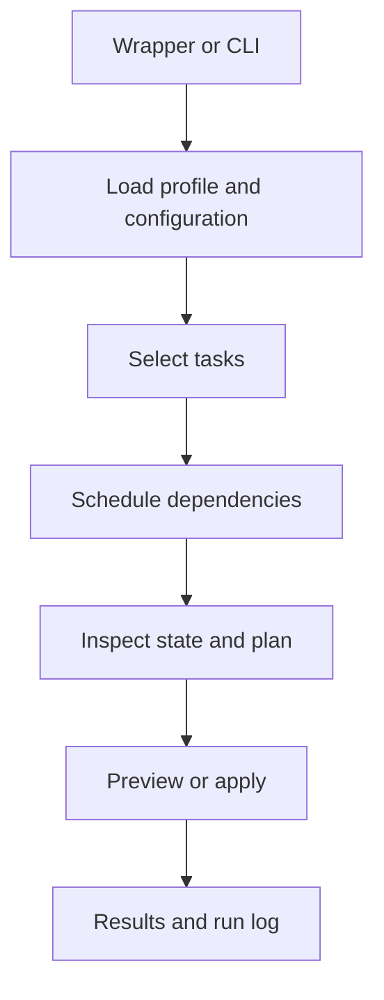

# Architecture

Dotfiles describes the machine state it wants, inspects the state it has, and
changes only what needs attention. It is not a list of installation scripts:
the dependency graph decides when work can run, and each item or workflow owns
its own convergence rules.

This guide is for contributors choosing where a change belongs. For commands,
read [Usage](USAGE.md); for desired-state declarations, read
[Configuration](CONFIGURATION.md).

## System view

Three boundaries explain most of the design:

| Boundary | Question it answers | Example |
|---|---|---|
| **Task** | Should this work run, and what must precede it? | Home symlinks |
| **Resource** | Is this independently managed item correct? | One home-directory link |
| **Operation** | What plan will converge this workflow as a whole? | Synchronizing a repository |

A **Requirement** checks an input without creating it. An **AccessClaim**
prevents concurrent work from touching the same shared state. Neither is a
substitute for a dependency.

For example, a symlink declaration becomes a resource inside the Home symlinks
task. The task waits for its graph predecessors; the resource checks its source
and destination; the engine decides whether to leave it alone, preview a link,
or create it. The result contributes to the task outcome and command status.
An operation takes the same route through selection and scheduling, but its
body plans a whole workflow rather than a collection of independent items.

## Repository layout

The Rust application has four layers:

| Layer | Responsibility |
|---|---|
| [`app/`](../cli/src/app) | CLI syntax, configuration loading, command composition, cross-domain dependencies, restart and elevation policy |
| [`engine/`](../cli/src/engine) | Task graphs, scheduling, convergence lifecycles, cancellation and result accounting |
| [`domains/`](../cli/src/domains) | Packages, files, Git, editors, services and other concrete desired state |
| [`infra/`](../cli/src/infra) | Filesystem, processes, environment, platform capabilities and logging |

Configuration lives outside those layers: `conf/` declares desired state,
`symlinks/` holds managed home content, and `system/` holds administrator-file
fragments. Most application-setting changes belong there, not in Rust.

Domains do not import sibling domains to coordinate work. The application
catalog wires those relationships. The
[domain-boundary tests](../cli/tests/domain_boundaries.rs) enforce this rule
and guard direct environment/platform access.

## Wrappers

[`dotfiles.sh`](../dotfiles.sh) and [`dotfiles.ps1`](../dotfiles.ps1) locate the
checkout and binary, handle `--build`, bootstrap when needed, and forward the
remaining arguments. Rust owns profile selection and command behavior.

Builds use Cargo's reported executable path rather than assuming a target
directory. Downloads receive the checks described in
[Release downloads](SECURITY.md#release-downloads). Finding a binary does not
prove it includes local Rust edits.

## Application layer

For engine commands, startup resolves one
[`RuntimePolicy`](../cli/src/app/commands/runtime.rs) before logging begins.
It combines CLI flags, the injected environment and terminal capabilities.
The context receives its resolved `ExecutionPolicy`; profile prompting,
restart logic and elevation do not independently reinterpret the environment.

Important distinctions:

- `CI` is active when present, even if empty or set to `"false"`. It disables
  prompts and requires applicable work to complete.
- Non-interactive execution does **not** by itself require complete work.
  Locally, an unmet prerequisite may be a skip; `--fail-on-skip` makes that
  command unsuccessful. Actual task failures already fail the command.
- Restart guards also use presence. The elevated-child environment marker
  instead needs a nonempty value.
- Structured JSONL output disables prompts. Terminal-dependent Windows exit
  pauses and interrupt handling remain separate from task prompt policy.

The [`CommandRunner`](../cli/src/app/commands/runner.rs) holds the run lock,
configuration store and execution context. Static update/remove tasks come
from [`catalog.rs`](../cli/src/app/catalog.rs); `check` has a
[separate task set](../cli/src/app/commands/check.rs). The
[execution coordinator](../cli/src/app/commands/execution/mod.rs) handles
elevation, restart phases, progress and final command status.

Read-only `list` uses configuration and task metadata without executing tasks,
probing runtime prerequisites, creating a run log, acquiring the run lock or
persisting selections. Its graph explains selection, not predicted changes.

## Configuration flow

The loader resolves the selected profile and overlay, decodes every required
main TOML file, selects active records, and gives matching overlay records
precedence. Source origins travel with entries so an overlay source stays an
overlay source. Scripts come only from the overlay.

Structural decoding covers inactive categories too. Active records receive
resource-specific conflict checks before merging; an overlay cannot conceal
contradictory declarations within the main source. Symlinks also need glob
expansion and merged target-overlap checks. Some domains retain unfiltered
views for source validation.

Loading errors stop task construction. Additional semantic diagnostics come
from `Config::validate`: startup displays them, while `config-diagnostics` fails
if any remain. Do not conflate these two validation stages or silently replace
invalid input with a default.

[`ConfigStore`](../cli/src/app/config/store.rs) exposes typed, `Arc`-backed
handles into one immutable configuration snapshot. Cloning a handle shares
ownership; `get()` borrows the data. Tasks, including dynamic script tasks, are
built once from that snapshot. They do not reload configuration as they run.

### Repository updates are a restart boundary

Repository synchronization can change the very files that define later work.
Continuing with the old task catalog would apply stale configuration.

The coordinator therefore runs the selected dependency closure ending at the
repository task first. If that phase succeeds and changes content, it starts
the **current binary** again with the original arguments and a restart guard.
The child reloads configuration and constructs a fresh catalog.

The parent keeps the run lock while waiting. The child selects tasks before
removing repeated repository synchronization, and does not reacquire the lock
or repeat the initial self-update preflight. Failure or cancellation prevents
restart; no change means the existing snapshot remains usable. Filtering out
repository work uses a single graph.

This is a reload boundary, not an independently selectable “reload” task.
See [`update.rs`](../cli/src/app/commands/update.rs) and
[`reexec.rs`](../cli/src/app/commands/reexec.rs).

## Task engine

Keep a task's identities separate:

| Field | Purpose |
|---|---|
| `task_id()` | Dependency identity: a static type, or type plus stable dynamic key |
| `selector()` | Stable public `--only` / `--skip` value |
| `name()` | Human-readable label |
| `log_key()` | Persistent identity, including a dynamic instance key |
| Visibility | Whether ordinary discovery, output rows and totals include it |
| `update_only()` | Command membership, not an ordering priority |

Use `task_metadata!` for metadata and `config_task!` for tasks containing only
one configuration handle. Dynamic tasks use stable instance keys and are
discovered from startup configuration, not opportunistically during execution.

### Dependencies and assessment

Dependencies, never catalog order, determine execution order:

- **Blocking:** predecessor failure or unmet work blocks the dependent.
- **Ordering-only:** wait for the predecessor, then inspect this task even if
  that predecessor failed.

The graph rejects duplicate identities and cycles. Same-domain edges belong
in the task; cross-domain edges belong in the application catalog.
If unavailable work is removed before scheduling, its transitive blocking
dependents must also be skipped: an absent graph node cannot propagate failure.

Applicability and elevation are assessed once per phase. Keep these probes
read-only and stable for that phase. Inputs that a predecessor may create
must be checked inside `run()`, after the wait. A task with no configured work
returns `NotApplicable`, not a changed result.

See [Task reference](TASKS.md#scheduling-model) for filtering and the difference
between a declared graph and its runtime assessment.

### Parallelism and shared state

Ready tasks run in scoped threads; resource batches can use Rayon.
`ctx.parallel()` gates both. `.sequential()` only serializes one batch—it does
not prevent another task from touching the same document.

Use [`AccessClaim`](../cli/src/engine/access.rs) for that exclusion. Equal
namespace/key pairs cannot overlap within the run's claim registry:

- A task reserves its full claim set after dependency waits, before its body.
- A resource reserves claims before discovery and holds them through preview,
  mutation or removal.
- A claimed task must declare all claims its nested resources will need.
  Undeclared nested claims fail rather than risking a deadlock.
- Resource dispatch waits on the caller thread, not on Rayon workers.
  Cancellation interrupts waits; dropping a reservation releases it.

Claims express neither completion order nor failure propagation. They are
explicit state identities, not automatic filesystem-alias detection, and
cannot coordinate external applications or other CLI processes. For example,
agent settings claim each target document, not each individual setting.

## Requirements

A [`Requirement<T>`](../cli/src/engine/requirement.rs) is a named read-only
probe that returns either:

| Result | Meaning |
|---|---|
| `Satisfied(evidence)` | The consumer receives the checked input |
| `Unsatisfied { reason }` | Required input is absent; report unmet work |
| `Unknown { error }` | Inspection failed; preserve the original typed error |

Call `process_requirement()` inside `run()`. It checks the `Preview` or
`Apply` contract once and passes the evidence into the continuation, which
still uses the ordinary resource/operation dry-run gate. Do not query the
same input again or install a hidden prerequisite.

Preview may need fewer inputs than apply. For example, an APM install preview
can describe local changes without an installed APM executable; a native
pin-update preview needs the tool. Neither proves installation has happened.

Requirements also support conservative early dispatch. A task declares its
ordering requirements, and the application adds a provider-stability
requirement through `TaskWithExtraDeps`. All must be satisfied at the
`Ordering` stage to waive the selected ordering-only waits. Empty declarations,
missing inputs and unknown results retain the waits. Blocking edges are never
waived.

Only the edge assessment survives into dispatch. Execution checks requirements
again after dependencies finish; it does not reuse startup evidence.
Requirements do not change selection or discover additional tasks.

## Resources

A [`Resource`](../cli/src/engine/resource/contract.rs) represents one
independently convergent item. Its lifecycle is **discover → plan → preview or
apply**. Discovery is intrinsic to the resource, or uses an injected batch
lookup when one query can inspect many items.

`Correct` needs no change. `Missing` and `Incorrect` are handled according to
the processing mode:

| Mode | Missing state | Incorrect state | Apply error |
|---|---|---|---|
| `Strict` | Create | Repair | Stop batch |
| `Lenient` | Create | Repair | Count failure and continue |
| `InstallMissing` | Create | Leave alone | Count failure and continue |
| `FixExisting` | Leave absent | Repair | Stop batch |

Unknown state is **not** missing state. Failed discovery must never trigger
blind creation; invalid or unknown state leaves unmet work. Discovery and
pre-apply warning errors remain fatal even in lenient mode; the continuation
policy above applies to apply errors.

`ResourceChange` separates applied, already-correct and skipped results.
An unusable result must not become a successful no-op. Removal is a separate
`RemovableResource` capability; the default removal plan acts on matching
managed state, not arbitrary mismatched user data. Unknown ownership prevents
removal and records failure.

Stopped batches retain a typed [`BatchReport`](../cli/src/engine/batch.rs):
completed statistics, interrupted work and unattempted items. Parallel batches
join already-started work before reporting. A failed shared inventory query
leaves all prepared items unattempted and is a task-level error, not an invented
resource failure. Later cancellation must not erase an earlier genuine failure.

## Operations

An [`Operation`](../cli/src/engine/operation.rs) handles one idempotent workflow,
such as repository synchronization or an overlay script. `current_state()`
returns complete, not applicable, blocked, or needs-run with an immutable plan.

`process_operation()` passes that **exact plan** to `preview()` or `apply()`.
Planning is read-only; preview must not recompute or partly execute the plan.
Use this lifecycle rather than duplicating check/dry-run/apply branches.

An operation is not a transaction or a sandbox. The engine cannot roll back a
partially completed external workflow, and script inspection/preview is safe
only if the script honors its protocol.

## Platform abstraction

Use context capabilities and injected environment, executor and filesystem
adapters for runtime decisions. Compile-time `cfg` gates remain appropriate
where native APIs require them. Paths retain native OS encoding; a non-Unicode
home path is not a missing environment variable.

The [elevation broker](../cli/src/app/commands/execution/elevation.rs) keeps
normal work unelevated. Linux primes sudo credentials for privileged commands;
Windows delegates selected tasks to an elevated child. Unavailable elevation
leaves unmet work and blocks blocking dependents, not independent work.
See [Elevation](SECURITY.md#elevation).

## Error handling and observability

Use checked [`CommandSpec`](../cli/src/infra/exec/mod.rs) requests unless a
nonzero exit has a domain meaning the caller explicitly handles. Preserve
typed spawn, I/O, nonzero-exit, capture-limit, timeout and cancellation causes
through helper context and task boundaries.

Subprocess capture is bounded: each stream retains at most an 8 MiB source-byte
prefix plus a truncation marker, but continues draining to avoid deadlock.
Exceeding the limit fails even an unchecked command, so truncated output cannot
be mistaken for a complete inventory. Timeout/cancellation also cover pipe
draining; process groups or Windows job objects allow descendant cleanup.

Atomic file publication stages content with owner-only Unix access. Replacing
a regular file preserves its mode; new files and symlink replacements remain
owner-only unless the caller explicitly applies another policy.

The scheduler's `ExecutionSummary`, **not logger counters**, decides command
success. A genuine failure exits 1 and takes precedence over interruption;
interruption alone exits 130. Neither implies rollback.

Logging records task identity, actions, commands, results and duration.
Normal output highlights changes and attention-worthy outcomes; verbose output
adds current tasks and decisions. Internal and non-applicable tasks stay out
of normal rows/totals, and finished rows retain completion order.

Run logs are schema-versioned, with one physical line per event. Restarted and
elevated processes have separate run IDs linked to their parent. A missing
finish record means unfinished, not necessarily crashed. Retention targets
50 process logs but preserves live leased logs. `dotfiles log` reads history
without creating another run and supports legacy text logs.

Argument redaction and captured-output policy are separate. By default failed
streams and successful stderr are retained, while successful stdout is
summarized by size. `OutputLog::Omit` excludes streams from logs and checked
errors; it is opt-in, not automatic secret scrubbing.
See [Secrets](SECURITY.md#secrets).

## Extending the system

Start with the smallest boundary that expresses the change:

| You need… | Change… |
|---|---|
| Different packages, settings or application content | `conf/`, `symlinks/`, or `system/` |
| Another independently managed item | A resource and thin task adapter |
| One multi-step convergence workflow | An operation |
| A checked input with reusable evidence | A requirement |
| Eligibility, dependencies, visibility or elevation | Task metadata/application wiring |
| Reusable OS/tool mechanics | An infrastructure adapter |
| Parsing or transformation only | A plain function or module |

Do not introduce a task just to split a function. Follow
[Change checklists](CONTRIBUTING.md#change-checklists) and choose focused
coverage from [Testing](TESTING.md).
