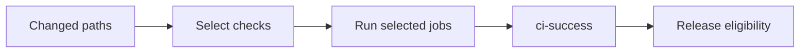

# CI and releases

CI answers two different questions: **did the checks selected for this patch
pass?** and, after a successful push to `main`, **is there an unpublished binary
change?** A green first answer does not imply a new release.

For local commands, use [Testing](TESTING.md). Workflow files and the
[path classifier](../.github/workflows/scripts/linux/classify-ci-changes.py)
are authoritative when changing automation.

## Reading a run

[`ci.yml`](../.github/workflows/ci.yml) runs for pushes and pull requests to
`main`, and manual dispatch. It does not use workflow-level path filters that
could leave required checks pending.

The last step applies only to successful, same-repository **push** CI on `main`.
Pull request CI cannot publish a release.

Always-on work includes documentation consistency, actionlint, workflow
contracts, and classification regressions. The `ci-success` job runs even after
an earlier failure and verifies that every selected gating job succeeded and
every unselected job was skipped. Missing outputs, cancellation, unexpected
skips, and classification failure fail the gate.

After a push, inspect the run for the **exact pushed SHA**, not simply the newest
green run on the branch. Read coverage and mutation results separately: they
are informational and excluded from the aggregate gate.

## Change-aware scheduling

Checks are selected by input, platform, linter, and application. The table is a
guide, not a replacement for the classifier's exact rules.

| Changed input | Typical additional coverage |
|---|---|
| Docs, skills, known editor/repository metadata | Always-on checks only; the docs selector fixture still compiles Rust |
| Rust source, embedded assets, Cargo/build/toolchain configuration | Both platform builds, Rust checks, profiles, round-trips, wrappers, and applications |
| Standalone Rust integration tests/fixtures | Both platform builds and Rust checks, not unrelated application/wrapper jobs |
| Cargo manifests/lockfiles | Dependency audit and deny in addition to Rust checks |
| `cli/deny.toml` or formatting policy | Dependency-policy or formatting check respectively |
| `conf/` | Validation, drift, and profile/round-trip checks; some files also select applications |
| `system/` | Linux configuration and profile/round-trip checks |
| `packages/` recipes | Linux build/Rust checks, config validation/drift, and ShellCheck |
| Managed application files | Configuration checks and the affected application/script fixtures |
| Quickshell | Python fixtures on both platforms and Linux offscreen QML |
| Wrappers | The affected platform's build and wrapper integration |
| Hooks | Hook and staged-input fixtures; hook-only edits do not request CLI builds |
| Shell/PowerShell files | The matching linter in addition to other selected work |
| CI workflow/shared orchestration, manual dispatch, or unknown inputs | Conservative full CI |
| Release workflow/selection | Publication eligibility without unrelated CI compilation |

Deletions and both sides of renames count. Invalid Git ranges fail; a valid
empty diff runs the always-on checks. Unavailable comparison ranges use
conservative full CI instead. Full CI alone does not request publication or
mutation testing.

Cargo verification uses the `ci` profile and `--locked`. Downstream integration
jobs reuse uploaded binaries rather than downloading an unrelated release.
Configuration-only Linux checks use `config_drift` instead of the full Rust suite
when full Rust coverage was not selected.

## Platform coverage

Coverage below is conditional on the relevant job being selected.

| Boundary | Linux | Windows | Still not proved |
|---|---|---|---|
| Rust build, Clippy, tests | Native | Native | Every architecture/runtime environment |
| `base` / `desktop` preview and config check | Yes | Yes | External installs deliberately omitted by those jobs |
| Update/remove round-trip | Yes | Yes | Every pre-existing user configuration |
| Wrappers | POSIX | PowerShell | Every network/authentication environment |
| Application integration | Git, zsh, Vim, Neovim | Git | Full Windows package and VS Code installation |
| Managed Python/PowerShell fixtures | Yes | Yes | A real compositor, network, or lock session |
| Quickshell QML | Offscreen with mocks | No | Native rendering and focus |
| Full commit-hook suite | Yes | No native job | Git-for-Windows hook runtime |
| Coverage reports | Informational | Informational | Correctness merely from a coverage percentage |
| Mutation testing | Changed-code shards | No | Native Windows mutation behavior |

Profile previews skip VS Code, and profile `check` runs omit external APM and
script analyzers. Windows application integration skips APM, packages, and VS
Code. Separate jobs or local checks cover some of those concerns; do not call
the profile matrix a full clean-machine installation test.

Mutation jobs run for PR/main-push changes to Rust source under `cli/src/`,
with eight shards covering the applicable changed-code set. Standalone test,
lockfile-only, and CI-only changes do not select them. Linux excludes native
Windows code and one equivalent mutation; see the
[mutation recipe](TESTING-RECIPES.md#focused-mutation-testing).

## Scheduled dependency checks

[`dependency-security.yml`](../.github/workflows/dependency-security.yml)
runs `cargo audit` and `cargo deny check all` weekly and on manual dispatch,
independently of changed paths. The policy check still runs after an advisory
failure unless the workflow is cancelled.

This separate workflow neither satisfies `ci-success` nor triggers a release.
Enable Actions failure notifications and configure Dependabot alerts/security
updates in repository settings separately. Check that the schedule remains
enabled; GitHub can disable schedules in inactive repositories.

## Release selection

[`release.yml`](../.github/workflows/release.yml) starts after successful
same-repository push CI on `main`. A read-only selection job compares that exact
tested SHA with the latest published, non-draft, non-prerelease release.

Publication is selected for binary or publishing-pipeline changes, or when no
release exists. Docs, ordinary configuration, wrappers, standalone test fixtures,
and lint-policy files do not by themselves require a new binary. Changes inside
`cli/src/`, including inline tests and embedded assets, are conservatively
treated as binary inputs. Unknown inputs also select publication.

**The baseline is the last published release, not the previous push.** If a
binary change passed CI but publication failed, a later docs-only push can
finish that pending release. If there is nothing unpublished, it skips instead.
Older/already-released commits skip; API errors, missing release tags, and
divergent release history fail explicitly.

Once selected, the workflow:

1. Resolves the version and source commit once for all builds.
2. Builds Linux x86_64/aarch64 and Windows x86_64 assets without dependency caches.
3. Generates checksums and build attestations with publishing permissions scoped
   to the publishing job.
4. Verifies attestations are retrievable, then publishes.

Release runs are serialized without cancelling an active publisher. Tags use
`vYYYY.MM.DD-N`, where `N` counts releases on that UTC day; the package version
in `Cargo.toml` is not the release version.

When reporting a release, verify the published tag, commit, and expected assets.
A successful CI gate or a running release workflow is not publication. See
[download verification](SECURITY.md#release-downloads) for the client side.

## Changing automation

Keep job conditions, classifier outputs, and aggregate dependencies aligned.
Make a new job's gating or informational status explicit. Use least-privilege
permissions, pin Actions to full commit SHAs, and reuse shared helpers under
[workflow scripts](../.github/workflows/scripts/).

Run the local `ci` stage and the affected job's focused command. The
[selection fixtures](TESTING-RECIPES.md#ci-selection-fixtures) use temporary Git
repositories and mocked release APIs; they do not publish. Preserve tests for
both affected and unaffected paths, deletions/renames, and unintended skips.
