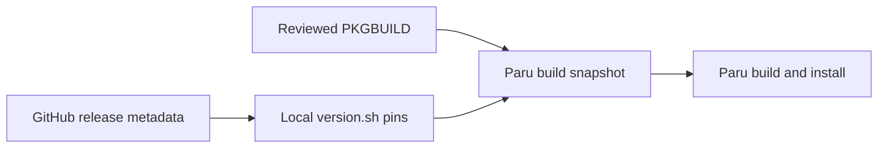

# Local package recipes

On Arch Linux, dotfiles maintains a small set of PKGBUILDs for official release
binaries. You review the recipes here; dotfiles discovers versions and prepares
them; Paru builds and installs the packages.

| Package | Recipe | Upstream |
|---|---|---|
| `apm-dotfiles` | [`packages/apm/`](../packages/apm/) | Microsoft APM |
| `github-copilot-app-dotfiles` | [`packages/github-copilot-app/`](../packages/github-copilot-app/) | GitHub Copilot App |
| `powershell-dotfiles` | [`packages/powershell/`](../packages/powershell/) | Microsoft PowerShell |
| `github-copilot-cli-dotfiles` | [`packages/github-copilot-cli/`](../packages/github-copilot-cli/) | GitHub Copilot CLI |
| `openai-codex-dotfiles` | [`packages/openai-codex/`](../packages/openai-codex/) | OpenAI Codex CLI |

**A refreshed recipe is not an upgraded application.** Dotfiles prepares the
available version and installs missing selected packages. Paru upgrades packages
that are already installed.

## Normal use

For a normal machine update followed by package upgrades:

```bash
dotfiles update
paru -Syu
```

These are applying commands. The first runs the full selected dotfiles update;
the second upgrades packages, not just these local recipes.

To inspect only local recipe preparation from this checkout:

```bash
dotfiles update --root . --no-repo-update --only local-package-versions,paru-config --dry-run
```

After reviewing the recipes and plan, remove `--dry-run` to prepare them.
This scoped command does **not** install packages or bootstrap missing tools.
On an already prepared machine, inspect Paru's repository listing without
upgrading:

```bash
paru -Sl --pkgbuilds
```

An explicit first installation, such as `paru -S apm-dotfiles`, works once
preparation succeeds. Running Paru alone uses the **last prepared snapshot**;
it does not discover a newer GitHub release or read your latest source edits.

### What happens during an update



| Task | Changes | Does not do |
|---|---|---|
| `local-package-versions` | Refreshes successful recipes' version/checksum pins | Download archives, execute recipes, or install packages |
| `paru-config` | Validates recipe metadata, prepares snapshots, and writes available repositories into Paru config | Install or upgrade packages |
| `aur-packages` | Installs missing selected packages whose inputs are ready | Upgrade every already-installed package |
| `apm` | Deploys agent dependencies using `apm` on PATH | Upgrade the APM executable |

Preparation waits for version discovery, but can use retained pins after an
upstream failure. Installation requires healthy Paru and ready inputs. A missing
local package whose inputs are unavailable is counted as a failure and omitted
from install requests; unrelated AUR packages can continue. It is **not** silently
installed from the AUR instead.

Agent deployment is independent of how APM was installed. An unrelated package
failure does not prevent use of an available APM; see
[Agent tooling](AGENT-TOOLING.md).

## Files and ownership

| Edit or inspect | Purpose | Tracked? |
|---|---|---|
| `packages/<recipe>/PKGBUILD` | Names, dependencies, URLs, packaging steps, and `pkgrel` | Yes |
| `packages/<recipe>/release.json` | GitHub source, asset names, and owned package names | Yes |
| Optional `package.install`, `LICENSE`, `NOTICE` | Lifecycle hooks and reviewed legal files | Yes |
| `packages/<recipe>/version.sh` | Discovered version and SHA-256 arrays | No |
| [`paru.conf.base`](../symlinks/config/paru/paru.conf.base) | Shared Paru options, including `CleanAfter` | Yes |
| Effective `paru.conf` | Generated machine-specific options and repository paths | No |
| `<CloneDir>/<package_base>/` | Disposable Git snapshot and Paru build output | No |

Edit tracked sources, not generated pins or cached recipes. Snapshot commits
are local cache state: they do not commit pins to the dotfiles repository,
create a remote, or publish anything.

Keep `pkgrel` in the PKGBUILD and bump it when a packaging-only change should
produce a newer Arch package. Release discovery manages `pkgver`, not `pkgrel`.

### Package-specific notes

- The Arch category selects APM, PowerShell, Copilot CLI, and Codex. The desktop
  Arch category additionally selects the Copilot App.
- Recipes use distinct `*-dotfiles` names and declare replacements/conflicts
  with their former packages. Review Paru's replacement prompt on first install.
- The Copilot App recipe extracts the official Debian package.
- PowerShell includes its .NET runtime. Its lifecycle script adds
  `/usr/bin/pwsh` to `/etc/shells` on install/upgrade and removes that entry
  on uninstall.
- Codex keeps the full upstream bundle, including helper/runtime files.
  CLI recipes also install completions and licenses; preserve those when
  changing packaging.

## Version discovery

A descriptor names a stable GitHub release source and one asset per architecture.
For example, the APM descriptor is:

```json
{
  "package_base": "apm-dotfiles",
  "repository": "microsoft/apm",
  "assets": {
    "aarch64": "apm-linux-arm64.tar.gz",
    "x86_64": "apm-linux-x86_64.tar.gz"
  }
}
```

| Field | Meaning |
|---|---|
| `package_base` | Actual makepkg `pkgbase`, or `pkgname` when no explicit base exists; not necessarily the source directory name |
| `repository` | GitHub `owner/repo` queried through `/releases/latest` |
| `assets` | Exact release asset names keyed by makepkg architecture |
| `packages` (optional) | All actual package names for split packages or names differing from the base; defaults to the base |
| `tag_prefix` (optional) | Exact prefix to strip before validating a release version |

Discovery scans immediate directories under `packages/` in sorted order.
It is independent of `conf/packages.toml`: maintaining a recipe does not
automatically select it for installation. A directory with neither descriptor
nor PKGBUILD is ignored; a PKGBUILD without `release.json` is an error.
Package bases and owned package names must be unique across descriptors.

For each recipe, dotfiles rejects drafts/prereleases, validates the version,
and requires a valid `sha256:` digest for **every configured architecture**.
It reads GitHub's metadata rather than downloading archives or executing a
version command. Only after all assets validate can that recipe's pins change.
The PKGBUILD sources `./version.sh`; makepkg later verifies the downloads
against those generated checksum arrays.

Without `tag_prefix`, a leading `v` is stripped. Codex instead declares
`"tag_prefix": "rust-v"`; an unexpected prefix fails. Asset names can contain
`{version}`, substituted with the validated version after prefix removal.
PowerShell uses this for versioned archive names.

Tracked license/notice files are not release metadata. Review and refresh them
separately when upstream terms change.

### Authentication, caching, and failures

GitHub requests prefer `GH_TOKEN`, then `GITHUB_TOKEN`, then an active
noninteractive `gh` login for github.com. Without credentials, public releases
can be queried anonymously. Rejected credentials are reported rather than
silently retried anonymously; tokens are not logged, cached, or passed as
subprocess arguments.

Validated metadata is cached for ten minutes in `bin/.github-releases-v1/`,
scoped by repository and credentials. Cache reuse still checks the current
descriptor and asset digests. Expired entries can use conditional requests.
Requests are serialized, even in parallel mode, and share rate-limit cooldowns
so one quota failure does not trigger a burst of requests.

A failed refresh retains that recipe's existing pins and remains a failure in
the summary. Other recipes can still succeed. Fresh cache entries remain usable
during cooldown; stale metadata is not presented as a successful refresh.
Cache-write problems produce warnings without invalidating otherwise valid pins.

Dry-run may read caches or query GitHub, but does not write caches, cooldowns,
pins, snapshots, or Paru config. It also does not execute PKGBUILDs.

## How Paru sees the recipes

The `paru-config` task combines the tracked base options with generated local
repository sections. It writes a regular file, replacing a former config
symlink atomically without overwriting that symlink's source.

| Path | Precedence |
|---|---|
| Generated config | `PARU_CONF`, then `$XDG_CONFIG_HOME/paru/paru.conf`, then `~/.config/paru/paru.conf` |
| Build root (`CloneDir`) | Nonempty `AURDEST`, then an absolute `$XDG_CACHE_HOME/paru/clone`, otherwise `~/.cache/paru/clone` |

Config overrides and `AURDEST` must be absolute. Empty config overrides are
invalid. Dotfiles creates the selected config destination when absent, so Paru
does not fall back to a different existing config.

An illustrative generated section looks like:

```ini
[options]
CloneDir = /home/you/.cache/paru/clone

[dotfiles-apm-dotfiles]
Path = /home/you/.cache/paru/clone/apm-dotfiles
GenerateSrcinfo
```

Paths are generated for the current user; do not copy these literal example
paths. Use the same environment when running dotfiles and Paru. A later
`--clonedir` override can break the required alignment between `CloneDir`,
repository `Path`, and `package_base`. Paths can contain internal spaces but
not surrounding whitespace, newlines, carriage returns, or `#`.

Paru's local `Path` repositories take priority over the AUR and skip the normal
recipe review step. **Review the tracked PKGBUILD before preparation.**
`GenerateSrcinfo` alone is insufficient: Paru 2.1.0 can skip repository refresh
when all repositories use local paths, so dotfiles publishes current `.SRCINFO`
itself. See the upstream
[Paru manual](https://github.com/Morganamilo/paru/blob/v2.1.0/man/paru.conf.5).

## Why there is a disposable Git snapshot

Paru's `CleanAfter` resets and cleans `<CloneDir>/<package_base>`. Pointing that
cleanup at the source checkout would put source edits and generated pins at risk.

Instead, each dotfiles-owned standalone cache repository commits these inputs:

- `PKGBUILD` and generated `version.sh`.
- Optional `package.install`, `LICENSE`, and `NOTICE`.
- Validated, generated `.SRCINFO`.

Paru can then clean build outputs while retaining usable inputs in the snapshot.
It cannot reset the separate dotfiles checkout. Recipes needing patches or
other local inputs require extending the snapshot format first; they are not
copied automatically.

Before publishing a snapshot, apply runs `makepkg --printsrcinfo` on separate
copies of its inputs. Package base, names, and architectures must match the
descriptor. **This executes the PKGBUILD; separate copies are not a sandbox.**
Only reviewed recipes belong here.

Successful validation is cached against the exact inputs and descriptor.
Ownership, working files, and committed inputs are still checked before reuse.
Changes, damage, or a missing validation record require another validation;
failures are not cached. Parallel mode can validate independent recipes with
up to four workers, then publishes in recipe order.

Snapshot safety is intentionally conservative:

- An ownership marker is required before reusing an existing cache repository.
- Unmanaged directories, linked worktrees, symlinked snapshot directories, and
  repositories pointing elsewhere are rejected.
- Inputs must be regular files in both working and committed trees. A replaced
  input link is repaired without modifying its target.
- Exact bytes and `.SRCINFO` are repaired when stale, including legacy snapshots
  and conflicting global line-ending settings.

A recipe that fails metadata validation is omitted from generated Paru
repositories and keeps its previous cached inputs. Other recipes can proceed.
The installer verifies current validated inputs **and** the published repository
section before requesting a missing local package. Invalid ownership descriptors
fail closed rather than allowing an AUR fallback.

## Adding a recipe

1. Create `packages/<recipe>/PKGBUILD` and `release.json`. Give the local package
   a distinct name where necessary to avoid an AUR recipe taking its place.
2. Make `package_base`, optional `packages`, and `assets` agree with makepkg's
   actual package base, package names, and architectures.
3. Point the descriptor at stable GitHub releases with published SHA-256 asset
   digests. Arbitrary version commands and VCS recipes are not supported.
4. Source `./version.sh` in the PKGBUILD. Keep `pkgrel` tracked and construct
   archive URLs using the upstream tag convention.
5. Keep extra inputs within the supported snapshot list. Use
   `install=package.install` for lifecycle hooks.
6. For automatic installation, add `{ name = "<package-name>", aur = true }`
   to the appropriate category in [`conf/packages.toml`](../conf/packages.toml).
7. Run offline checks, review a preparation preview, and verify the build on
   Arch in an isolated environment before installing.

On a fresh checkout, preview can describe snapshot work before pins exist.
Applying `paru-config` needs pins, so refresh versions first.

## Logs and troubleshooting

| Symptom or output | Meaning / next step |
|---|---|
| `Local package versions: write .../version.sh` | Available version/checksum pins changed; nothing was installed |
| `Paru configuration: refresh local package snapshot ...` | Cached build inputs or metadata changed |
| `Paru configuration: write .../paru.conf` | Available repository paths/options changed |
| Paru reports no upgrade after refresh | Inspect snapshot `version.sh` and `.SRCINFO`; rerun preparation and check `paru -Sl --pkgbuilds` |
| Missing release asset/digest or rate limit | Fix the descriptor or retry after the reported cooldown; old pins survive |
| Pins missing | Apply version discovery before snapshot preparation |
| Unmanaged cache directory | Inspect and preserve it before moving it; dotfiles will not claim an unrelated repository |
| `git reset --hard HEAD: No such file or directory` | Check `CloneDir`, repository `Path`, `package_base`, and environment/command-line overrides agree |
| Local install excluded | Inspect descriptor ownership, metadata validation, and the published repository section; do not force an AUR fallback |

Implementation and focused regressions live in
[`local_builds.rs`](../cli/src/domains/packages/local_builds.rs),
[`snapshots.rs`](../cli/src/domains/packages/local_builds/snapshots.rs), and
[`tests.rs`](../cli/src/domains/packages/local_builds/tests.rs).

## CI and validation

Recipe-only changes select offline Linux Rust checks, configuration
validation/drift, and ShellCheck. They do not request a CLI binary release or
Windows package integration. Rust implementation changes retain the normal
cross-platform rules.

Offline coverage checks real descriptors without generated pins, shell inputs,
mocked release failures, independent refreshes, retained-pin recovery, preview
safety, package readiness, and snapshot ownership/cleanup isolation.
ShellCheck includes tracked PKGBUILDs and install scripts, not downloaded files
or build outputs.

Choose local commands from [Testing](TESTING.md#choosing-coverage), using the
pinned Rust toolchain. A recipe edit needs more than a successful docs check.

CI does **not** establish current release availability, archive download
checksums, native Arch builds/installation, or Paru's full cleanup lifecycle.
Ubuntu and Windows profile jobs do not perform native Arch package operations.
For those gaps, use a disposable Arch build/home/cache with controlled config
and installation blocked. Build-only Paru (`paru -B`) is appropriate for cleanup
tests; verify that source edits and cached pins both survive.
