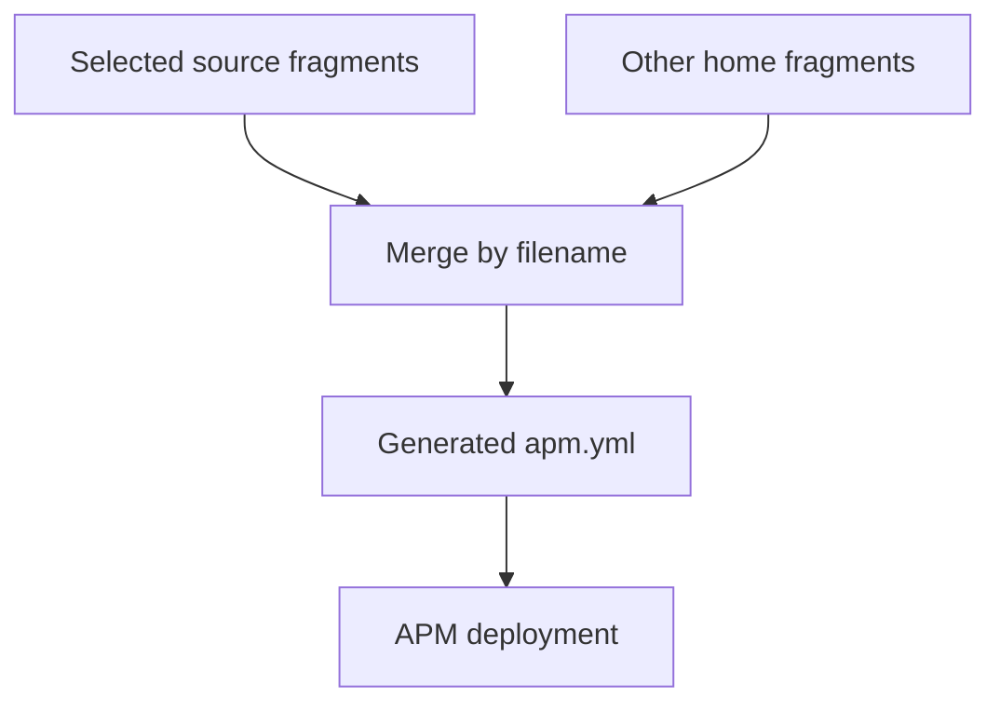

# Agent configuration

Dotfiles manages agent preferences separately from reusable agent content:

| Kind of change | How it is applied |
|---|---|
| Copilot or Codex preferences | The `agent-settings` task edits declared settings |
| Skills, plugins, and tool integrations | The `agent-packages` task uses [Microsoft APM](https://github.com/microsoft/apm), the Agent Package Manager, to install them |
| Instructions for working on this repository | Agents read `AGENTS.md` and `.agents/skills/` from the checkout; no deployment is needed |

An agent *harness* is the application that runs the agent, such as Copilot or
Codex. APM packages bundle reusable content for these applications. A local
plugin is a package maintained in this repository rather than downloaded.

:::caution[Packages can do more than provide text]
Review package sources before applying them. Packages can contain executable
hooks, MCP servers (tools the agent can call), and scheduled workflows.
When the Copilot App is detected, dotfiles enables its managed workflows in
**autopilot** mode.
:::

## Responsibilities

Start with the source that owns your change:

A configuration *fragment* is a YAML file containing part of the APM
configuration. Dotfiles combines the selected fragments before deployment.

| I want to… | Edit |
|---|---|
| Set a Copilot or Codex preference | [`conf/agent-settings.toml`](https://github.com/sneivandt/dotfiles/blob/main/conf/agent-settings.toml) |
| Add an external plugin or MCP server | A YAML configuration fragment in [`symlinks/apm/config/`](https://github.com/sneivandt/dotfiles/tree/main/symlinks/apm/config/) |
| Change reusable personal agent behavior | [`symlinks/apm/plugins/dot-agent/`](https://github.com/sneivandt/dotfiles/tree/main/symlinks/apm/plugins/dot-agent/) |
| Add a focused reusable skill | [`symlinks/apm/plugins/dot-skill/`](https://github.com/sneivandt/dotfiles/tree/main/symlinks/apm/plugins/dot-skill/) |
| Choose which profiles receive a fragment/plugin | [`conf/symlinks.toml`](https://github.com/sneivandt/dotfiles/blob/main/conf/symlinks.toml) |
| Guide contributors to this repository | [`AGENTS.md`](https://github.com/sneivandt/dotfiles/blob/main/AGENTS.md) or [`.agents/skills/`](https://github.com/sneivandt/dotfiles/tree/main/.agents/skills/) |

Keep employer-specific instructions, private integrations, and secrets out of
the public sources. Private content belongs in a [private overlay](private-overlays.md).
Never edit the generated combined configuration, `~/.apm/apm.yml`, lock data,
or deployed harness copies as a substitute for changing their sources.

**For maintainers:** See [Agent deployment internals](agent-deployment-internals.md)
for changes to the deployment implementation rather than agent content.

## Harness settings

The `agent-settings` task edits only declared keys in these documents:

| Application | User settings |
|---|---|
| `copilot` | `~/.copilot/settings.json` |
| `codex` | `~/.codex/config.toml` |

Unmanaged keys survive. Invalid existing documents are reported, not replaced.
Removing a declaration stops managing the key; it does **not** delete the stored
value. Conflicting declarations for the same harness/key fail before writes.
This task does not run APM.

See [Agent harness settings](configuration-reference.md#agent-harness-settings) for the
schema. Use the source file for current preferences, including declared
Codex desktop settings; do not assume all settings apply to every agent surface.

## Adding an agent package

First choose the audience: repository-only guidance belongs in `.agents/skills/`,
reusable public content in a local plugin, and private content in an overlay.

### Add a skill to an existing plugin

For a reusable skill, create
`symlinks/apm/plugins/dot-skill/.apm/skills/<skill-name>/SKILL.md`. For example,
a `change-summary` skill could start with:

```markdown title="symlinks/apm/plugins/dot-skill/.apm/skills/change-summary/SKILL.md"
---
name: change-summary
description: Use when asked to summarize a code change for a reviewer.
---

Explain the user-visible change first, then the reason for it.
Separate remaining limitations from completed work.
```

APM calls an individual skill, prompt, hook, or other content item a
*primitive*. The existing
[`dot-skill/apm.yml`](https://github.com/sneivandt/dotfiles/blob/main/symlinks/apm/plugins/dot-skill/apm.yml)
uses `includes: auto`, which discovers primitives beneath `.apm/`.
You do not need a new dependency or symlink declaration for each skill added
to this already-selected plugin.

Validate the package and preview deployment before applying it, as described
[below](#validate-preview-and-apply). Successful packing checks package shape;
it does not prove the instructions are useful or compatible with every target.

### Add a package or configuration fragment

The combined APM configuration is called a *manifest*. The existing
[`base.yml`](https://github.com/sneivandt/dotfiles/blob/main/symlinks/apm/config/base.yml)
shows how it selects the two local plugins:

```yaml
targets:
  - agent-skills
  - copilot

dependencies:
  apm:
    - ~/.apm/plugins/dot-agent
    - ~/.apm/plugins/dot-skill
```

This is an excerpt, not another fragment to add. A *target* names a destination
that APM can deploy to; [Deployment targets](#deployment-targets) explains the
two names above and the additional detected integrations.

To add another package:

1. Add its dependency to the narrowest applicable fragment. Choose the
   dependency's version or revision rule deliberately; normal updates can
   fetch newer revisions when that rule allows them.
2. For a new local plugin, provide its `apm.yml` and content below `.apm/`.
   Use forward slashes in local dependency paths on both platforms.
3. If adding a fragment, declare its link in `conf/symlinks.toml`. Keep its
   category selection compatible with the local plugins it requires.
4. Validate, preview, and apply using the next section.

Keep self-defined MCP servers as direct dependencies unless you intentionally
trust another package to declare them for you. Dependency-level `targets`
restrict a whole package. Split packages if their content needs different
destinations.

## Validate, preview, and apply

On a machine with dotfiles, a selected profile, and `apm` on PATH:

```sh
dotfiles check --only config-diagnostics,symlink-sources,apm-plugins
dotfiles update --only agent-packages --dry-run
```

The checks verify source/link configuration and run
`apm pack --dry-run --verbose` in local plugin directories. Missing APM is an
unmet prerequisite, not a passing check. Private plugins need validation in
their own source context too.

A scoped agent run does not install prerequisites. If you added plugin links,
apply the symlink task first; for a first setup, use the normal
[update walkthrough](getting-started.md). A normal update coordinates agent
deployment with symlink and package installation. APM can come from any
installation method as long as `apm` is on PATH.

Review the sources, dependency changes, and destinations. When you intend to
deploy to your home, apply:

```sh
dotfiles update --only agent-packages
```

This is a real deployment, not a way to test a skill edit in isolation.
It can run package code and enable scheduled workflows. To change only
preferences in `conf/agent-settings.toml`, preview and apply `agent-settings`
instead.

## Configuration fragments

The symlink configuration selects source fragments that appear under
`~/.apm/config/`. Names ending in `.yml` or `.yaml` are supported. A filename
such as `arch.yml` does not select a platform: its symlink category does.



Planning reads selected **source files**, even before their home links exist.
A selected source replaces the home input with the same filename, allowing
preview of a stale or broken managed link. Other YAML files already in
`~/.apm/config/` still participate.

Order is by effective filename, not by public/private origin. `private.yml`
sorts after `base.yml`; `90-private.yml` sorts before it. This is not the
[TOML overlay merge](private-overlays.md#merge-rules).

### Merge rules to keep in mind

Each nonempty fragment must be a YAML mapping. Dependencies are combined in
filename order, and identical entries are included once. For named MCP servers,
the first declaration of a name wins: repeating it is **not** an override.
Keep one authoritative declaration for each server.

Target lists also combine. Omitting a base target from an overlay does not
remove it. Other mappings merge recursively, lists append unique values, and
later scalar values replace earlier ones.

See the [full merge contract](agent-deployment-internals.md#fragment-merge-contract)
when debugging a conflicting configuration.

## Update behavior

An applying update:

1. Combines the fragments into `~/.apm/apm.yml` if its content needs changing.
2. Updates dependencies according to their declared version rules.
3. Installs the resulting content, including local plugin edits even when
   no dependency version changed.
4. Applies the detected Copilot App and Cowork integrations below and reports
   changes.

On Arch, `apm-dotfiles` supplies the executable through the
[dotfiles-managed Arch package recipe](package-management.md#custom-arch-packages). **Updating agent dependencies is not
upgrading the APM executable.**

### What a preview can show

An update is not a reinstall limited to previously locked versions. Its dry-run
also requires APM on PATH:

| Generated manifest | Preview behavior |
|---|---|
| Already matches the fragments | Runs `apm update -g --dry-run` and summarizes the native plan |
| Would change | Describes the manifest write and update/install commands instead of asking APM to inspect stale inputs |

Neither path installs the content or repairs the detected integrations. The
native preview may contact upstream services. It does not write the generated
manifest, remove legacy lock entries, or update Cowork's ownership inventory.
The general [dry-run limits](commands-and-usage.md#dry-run-scope) still apply.

## Deployment targets

Keep the base fragment's explicit targets. Without them, APM can discover
application directories you did not intend to manage. The primary dotfiles
deployment uses the targets in the generated manifest.

| Surface | Selection | Deployment |
|---|---|---|
| Shared agent skills | Base target `agent-skills` | Native APM; `~/.agents/skills` |
| Copilot MCP configuration | Base target `copilot` | Native APM; `~/.copilot/mcp-config.json` |
| Copilot App workflows | Host has `~/.copilot/data.db` | APM installs workflows; dotfiles enables them in autopilot |
| Cowork skills | A Cowork path is configured or detected | Dotfiles copies selected shared skills |

The last two are **host-detected additions**, not ordinary entries in the base
target list. Removing a target from that list does not disable these integrations.

### Copilot App workflows

When the App database exists, dotfiles enables APM's experimental `copilot-app`
support and installs workflow packages after the primary deployment. It does
not send manifest-wide MCP dependencies to this workflow-only integration.

:::caution[Disabling a managed workflow in the App is temporary]
Dotfiles restores its managed workflows to **enabled, autopilot** state and
repairs their next-run schedules. The next agent-package update can enable a
workflow you disabled in the App. Change the package source or dependency
selection for a lasting change.
:::

Workflow repair needs Python and database access. Repair warnings are reported
separately from the native deployment result; inspect them even when APM
itself succeeded.

### Cowork skills

Cowork is experimental and receives **skills only**. Those skills must remain
useful without MCP servers, hooks, prompts, agents, commands, or instructions.
The destination is the first available value in this order:

1. Nonempty `APM_COPILOT_COWORK_SKILLS_DIR`.
2. `copilot_cowork_skills_dir` in `~/.apm/config.json`.
3. On Windows, `ONEDRIVECOMMERCIAL`, then `ONEDRIVE`, with
   `Documents/Cowork/skills` appended.

An explicit path works on Linux too. A malformed/unreadable persisted config or
a non-string path is an error, not permission to fall back elsewhere. Missing,
null, or blank persisted paths allow fallback; an environment override bypasses
that lower-priority config.

Dotfiles copies selected content from `~/.agents/skills`, preserving the
Cowork/OneDrive directories and their Windows permissions. Packages with a
target restriction contribute only if it includes `copilot-cowork`.

For a removed or excluded skill, cleanup removes **only its `SKILL.md`**, and
only when `.dotfiles-apm-skills.json` at the destination records ownership.
Directories, other files, and unrelated skills remain. Do not delete that
inventory to fix a deployment problem; it is how cleanup identifies managed
content. The [copy and cleanup internals](agent-deployment-internals.md#cowork-copy-and-cleanup)
explain the file/link safety rules.

## Removing packages and targets

Remove a dependency from its **source fragment**, then run the agent packages
task while a valid fragment remains. Native APM handles stale deployments;
Cowork uses the narrower inventory-based cleanup described above.

To remove a normal target, remove it from every contributing fragment because
lists merge by union. Host-detected integrations are separate.

**Deleting the last fragment is not an uninstall.** With no managed or unmanaged
fragments, the task does not run. It leaves the generated manifest, lockfile,
and deployments alone. Keep a valid fragment while applying the intended empty
dependency set.

## Overlays

A [private overlay](private-overlays.md) uses the same fragment/plugin layout. Keep its links in compatible
categories and validate the combined configuration. Filename order still
governs merging; private origin grants no automatic priority.

Unexpected dependency? Inspect all selected source fragments **and** unmanaged
home fragments before changing generated state.

## Authentication and failure diagnosis

| Symptom | Next step |
|---|---|
| `apm` unavailable | Install it deliberately for the platform; a scoped agent task cannot bootstrap its own prerequisites |
| Authentication prerequisite unmet | Authenticate outside the run, for example with `gh auth login`, then retry |
| Unexpected dependency or target | Inspect effective fragment names and merge rules |
| Workflow repair warning | Check Python, App database access, and the managed prompt sources |
| Cowork path/copy failure | Check destination precedence, directory/link conflicts, and the ownership inventory |
| Package edits did not deploy | Confirm source links and inspect verbose native install output |

APM subprocesses cannot open interactive Git credential prompts. Recognized
authentication failures are reported as unmet prerequisites; other native
failures fail the task. Keep tokens out of fragments and diagnostic excerpts.

A failed run can already have changed the manifest or some targets. There is
no automatic rollback. Correct the reported cause and rerun; deleting lockfiles,
whole deployment trees, or App data is not a safe first response.
