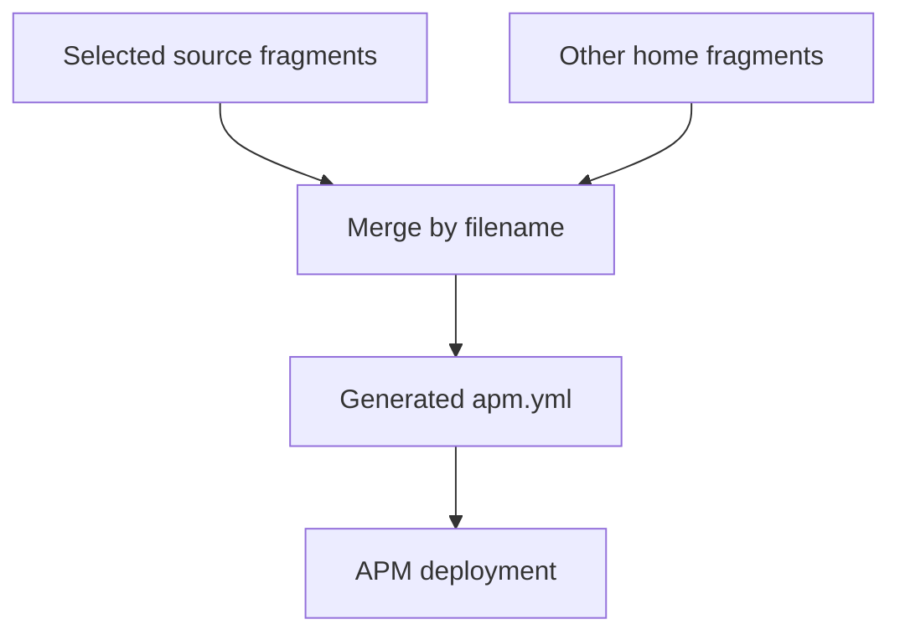

# Agent configuration

Use this guide to change agent preferences, add reusable skills or integrations,
and choose their deployment destinations. The `agent-settings` task manages
Copilot/Codex preferences; `agent-packages` uses
[Microsoft APM](https://github.com/microsoft/apm), the Agent Package Manager,
to update and deploy reusable content.

An agent *harness* is the application running the agent. APM packages bundle
content for these applications; a local plugin is maintained in this checkout.
Repository instructions in `AGENTS.md` and `.agents/skills/` are read directly
and need no deployment.

:::caution[Packages can do more than provide text]
Review package sources before applying them. Packages can contain executable
hooks, MCP servers (tools the agent can call), and scheduled workflows.
When the Copilot App is detected, dotfiles enables its managed workflows in
**autopilot** mode.
:::

## Choose what to change

A configuration *fragment* is a YAML file containing part of the APM
configuration. Dotfiles combines the selected fragments before deployment.
Choose the source for your change:

| Change | Source |
|---|---|
| Set a Copilot or Codex preference | [conf/agent-settings.toml](https://github.com/sneivandt/dotfiles/blob/main/conf/agent-settings.toml) |
| Add an external plugin or MCP server | A YAML configuration fragment in [symlinks/apm/config/](https://github.com/sneivandt/dotfiles/tree/main/symlinks/apm/config/) |
| Change reusable personal agent behavior | [symlinks/apm/plugins/dot-agent/](https://github.com/sneivandt/dotfiles/tree/main/symlinks/apm/plugins/dot-agent/) |
| Add a focused reusable skill | [symlinks/apm/plugins/dot-skill/](https://github.com/sneivandt/dotfiles/tree/main/symlinks/apm/plugins/dot-skill/) |
| Choose which profiles receive a fragment/plugin | [conf/symlinks.toml](https://github.com/sneivandt/dotfiles/blob/main/conf/symlinks.toml) |
| Guide contributors to this repository | [AGENTS.md](https://github.com/sneivandt/dotfiles/blob/main/AGENTS.md) or [.agents/skills/](https://github.com/sneivandt/dotfiles/tree/main/.agents/skills/) |

Keep employer-specific instructions and private integrations in a
[private overlay](private-overlays.md), using the same fragment/plugin layout
and compatible categories. Keep credentials out of tracked fragments.
Never edit the generated combined configuration, `~/.apm/apm.yml`, lock data,
or deployed harness copies as a substitute for changing their sources.

For implementation changes, see [Deployment maintenance](#deployment-maintenance).

## Agent preferences

The `agent-settings` task edits only declared keys in these documents:

| Application | User settings |
|---|---|
| `copilot` | `~/.copilot/settings.json` |
| `codex` | `~/.codex/config.toml` |

Unmanaged keys and TOML comments survive. Each document is updated as one
transaction; an invalid key or incompatible parent value leaves that document
unchanged. Detected concurrent edits stop publication; retry after resolving
the conflict. This cannot exclude writes by an application that does not
coordinate with dotfiles.
Invalid existing documents are reported, not replaced.
Removing a declaration stops managing the key; it does **not** delete the stored
value. Conflicting declarations for the same harness/key fail before writes.
This task does not run APM. With dotfiles installed and a profile selected,
edit `conf/agent-settings.toml` and preview preference changes separately:

```sh
dotfiles update --only agent-settings --dry-run
```

Review the changed keys, then remove `--dry-run` to apply.

See [Agent harness settings](configuration-reference.md#agent-harness-settings) for the
schema. Use the source file for current preferences, including declared
Codex desktop settings; do not assume all settings apply to every agent surface.

## Add a skill or package

First choose the audience: repository-only guidance belongs in `.agents/skills/`,
reusable public content in a local plugin, and private content in an overlay.

### Add a skill to an existing plugin

For a reusable skill, create
`symlinks/apm/plugins/dot-skill/.apm/skills/<skill-name>/SKILL.md`. For example,
a `change-summary` skill could start with:

```markdown title="symlinks/apm/plugins/dot-skill/.apm/skills/change-summary/SKILL.md"
---
name: change-summary
description: Use when asked to summarize a code change for a reviewer.
---

Explain the user-visible change first, then the reason for it.
Separate remaining limitations from completed work.
```

The existing
[dot-skill/apm.yml](https://github.com/sneivandt/dotfiles/blob/main/symlinks/apm/plugins/dot-skill/apm.yml)
uses `includes: auto` to discover skills and other content beneath `.apm/`.
Adding a skill to this plugin needs no new dependency or symlink declaration.

Validate the package and preview deployment before applying it, as described
[below](#validate-preview-and-apply). Packing checks the package's structure;
it does not prove the instructions are useful or compatible with every target.

### Add a package or configuration fragment

The combined APM configuration is called a *manifest*. The existing
[base.yml](https://github.com/sneivandt/dotfiles/blob/main/symlinks/apm/config/base.yml)
shows how it selects the two local plugins:

```yaml
targets:
  - agent-skills
  - copilot

dependencies:
  apm:
    - ~/.apm/plugins/dot-agent
    - ~/.apm/plugins/dot-skill
```

This is an excerpt, not another fragment to add. A *target* names a destination
that APM can deploy to; [Deployment targets](#deployment-targets) explains the
two names above and the additional detected integrations.

To add another package:

1. Add its dependency to the narrowest applicable fragment. Choose the
   dependency's version or revision rule deliberately; normal updates can
   fetch newer revisions when that rule allows them.
2. For a new local plugin, provide its `apm.yml` and content below `.apm/`.
   Use forward slashes in local dependency paths on both platforms.
3. If adding a fragment, declare its link in `conf/symlinks.toml`. Keep its
   category selection compatible with the local plugins it requires.
4. Review the destinations below, then follow
   [Validate, preview, and apply](#validate-preview-and-apply).

Keep self-defined MCP servers as direct dependencies unless you intentionally
trust another package to declare them for you. Dependency-level `targets`
restrict a whole package. Split packages if their content needs different
destinations.

## Deployment targets

Keep the base fragment's explicit targets. Without them, APM can discover
application directories you did not intend to manage. The primary dotfiles
deployment uses the targets in the generated manifest.

| Manifest target | Destination |
|---|---|
| `agent-skills` | Shared skills in `~/.agents/skills` |
| `copilot` | MCP configuration in `~/.copilot/mcp-config.json` |

Two integrations are added when detected on the host:

- If `~/.copilot/data.db` exists, APM installs Copilot App workflows and dotfiles
  enables them in autopilot.
- If a Cowork path is configured or detected, dotfiles copies selected shared
  skills there.

These are not ordinary entries in the base target list. Removing a manifest
target does not disable them. See [Detected integrations](#detected-integrations)
for their selection and cleanup rules.

## Validate, preview, and apply

On a machine with dotfiles, a selected profile, and APM on PATH:

```sh
dotfiles check --only config-diagnostics,symlink-sources,apm-plugins
dotfiles update --only agent-packages --dry-run
```

The checks verify source/link configuration and run
`apm pack --dry-run --verbose` in local plugin directories. If APM is missing,
the APM check is skipped. Private plugins need validation in their own
source context too.

A scoped agent run does not install prerequisites. If you added plugin links,
apply the symlink task first; for a first setup, use the normal
[update walkthrough](getting-started.md). A normal update coordinates agent
deployment with symlink and package installation. APM can come from any
installation method as long as `apm` is on PATH.

### What a preview can show

A dry run requires APM on PATH. What it can show depends on whether the
generated manifest matches your source fragments:

| Generated manifest | Preview behavior |
|---|---|
| Already matches the fragments | Runs `apm update -g --dry-run` and summarizes the native plan |
| Would change | Describes the manifest write and update/install commands instead of asking APM to inspect stale inputs |

Neither path deploys content, writes the generated manifest, or changes the
Copilot App or Cowork integrations. APM's preview may contact upstream services.
The general [dry-run limits](commands-and-usage.md#dry-run-scope) still apply;
see [Deployment maintenance](#deployment-maintenance) for contributor boundaries.

### Apply the reviewed changes

Review the sources, dependency changes, and destinations. Applying combines
fragments into `~/.apm/apm.yml`, updates dependencies within their declared version
rules, and installs content, including local edits with unchanged dependency refs.
It then applies detected integrations. When you intend to deploy to your home:

```sh
dotfiles update --only agent-packages
```

This is a real deployment, not a way to test a skill edit in isolation.
It can run package code and enable scheduled workflows. For preference changes,
follow [Agent preferences](#agent-preferences). On Arch, the APM executable comes
from the [apm-dotfiles package](package-management.md#custom-arch-packages);
upgrading that application is separate from deploying agent content.

## Configuration fragments

The symlink configuration selects source fragments that appear under
`~/.apm/config/`. Names ending in `.yml` or `.yaml` are supported. A filename
such as `arch.yml` does not select a platform: its symlink category does.



Dotfiles reads the selected source fragments directly, so previews use your
edits even if a fragment's home link is missing or broken. Other YAML files
already in `~/.apm/config/` also contribute unless a selected source has the
same filename.

Fragments merge in filename order. A private fragment has no special priority:
`private.yml` sorts after `base.yml`, but `90-private.yml` sorts before it.
This differs from the
[TOML overlay merge](private-overlays.md#merge-rules).

### Fragment merge rules

Each nonempty fragment must contain a YAML mapping. An empty list does not clear
entries from another fragment. Merge behavior is:

| Input | Result |
|---|---|
| `name`, `version` | Always generated as `dotfiles`, `1.0.0` |
| `dependencies`, `devDependencies` | Groups append in filename order |
| Named MCP entries within a dependency group | First entry for a name wins |
| Other dependency entries, including unnamed MCP entries | Identical serialized entries deduplicate; first wins |
| Other mappings | Merge recursively |
| Other sequences, including `targets` | Append unique values |
| Other scalar values or differing value types | Later value replaces earlier value |

Keep each named MCP server in one fragment; later declarations cannot override
it. Exact merge examples and regressions live in
[fragments.rs](https://github.com/sneivandt/dotfiles/blob/main/cli/src/domains/ai/apm/fragments.rs).

## Detected integrations

These additions depend on the host, not just the manifest's target list.

### Copilot App workflows

When the App database exists, dotfiles enables APM's experimental `copilot-app`
support and installs workflow packages after the primary deployment. It does
not send manifest-wide MCP dependencies to this workflow-only integration.

:::caution[Disabling a managed workflow in the App is temporary]
Dotfiles restores its managed workflows to **enabled, autopilot** state and
repairs their next-run schedules. The next agent-package update can enable a
workflow you disabled in the App. Change the package source or dependency
selection for a lasting change.
:::

Workflow repair needs Python and database access. A failed repair fails the task
even when APM succeeded. Missing prerequisites are reported as unmet work and
fail strict runs (`--fail-on-skip` or CI). If deployment itself fails, dotfiles
still attempts repair without replacing the original failure.

### Cowork skills

Cowork is experimental and receives **skills only**. Those skills must remain
useful without MCP servers, hooks, prompts, agents, commands, or instructions.
The destination is the first available value in this order:

1. Nonempty `APM_COPILOT_COWORK_SKILLS_DIR`.
2. `copilot_cowork_skills_dir` in `~/.apm/config.json`.
3. On Windows, `ONEDRIVECOMMERCIAL`, then `ONEDRIVE`, with
   `Documents/Cowork/skills` appended.

Set `APM_COPILOT_COWORK_SKILLS_DIR` to choose a destination explicitly,
including on Linux. Dotfiles copies selected skills from `~/.agents/skills`
while preserving the destination directories and their Windows permissions.
If a package restricts its targets, include `copilot-cowork` to send its skills
here.

Dotfiles records deployed file hashes and removes unchanged owned files that
disappear from the source or leave the selected skill set. An existing file
that matches the source can become managed. Dotfiles reports a conflict when
a destination file differs from both the source and its last deployed version,
or when a stale file has local edits. Move the conflicting file aside before
retrying. Directories, unrelated skills, and other unowned files remain. Keep the destination's
`.dotfiles-apm-skills.json` and `.dotfiles-apm-files.json` ownership records.
For older deployments without file hashes, cleanup remains limited to the
recorded skill's `SKILL.md`. For path-resolution failures or copy conflicts, see
[Deployment maintenance](#deployment-maintenance).

## Removing packages and targets

Remove a dependency from its source fragment, then run the agent packages
task while a valid fragment remains. Native APM handles stale deployments;
Cowork uses the narrower inventory-based cleanup described above.

To remove a normal target, remove it from every contributing fragment because
target lists combine. The detected Copilot App and Cowork integrations are
controlled separately.

**Deleting the last fragment is not an uninstall.** With no managed or unmanaged
fragments, the task does not run. It leaves the generated manifest, lockfile,
and deployments alone. Keep a valid fragment while applying the intended empty
dependency set.

To remove all declared dependencies while retaining the base targets, keep a
selected fragment with:

```yaml
targets:
  - agent-skills
  - copilot

dependencies:
  apm: []
```

Remove dependencies from every other selected source and unmanaged home fragment
too, including `mcp`, `lsp`, and `devDependencies` groups. Lists combine, so an
empty list cannot clear another fragment's entries. Keep the retained fragment's
symlink declaration active.

Preview with `dotfiles update --only agent-packages --dry-run`,
then remove `--dry-run` after reviewing the source changes and destinations.
When the manifest needs changing, preview describes delegated commands rather
than enumerating removals. Check the run log and affected targets before deleting
the retained fragment. See [preview behavior](#what-a-preview-can-show).

## Troubleshoot deployment

| Symptom | Next step |
|---|---|
| `apm` unavailable | Install it deliberately for the platform; a scoped agent task cannot bootstrap its own prerequisites |
| Authentication prerequisite unmet | Authenticate outside the run, for example with `gh auth login`, then retry |
| Unexpected dependency or target | Inspect effective fragment names and merge rules |
| Workflow repair warning | Check Python, App database access, and the managed prompt sources |
| Cowork path/copy failure | Check destination precedence, directory/link conflicts, and the ownership inventory |
| Package edits did not deploy | Confirm source links and inspect verbose native install output |

APM subprocesses cannot open interactive Git credential prompts. Recognized
authentication failures are reported as unmet prerequisites; other native
failures fail the task. Keep tokens out of fragments and diagnostic excerpts.

A failed run can already have changed the manifest or some targets. There is
no automatic rollback. Correct the reported cause and rerun; deleting lockfiles,
whole deployment trees, or App data is not a safe first response.

## Deployment maintenance

The implementation lives under
[cli/src/domains/ai/apm/](https://github.com/sneivandt/dotfiles/tree/main/cli/src/domains/ai/apm/).
Native APM owns dependency resolution, local-source verification, and stale
deployment cleanup. Dotfiles owns fragment merging and the detected integrations.

See [Agent deployment implementation](architecture.md#agent-deployment-implementation)
for contributor contracts and source ownership. For a package or preference
edit, use the [validation and preview steps](#validate-preview-and-apply) above.

Use isolated homes, synthetic App databases, controlled executors, and the
[Testing guide](testing.md#choosing-coverage). Never deploy to the live home to
test an implementation change. Dotfiles validates local source relationships;
native `apm pack --dry-run --verbose` owns package shape validation. Packing
does not prove deployment compatibility.

Adapter changes also need the
[deployment contracts](architecture.md#agent-deployment-implementation), including
partial failures and preservation of unrelated content. A newer APM version
alone does not prove that an adapter can be removed.
