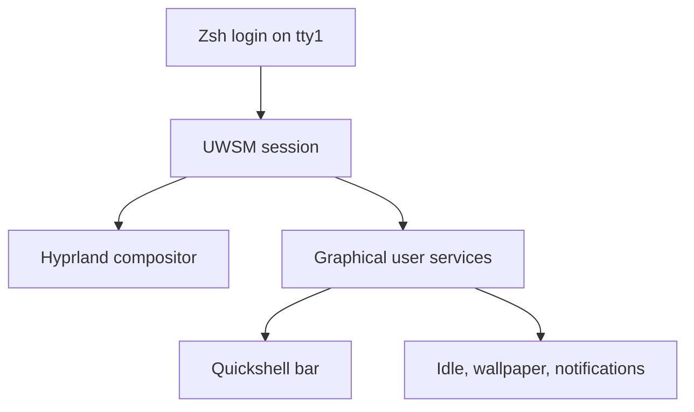

# Arch desktop

The Arch `desktop` profile builds a Wayland desktop around **Hyprland** for
windows and workspaces and **Quickshell** for the bar and menus. UWSM (Universal
Wayland Session Manager) starts the graphical session; systemd manages its
background services.

This guide covers the running desktop, not installing Arch itself. Begin with
[Getting started](getting-started.md) and choose `desktop`; Arch detection adds
the `arch` category automatically. [Package management](package-management.md)
explains installation and upgrades.

## Everyday shortcuts

`Super` is the Windows/logo key. The full mapping is in
[`binds.lua`](https://github.com/sneivandt/dotfiles/blob/main/symlinks/config/hypr/conf/binds.lua).

| Shortcut | Action |
|---|---|
| Super + Return | Open Alacritty |
| Super + P | Open the application launcher |
| Super + O / V | Choose a browser / editor |
| Super + G / C | Open GitHub Copilot / ChatGPT |
| Super + Q | Close the focused window |
| Super + 1–9 | Change workspace |
| Super + Shift + 1–9 | Move the window to a workspace |
| Super + End | Lock the session |
| Super + Shift + S | Select an area for a screenshot |

## Hyprland media keys

Bindings use standard `XF86` symbols, not physical F-key positions. Keyboard
Fn mode determines which symbols are sent. Fallback shortcuts are:

| Shortcut | Action |
|---|---|
| Super + F1 | Toggle output mute |
| Super + F2 / F3 | Lower / raise output volume by 5% |
| Super + F4 | Toggle microphone mute |
| Super + F5 / F6 | Lower / raise display brightness by 5% |

Volume follows the default output through `pactl` and can exceed 100%.
Playback uses `playerctl`. Dedicated media keys also work while locked;
fallback shortcuts do not.

[`brightness.sh`](https://github.com/sneivandt/dotfiles/blob/main/symlinks/config/hypr/scripts/brightness.sh)
targets display backlights, never keyboard LEDs, and keeps brightness above
zero. With no backlight it does nothing. External monitors usually need
separate DDC/CI configuration unless their driver exposes a backlight.

## Bar and menus

Quickshell puts workspaces and the focused window on the left, with media,
tray items, and controls alongside them. Use the bar as follows:

| Control | What you can do |
|---|---|
| Workspaces | Switch to a workspace |
| Playing media | Click to play/pause, middle-click for the previous track, or right-click for the next |
| Markets | View configured stock and cryptocurrency quotes, expand a quote, or request a refresh |
| Network | Choose a saved network or enter a Wi-Fi password; right-click opens the connection editor |
| Volume | Choose the output and adjust volume up to 150%, with 100% marked; scroll the bar icon for volume or middle-click to mute |
| Battery, when present | Inspect battery status |
| Power | Lock immediately, or confirm logout, restart, or shutdown |
| Clock | Open the calendar |

Only one bar popup opens at a time across monitors. The bar reserves space for
tiled windows, sits below floating windows and hides on fullscreen workspaces.
Mako margins align notifications with the tiled frame without adding the bar
offset twice.

### Tray applications

GitHub Copilot and ChatGPT use monochrome brand icons in
the regular tray, visible only while the applications expose tray items.
Other applications retain their own icons. Context menus, middle-click and
scrolling remain available.

Copilot's left click goes through
[`launch-github.sh`](https://github.com/sneivandt/dotfiles/blob/main/symlinks/config/hypr/scripts/launch-github.sh) to invoke
the app's **Open GitHub Copilot** action; ordinary tray activation does not
restore that window. ChatGPT uses normal activation. Copilot launcher failures
appear in its tooltip and log. The brand SVGs carry Font Awesome Free/CC BY 4.0
attribution in [`icons/`](https://github.com/sneivandt/dotfiles/tree/main/symlinks/config/quickshell/icons).

### Network and market refreshes

NetworkManager handles connections; enterprise Wi-Fi setup stays in the
connection editor. Saved Wi-Fi profile details are cached for up to 60 seconds.
Live adapter, connection and signal state are still polled. Connection actions
and profile inventory changes invalidate that cache.

The Markets menu refreshes on startup and every five minutes, with a manual
refresh control in the menu. Each symbol keeps its last successful quote and
timestamp when a request fails. The menu marks stale data rather than hiding
every cached quote because one request failed. Configure the symbols in
[`stocks.py`](https://github.com/sneivandt/dotfiles/blob/main/symlinks/config/hypr/scripts/stocks.py).

## Screen locking and suspend

[`hypridle.conf`](https://github.com/sneivandt/dotfiles/blob/main/symlinks/config/hypr/hypridle.conf)
requests locking after **10 idle minutes** and turns displays off after **15**.
Idle inhibitors can postpone these actions. Turning off displays is not
suspending the machine.

Before sleep, Hypridle requests a session lock. `inhibit_sleep = 3` waits for
the compositor's lock notification because automatic detection cannot see
Hyprlock behind the shared wrapper. This needs Hypridle/compositor support.

The delay is bounded by logind's `InhibitDelayMaxSec`: a failed locker does
**not** guarantee suspend will be prevented. Resume turns displays on but
does not unlock the session.

## Where to customize

Edit tracked sources under
[`symlinks/config/`](https://github.com/sneivandt/dotfiles/tree/main/symlinks/config/),
not installed copies. These may already be live links. For a different
machine's settings, use a [private overlay](private-overlays.md); an overlay
replaces a matching linked source rather than patching the base file's contents.

| Change | Start here |
|---|---|
| Monitor arrangement | [`monitors.lua`](https://github.com/sneivandt/dotfiles/blob/main/symlinks/config/hypr/conf/monitors.lua) |
| Keyboard, mouse, and touchpad | [`input.lua`](https://github.com/sneivandt/dotfiles/blob/main/symlinks/config/hypr/conf/input.lua) |
| Window and application shortcuts | [`binds.lua`](https://github.com/sneivandt/dotfiles/blob/main/symlinks/config/hypr/conf/binds.lua) |
| Window appearance | [`appearance.lua`](https://github.com/sneivandt/dotfiles/blob/main/symlinks/config/hypr/conf/appearance.lua) |
| Bar colors, typography, spacing, and motion | [`Theme.js`](https://github.com/sneivandt/dotfiles/blob/main/symlinks/config/quickshell/Theme.js) |
| Bar contents and layout | [`Bar.qml`](https://github.com/sneivandt/dotfiles/blob/main/symlinks/config/quickshell/Bar.qml) |
| Popup placement, focus, dismissal, and scrolling | [`ShellPopup.qml`](https://github.com/sneivandt/dotfiles/blob/main/symlinks/config/quickshell/ShellPopup.qml) |
| Notification spacing | [`mako/config`](https://github.com/sneivandt/dotfiles/blob/main/symlinks/config/mako/config) |

[`hyprland.lua`](https://github.com/sneivandt/dotfiles/blob/main/symlinks/config/hypr/hyprland.lua)
loads the Lua modules in `hypr/conf/`. Use the existing Lua format, not a
configuration snippet for a different Hyprland syntax.

## Reloading changes

Quickshell watches linked sources and keeps the last valid shell when a reload
fails. Editing this checkout can therefore reload the live UI without running
dotfiles again.

For deliberate manual reloads, Hyprland uses `hyprctl reload config-only`
and `hyprctl configerrors`; mako uses `makoctl reload`. Fuzzel reads its
configuration on launch. Existing GTK applications may need reopening.

Keep Hyprlock's simple background and disabled animations while its
[documented DPMS workaround](https://github.com/sneivandt/dotfiles/blob/main/symlinks/config/hypr/hyprlock.conf) is needed.

## Session and services

The managed
[`zprofile`](https://github.com/sneivandt/dotfiles/blob/main/symlinks/zprofile)
starts `hyprland-uwsm.desktop` through UWSM on `tty1` when a session may start.
Other terminals remain ordinary shells. UWSM owns session identity;
application environment settings belong in
[`conf/env.lua`](https://github.com/sneivandt/dotfiles/blob/main/symlinks/config/hypr/conf/env.lua).



Long-running daemons are user services, not duplicated Hyprland autostart
commands. They include Quickshell, Hypridle, Hyprpaper, Mako, Gammastep, the
keyring, and the authentication agent. NetworkManager is a system service;
the old `dhcpcd` service and standalone network tray applet are disabled.
PipeWire and WirePlumber provide audio.

Service selection lives in
[`conf/systemd-units.toml`](https://github.com/sneivandt/dotfiles/blob/main/conf/systemd-units.toml);
custom units live under
[`config/systemd/user/`](https://github.com/sneivandt/dotfiles/tree/main/symlinks/config/systemd/user/).
Keep their graphical-session lifetime and safety settings when customizing.

The desktop portal uses Hyprland for screen sharing and GTK for file choosers.
That selection belongs in
[`hyprland-portals.conf`](https://github.com/sneivandt/dotfiles/blob/main/symlinks/config/xdg-desktop-portal/hyprland-portals.conf).

## Diagnose a desktop problem

Check the owning component before restarting the whole session:

```sh
hyprctl configerrors
systemctl --user status quickshell.service
journalctl --user -u quickshell.service -b
```

Substitute the affected service for Quickshell. These inspect the running
session; reloading, locking, suspending, and changing connectivity are separate
actions. Review journal output before sharing it.

Use [Troubleshooting](troubleshooting.md#systemd-changes-are-not-visible) for
inactive units and keyring issues. Contributors can check helpers and UI logic
with the isolated [application tests](testing.md#application-configuration)
without restarting the desktop.
