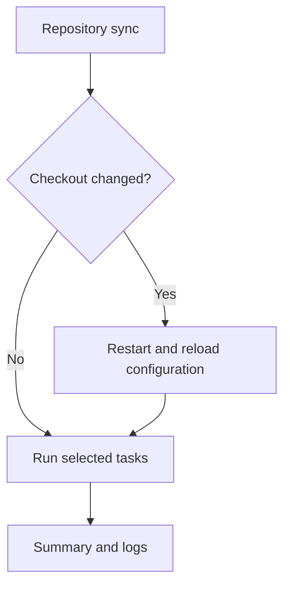

# Commands and usage

Use dotfiles to apply the packages, files, and settings declared in this checkout.
Start with [Getting started](getting-started.md) for a first installation, or the
[Windows guide](windows-and-wsl.md) for PowerShell examples.

The examples use the checkout behind your installed dotfiles launcher and
your saved profile. Before installation, use `./dotfiles.sh` on Linux or
`.\dotfiles.ps1` on Windows; see [Wrapper bootstrap](cli-reference.md#wrapper-bootstrap).
In an interactive terminal, update, remove, and check prompt when no profile
is selected. The read-only list and explain commands need an existing selection
or an explicit `--profile`. See [Unattended runs](#unattended-runs) for automation.

## Everyday commands

| Goal | What to run |
|---|---|
| See the available tasks | `dotfiles list` |
| Preview an update | `dotfiles update --dry-run` |
| Sync the repository and apply updates | `dotfiles update` |
| Validate configuration and repository files | `dotfiles check` |
| Inspect a managed home symlink | `dotfiles explain <path>` |
| Read the latest run | `dotfiles log` |
| Preview removal | `dotfiles remove --dry-run` |

Use `--profile base` or `--profile desktop` to override the saved role for one
run. Neither profile is a user-files-only mode.
Preview before the first apply. Back up and move aside any entries that block
managed links. Changes to linked application settings may take effect immediately.

## Dry-run scope

`--dry-run` previews planned configuration changes. **It is not a sandbox or a
promise of zero writes.**

| Activity | What a preview still does |
|---|---|
| Wrapper bootstrap | Can download a binary, or build one with `--build`, before the CLI starts |
| CLI release check | Can read caches and query GitHub; does not replace the binary or write release caches |
| Repository task | Can query remote refs, but does not fetch or merge; omit it with `--no-repo-update` |
| Bookkeeping | Writes a run log and acquires the repository lock |
| Selection | Can save an interactive profile choice or an explicit `--overlay` |
| Inspection | Reads host state and invokes external tools; their effects are not sandboxed |
| Overlay scripts | Executes `--check` and, when needed, `--dryrun`; the scripts must honor those modes |

For discovery without task probes, use an existing binary's `list` command.
It does not execute tasks or scripts, acquire the run lock, create a run log,
or save profile/overlay selections.

## Discover tasks

Use `dotfiles list` to find the selectors available to your profile and platform.
To include inapplicable tasks or inspect selection and dependencies:

```sh
dotfiles list --all
dotfiles list --graph update
```

A listed task may still need tools that are not installed. A graph explains
selection, not what will change. See [Task reference](task-reference.md) for
each task and [Task discovery output](cli-reference.md#task-discovery-output)
for graph markers and structured formats.

## Update

Update is the default: running the launcher without a command applies an update.
Tasks check what is installed or configured and leave it alone when it already
matches the configuration.
See [Update lifecycle](#update-lifecycle) for startup and repository synchronization.
For a targeted change, pass a task selector to `--only` and preview the
selection. For example, to preview changes to managed symlinks:

```sh
dotfiles update --only symlinks --dry-run
```

Remove `--dry-run` after review. Filters select tasks, not the CLI release check.

### Select tasks

Use exact selectors from the task listing. For example, select `symlinks` and
`git-hooks` together:

```bash
dotfiles list
dotfiles update --only symlinks,git-hooks --dry-run
```

- `--only` runs the named tasks. Repeat the flag or separate selectors with commas.
- `--skip` excludes tasks and takes precedence over `--only`.
- Selectors match exactly after case, punctuation, and whitespace normalization.
  Full task labels also work; arbitrary substrings do not.
- Unknown selectors and a filter selecting no tasks are errors.
- `--only packages` means **all selected pacman or winget packages**, not a
  single package and not the AUR package list.

**Dependencies are not included automatically.** If a required task is omitted,
dotfiles warns and proceeds as though that prerequisite had succeeded. Use
`--with-deps` to include prerequisites and other tasks the selection must wait for:

```bash
dotfiles list --graph update --only systemd --with-deps
dotfiles update --only systemd --with-deps --dry-run
```

Inspect the graph first: the systemd example adds package work, AUR setup,
custom package preparation, symlinks, and file permissions where applicable.
Other selections, such as `git-hooks`, can also add repository synchronization.
`--skip` is applied after expansion, so it can remove a prerequisite again.
`--with-deps` is available only for update and update graphs.

### Unattended runs

Select the profile explicitly, disable prompts, and require a
complete result when automation depends on one:

```bash
dotfiles update --profile base --non-interactive --fail-on-skip
```

This **applies** configuration. Add `--dry-run` to preview instead.
Non-terminal stdin and JSON Lines output also disable prompts. Any present
`CI` variable (even `CI=false`) disables prompts and enables strict skip handling.
Tasks that do not apply to the selected platform or configuration are not failures.

Only one update, remove, or check can run against a repository at a time.
Previews count too; linked worktrees share the same lock. `list` and `log`
remain available while a run is active.

## Console output

Check the header's profile, platform, overlay, and dry-run indicator first.
Tasks print as they finish, so output order is not configuration order.
While tasks run in an interactive terminal, a spinner shows the remaining task
count and active task names.

| Status | Meaning |
|---|---|
| `✓` / `CHANGED` or `PASSED` | Changes applied, or a check passed |
| `~` / `PLANNED` | A dry run found changes to make |
| `○` / `CURRENT` | Already satisfied; shown with `--verbose` |
| `⊘` / `SKIPPED` | Work was not performed; read the reason |
| `⊘` / `BLOCKED` | A required predecessor did not complete successfully |
| `⊘` / `INTERRUPTED` | Work stopped during cancellation |
| `✗` / `FAILED` | An operation failed |

`--verbose` adds current tasks, decisions, and timings. `--no-symbols` uses the
text labels above; `NO_COLOR` disables color. Inapplicable and internal tasks
do not appear in normal rows or totals, but remain in logs.

Indented actions describe files or packages. The final counts describe
tasks, not the number of action lines. Failed, interrupted, blocked, and
skipped work appears before successful counts. **Exit 0 with skipped work is
not necessarily a complete installation.** Use `--fail-on-skip` when it must be.

## Check configuration

The check command validates configuration, checks source files, and runs
available code analyzers. It does not install or repair configuration and has
no `--dry-run`. It writes a log and holds the run lock. It can save a profile
chosen at the prompt or an overlay passed with `--overlay`.

```bash
dotfiles check
```

The `config-diagnostics` task fails on configuration diagnostics, including
warnings. Missing optional tools are visible skips; `--fail-on-skip` and CI
make them fatal.

See [Testing](testing.md#cli-validation) for scoped checks and prerequisites.
Task filtering cannot bypass malformed configuration loaded at startup.

## Logs

After a failure, use the log-viewing command printed by the CLI. It selects
the failed run with a stable `--id`, even after later runs.

```sh
dotfiles log                          # newest run
dotfiles log --list                   # history and stable run IDs
dotfiles log --task symlinks --verbose # one task in the newest run
```

Read the failed command's diagnostics and the reason for each failed or
skipped task.
If the process restarted or delegated elevation, follow the linked child log.
Earlier changes are not rolled back when a later task fails.

Review logs for private paths, configuration, and tool output before sharing
them. The [log reference](cli-reference.md#logs) covers older runs, filters,
raw output, retention, and storage locations.

## Inspect a home path

Use `dotfiles explain <path>` to see which declaration manages a home symlink.
Pass a path relative to your home directory or an absolute path. For example,
to inspect your Bash startup file:

```bash
dotfiles explain .bashrc
```

On Linux, `~/.bashrc` also works. The output shows the declaration, source,
resolved target, and what update and remove would do. Use the same profile and
overlay you use for updates. An existing CLI binary inspects the path without
starting a task or writing a run log.

## Remove integrations

Preview with the original profile and overlay while their sources still exist:

```bash
dotfiles remove --dry-run
```

Remove `--dry-run` only after reviewing the result. If your saved selection has
changed, pass the original `--profile` and `--overlay` explicitly.

| Removed integration | Result |
|---|---|
| Managed home links | Replaced with real copies of the configured sources |
| Managed Git hooks and launcher | Removed only if they still match their managed state |
| Active overlay scripts | Their removal actions run when their checks find managed state |

**Remove is not rollback.** The copies contain current configured content,
not your pre-install files. Missing targets stay missing. Use
`dotfiles remove --only symlinks --restore-missing` if you also want copies at
missing paths. Existing files and links to other sources are preserved. Keep
the checkout until copying succeeds. If removal reports a nested link that depends on the checkout, fix the reported link before retrying.
If another process replaces a target during removal, keep the new entry and
review the recovery path printed by dotfiles.

Packages, registry settings, PATH, services, system files, permissions, login
shell, Git/agent settings, completions, editor extensions, and agent deployments
remain. See [Remove tasks](task-reference.md#remove-tasks) before planning a cleanup.

## Shell completions

The `completions` task installs Zsh or PowerShell registration. Open a new shell
after installation. Task completion uses the current binary's read-only
discovery and carries forward `--root`, `--profile`, and `--overlay`; it does
not prompt for or save a profile.

For managed shell behavior beyond the CLI, see [Application settings](application-settings.md).

## Interrupting a run

1. Press Ctrl-C once to stop dispatching new work and wait for in-flight work.
2. Press it again to request a force quit. An interactive prompt defaults to no.
3. Confirming, or pressing Ctrl-C while that prompt is open, exits immediately.
   In non-interactive mode the second Ctrl-C force quits without asking.

Neither graceful cancellation nor force quit rolls back completed changes.
Force quit can leave external installers running; inspect them before retrying.

## Update lifecycle

A normal update has three stages before reporting its result:

1. The wrapper obtains a usable CLI. It can download a verified release before
   the CLI processes any command, including help or dry-run. See
   [Wrapper bootstrap](cli-reference.md#wrapper-bootstrap).
2. An eligible release binary checks for a newer CLI, verifies and installs it,
   then restarts. This check precedes task selection for `update` and `remove`;
   development builds and read-only commands do not self-update. A release-lookup
   failure leaves the existing binary usable. See
   [Release downloads](security-and-trust.md#release-downloads) for verification.
3. The `repository` task fetches and fast-forwards the checkout and an active
   Git overlay to their configured upstreams, then selected tasks apply state.
   Both repositories must pass readiness checks first. Tracked changes, detached
   HEAD, missing upstreams, divergence, and remote failures are reported rather
   than repaired. Dotfiles does not switch branches, stash, reset, or rebase.



Repository changes trigger a restart to reload declarations and task definitions;
the parent keeps the run lock. Changes to already-linked application sources can
take effect immediately, even before a task rewrites a link.

A preview can query remote refs but does not fetch or inspect commits it has not
downloaded. It is not a saved execution plan: applying inspects the machine again.
Use `--no-repo-update` for both preview and apply when reviewing a fixed checkout.
That does not freeze the CLI or external dependencies.

Package installation and application upgrades are separate. See
[Package management](package-management.md#install-and-upgrade) for pacman,
Paru, and winget behavior. Agent updates follow their declared version rules;
VS Code installs missing extension IDs, while Neovim plugins are managed in
the editor. See [Agent configuration](agent-configuration.md) and
[Application settings](application-settings.md#visual-studio-code).

Earlier changes survive a later failure. Read the summary and linked child logs
after a restart or elevation; [Logs](#logs) explains how to follow a run.

### Control what advances

Ordinary updates need no extra switches. Use these to narrow a run deliberately:

| Control | Effect and limit |
|---|---|
| `DOTFILES_SKIP_SELF_UPDATE=1` | Keep the CLI version; wrapper bootstrap can still download a missing binary |
| `--no-repo-update` | Keep checkout contents fixed; the CLI release check still runs |
| `--only <selectors>` | Select tasks, not startup checks; add `--with-deps` for prerequisites |
| `--skip agent-packages` | Leave agent deployments alone; preferences and the APM executable are separate |
| `--skip custom-package-versions` | Keep custom package pins; recipe preparation can still use them |

There is no blanket offline switch. See [Dry-run scope](#dry-run-scope) for
the writes, inspection, and script execution a preview can still perform.

For exhaustive options and exit codes, use the [CLI reference](cli-reference.md).
