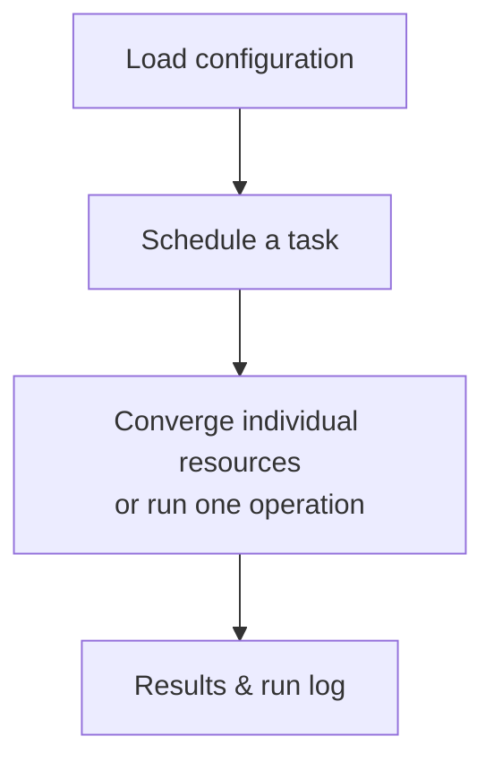

# Architecture

Dotfiles compares your machine's current state against your declarations and
applies only the changes needed to converge them. A dependency graph controls
execution order, while each resource or operation defines how to inspect and
update its slice of state. Running the same command again leaves already-correct
state untouched.

This guide explains where code belongs and why the engine enforces its
boundaries. For everyday commands, see [Commands and usage](../guides/commands-and-usage.md);
for configuration schemas, see [Configuration basics](../guides/configuration-basics.md).
When you're ready to implement a feature, move on to
[Adding a task](adding-a-task.md) and [Writing tests](writing-tests.md).

## Design decisions

- [One update syncs the checkout and applies the machine's configuration](../guides/commands-and-usage.md#update).
- [Home symlinks expose edits immediately, without another update](../reference/home-symlinks.md).
- [These dotfiles are for one person's machines, not every possible setup](../index.md).
- [Changing profiles selects future work without undoing earlier updates](../guides/profiles-and-categories.md#changing-profiles-or-categories).
- [Selecting a single task does not automatically add its dependencies](../guides/commands-and-usage.md#select-tasks).

## System view

Three core boundaries shape the CLI:

| Boundary | Responsibility |
|---|---|
| Task | Decides whether work applies and what must finish before it, such as the Home symlinks task |
| Resource | Inspects and converges one independent item, such as a single home symlink |
| Operation | Plans and executes a single multi-step workflow, such as repository synchronization |

Two smaller primitives support them: a `Requirement` checks a runtime input
without creating it, and an `AccessClaim` keeps concurrent work from colliding
on shared state. Neither replaces graph dependencies.

Take a symlink declaration as an example: it becomes a resource inside the Home
symlinks task. The task waits for its graph predecessors, the resource inspects
its source and target, and the engine decides whether to skip, preview, or
create the link, feeding the outcome into the task summary and run log. An
operation travels through the same selection and scheduling path, but plans one
cohesive workflow rather than a batch of independent items.

## Repository layout

The Rust CLI is organized into four layers:

| Layer | Responsibility |
|---|---|
| [app/](https://github.com/sneivandt/dotfiles/tree/main/cli/src/app) | CLI parsing, config loading, command composition, cross-domain dependencies, and restart/elevation policy |
| [engine/](https://github.com/sneivandt/dotfiles/tree/main/cli/src/engine) | Task graphs, scheduling, convergence lifecycles, cancellation, and result accounting |
| [domains/](https://github.com/sneivandt/dotfiles/tree/main/cli/src/domains) | Concrete desired-state implementations (packages, files, Git, editors, services, and agents) |
| [infra/](https://github.com/sneivandt/dotfiles/tree/main/cli/src/infra) | Filesystem, subprocesses, environment, platform capabilities, and logging |

Desired-state data lives outside Rust: `conf/` holds declarations, `symlinks/`
holds managed home content, and `system/` holds `/etc` fragments. Most
preference edits stay in those directories rather than in Rust.

Sibling domains never import each other directly to coordinate work; cross-domain
edges live in the application catalog. The
[domain-boundary tests](https://github.com/sneivandt/dotfiles/blob/main/cli/tests/domain_boundaries.rs)
enforce this isolation alongside checks on direct environment and platform
access.

## Wrappers

[dotfiles.sh](https://github.com/sneivandt/dotfiles/blob/main/dotfiles.sh) and
[dotfiles.ps1](https://github.com/sneivandt/dotfiles/blob/main/dotfiles.ps1)
locate the checkout and binary, handle `--build`, download and verify a release
when needed, and forward all remaining arguments. The Rust binary owns profile
selection and command semantics.

See [Source builds](contributing.md#source-builds) for wrapper builds and
[Release downloads](../guides/security-and-trust.md#release-downloads) for
checksum and provenance verification.

## Application layer

Before logging starts, engine commands resolve a single
[RuntimePolicy](https://github.com/sneivandt/dotfiles/blob/main/cli/src/app/commands/runtime.rs)
from CLI flags, the injected environment, and terminal capabilities. The
execution context receives the derived `ExecutionPolicy` so prompting, restart
handling, and elevation all follow one consistent decision:

- `CI` activates whenever the variable is present (even if empty or `"false"`),
  disabling prompts and requiring applicable tasks to complete.
- Running non-interactively does **not** by itself turn skips into failures:
  locally, unmet prerequisites show as skipped unless you pass `--fail-on-skip`,
  whereas genuine task failures always fail the command.
- Restart guards check environment-variable presence; the elevated-child marker
  requires a nonempty value.
- Structured JSON Lines output disables interactive prompts, while terminal
  exit pauses on Windows and signal handling remain separate.

[CommandRunner](https://github.com/sneivandt/dotfiles/blob/main/cli/src/app/commands/runner.rs)
holds the locks (main checkout, active Git overlay, and home), the
configuration store, and the execution context. The home lock coordinates even
independent clones targeting the same home directory regardless of
state-directory environment overrides. Static `update` and `remove` tasks come
from [catalog.rs](https://github.com/sneivandt/dotfiles/blob/main/cli/src/app/catalog.rs),
while `check` uses its own
[task list](https://github.com/sneivandt/dotfiles/blob/main/cli/src/app/commands/check.rs).
The [execution coordinator](https://github.com/sneivandt/dotfiles/blob/main/cli/src/app/commands/execution/mod.rs)
manages elevation, restart phases, progress output, and final exit status.

Read-only `list` commands inspect configuration and task metadata without
running tasks, probing runtime requirements, writing logs, taking locks, or
saving selections. Their graph output reflects selection rather than predicted
machine changes.

## Configuration flow

The loader resolves the active profile and overlay, parses every required main
TOML file, filters entries by active categories, and applies overlay overrides.
Each entry retains its source origin so relative paths inside an overlay stay
anchored to that overlay. Script tasks can only come from an overlay.

Structural parsing covers inactive categories too, and active declarations are
checked for conflicts within each repository before merging so an overlay can't
mask an invalid base file. Symlinks additionally expand globs and check for
merged target collisions; some domains also retain unfiltered views for source
validation.

Loading errors abort before tasks are built. Semantic diagnostics come from
`Config::validate`: normal startup prints them as warnings, whereas
`config-diagnostics` fails if any remain. Keep those two stages distinct and
never silently substitute defaults for invalid input.

[ConfigStore](https://github.com/sneivandt/dotfiles/blob/main/cli/src/app/config/store.rs)
provides typed, `Arc`-backed handles to a single immutable snapshot. Cloning a
handle shares ownership and `get()` borrows the slice. All tasks (including
dynamic overlay script tasks) are constructed once from that snapshot and never
reload config mid-run.

### Repository updates are a restart boundary

Syncing the checkout can update the very TOML files and scripts that define
the rest of the run, so continuing with the old snapshot would apply stale
configuration.

To avoid that, the coordinator runs the selected dependency closure ending at
the repository task first. If that phase succeeds and pulls in changes, it
re-executes the **current binary** with the original arguments and a restart
guard so the child reloads configuration and builds a fresh task catalog.

The parent keeps its locks while waiting, and the child acquires continuation
locks so another invocation can't sneak in if the parent exits early. When both
processes support shared lock handoff, the child also preserves the original
lock paths used by older binaries (and a child spawned by an older self-updater
can likewise guard its work against newer invocations). The child filters tasks
before stripping repeated repository sync and skips the initial self-update
preflight. Failures or cancellations abort before restarting, and a no-op sync
keeps the existing snapshot. Filtering out repository work skips the split and
runs a single graph.

This restart boundary is built into the coordinator rather than exposed as a
selectable task. See
[update.rs](https://github.com/sneivandt/dotfiles/blob/main/cli/src/app/commands/update.rs)
and [reexec.rs](https://github.com/sneivandt/dotfiles/blob/main/cli/src/app/commands/reexec.rs).

## Task engine

Each task separates its internal, public, and logging identities:

| Field | Purpose |
|---|---|
| `task_id()` | Dependency identity: a static type, or a type plus a stable dynamic key |
| `selector()` | Stable public `--only` / `--skip` name |
| `name()` | Human-readable display label |
| `log_key()` | Persistent log identity, including any dynamic instance key |
| Visibility | Whether normal discovery, console rows, and totals include the task |
| `update_only()` | Command membership (not an ordering priority) |

Use `task_metadata!` for standard metadata and `config_task!` for tasks that
hold a single configuration handle. Dynamic tasks must have stable instance keys
and are discovered from startup configuration rather than created dynamically
during execution.

### Dependencies and assessment

Execution order comes strictly from dependency edges, never from catalog order:

- **Blocking:** predecessor failure or unmet work blocks the dependent task.
- **Ordering-only:** waits for the predecessor to finish, then runs and
  inspects its own state even if the predecessor failed.

The graph rejects duplicate task IDs and cycles. Same-domain edges live on the
task itself, while cross-domain edges live in `app/catalog.rs`. When an
unavailable task is pruned before scheduling, its transitive blocking
dependents are marked skipped as well so an absent node doesn't silently drop
failure propagation.

Applicability and elevation are evaluated once per phase and must stay
read-only and deterministic for that phase. Inputs that a predecessor might
create belong inside `run()` after dependencies finish. A task with no active
entries returns `NotApplicable` rather than a changed status.

See [Scheduling model](../reference/task-reference.md#scheduling-model) for
task filtering and how the declared graph relates to runtime assessment.

### Parallelism and shared state

The scheduler dispatches each task as soon as its dependencies finish, running
ready tasks on a bounded scoped-thread pool. Resource batches run on a separate
Rayon pool. Passing `--no-parallel` limits task scheduling to one worker and
runs resource batches serially; `.sequential()` serializes a single batch,
though another task could still touch the same underlying file concurrently.

To prevent cross-task collisions on shared state, declare an
[AccessClaim](https://github.com/sneivandt/dotfiles/blob/main/cli/src/engine/access.rs).
Matching namespace/key pairs never overlap inside the run's claim registry:

- A task acquires its full claim set after dependency waits and before running
  its body.
- A resource acquires its claims before discovery and holds them through
  preview, apply, or removal.
- A task that holds claims must declare every claim its nested resources need;
  undeclared nested claims fail fast instead of risking deadlock.
- Resource dispatch waits on the caller thread rather than tying up Rayon
  workers; cancellation interrupts waits, and dropping a guard releases it.

Claims govern mutual exclusion only: they do not define ordering or propagate
failures, they do not detect filesystem aliases automatically, and they cannot
coordinate external apps or separate CLI processes. Agent settings, for
instance, claim each target JSON file rather than individual keys.

## Requirements

A [requirement](https://github.com/sneivandt/dotfiles/blob/main/cli/src/engine/requirement.rs)
is a named, read-only probe returning one of three outcomes:

| Result | Meaning |
|---|---|
| `Satisfied(evidence)` | Input is ready; passes typed evidence to the consumer |
| `Unsatisfied { reason }` | Required input is missing; records unmet work |
| `Unknown { error }` | Probe failed; preserves the original typed error |

Call `process_requirement()` inside `run()`. It checks the `Preview` or `Apply`
contract once and passes the evidence to the continuation, which still obeys
the normal dry-run gate. Never re-query the same input or silently install a
missing prerequisite.

Preview contracts can be lighter than apply contracts: an AUR package preview,
for example, checks pacman's installed database without needing the `paru`
binary that an earlier task only planned to install (while still noting that a
passing preview doesn't guarantee apply will succeed).

Requirements also enable conservative early dispatch. A task declares its
ordering requirements, and the application attaches a provider-stability check
via `TaskWithExtraDeps`. Only when **all** checks pass at the `Ordering` stage
are the selected ordering-only waits waived; empty declarations, missing
inputs, or unknown results keep the waits, and blocking edges are never waived.
If none of the conditional providers were selected in the run, there is no wait
to waive and neither probe executes (providers with recorded outcomes from an
earlier restart phase still count as selected).

Only the waived-edge decision carries into dispatch; execution still re-checks
its requirements once dependencies complete, and requirements never alter task
selection or discover new tasks.

VS Code extensions, agent packages, and systemd units use early dispatch for
package waits. On pacman systems, provider stability requires all configured
packages to be installed and Paru to be healthy (other package managers and
failed or unknown probes keep the waits). Systemd also requires already-converged
units and keeps its waits on symlinks (plus the launcher when enabling the
first-login service), while agent packages retains its blocking symlink edge.
The declared graph and `--with-deps` expansion stay unchanged.

## Resources

A [Resource](https://github.com/sneivandt/dotfiles/blob/main/cli/src/engine/resource/contract.rs)
manages one independent item (a symlink, package, registry value, etc.) through
a **discover -> plan -> preview or apply** lifecycle. Discovery can be
per-item or use a batch lookup when one query inspects many items at once.

`Correct` items require no action. `Missing` and `Incorrect` items follow the
selected processing mode:

| Mode | Behavior |
|---|---|
| `Strict` | Create missing items and repair incorrect ones; stop on the first apply error |
| `Lenient` | Create and repair; record apply errors and continue with remaining items |
| `InstallMissing` | Create missing items and leave existing items alone; record apply errors and continue |
| `FixExisting` | Repair existing items and leave missing items absent; stop on the first apply error |

Unknown state is **never** treated as missing state: failed discovery must
never trigger speculative creation, and discovery or pre-apply warning errors
stay fatal even in `Lenient` mode (continuation applies only to apply errors).

`ResourceChange` distinguishes applied, already-correct, and skipped outcomes
so an unusable result can't masquerade as a clean no-op. Removal is a separate
`RemovableResource` trait whose default plan acts only on matching managed
state; unknown ownership blocks removal and reports a failure rather than
touching user data.

Interrupted or stopped batches return a typed
[BatchReport](https://github.com/sneivandt/dotfiles/blob/main/cli/src/engine/batch.rs)
tracking completed counts, interrupted items, and unattempted items. Parallel
batches join already-started work before returning. A failed shared inventory
query marks every prepared item unattempted and bubbles up as a task-level
error rather than synthetic per-item failures, and later cancellation never
masks an earlier genuine failure.

## Operations

An [Operation](https://github.com/sneivandt/dotfiles/blob/main/cli/src/engine/operation.rs)
models a single idempotent workflow such as repository synchronization or an
overlay script. `current_state()` reports complete, not applicable, blocked, or
needs-run along with an immutable plan.

`process_operation()` feeds that **exact plan** into `preview()` or `apply()`.
Planning stays strictly read-only, and preview must neither recompute nor
partially execute the plan. Always reuse this lifecycle instead of hand-rolling
parallel check/dry-run/apply branches.

Keep in mind that an operation is neither a transaction nor a sandbox: the
engine cannot roll back a partially executed external command, and script
checks and previews stay read-only only when the script honors its protocol.

## Platform abstraction

Use context capabilities plus injected environment, executor, and filesystem
adapters for runtime platform logic, reserving compile-time `cfg` gates for
OS-specific APIs. Keep paths in native OS encoding so a non-UTF-8 home path is
never misread as a missing environment variable.

The [elevation broker](https://github.com/sneivandt/dotfiles/blob/main/cli/src/app/commands/execution/elevation.rs)
keeps the main run unelevated: Linux primes `sudo` for privileged commands,
while Windows delegates only machine-scoped Developer Mode work to a
short-lived elevated child so home links and HKCU registry values remain under
the original user account. Unavailable elevation leaves unmet work and blocks
blocking dependents without halting independent tasks; see
[Elevation](../guides/security-and-trust.md#elevation).

## Error handling and observability

Prefer checked [CommandSpec](https://github.com/sneivandt/dotfiles/blob/main/cli/src/infra/exec/mod.rs)
calls unless a nonzero exit code carries explicit domain meaning that you
handle directly. Preserve typed spawn, I/O, nonzero-exit, capture-limit,
timeout, and cancellation errors across helper and task boundaries.

Subprocess output capture is bounded: each stream keeps up to an 8 MiB prefix
plus a truncation marker while continuing to drain so child pipes never
deadlock. Exceeding the limit fails even unchecked commands so truncated output
can't look like a complete inventory. Timeouts and cancellations also bound
pipe draining, using Unix process groups or Windows job objects to clean up
descendant processes.

Atomic file writes stage content with owner-only Unix permissions. Replacing a
regular file preserves its mode, while new files and symlink replacements stay
owner-only unless the caller applies a different mode explicitly.

The scheduler's `ExecutionSummary` (**not** logger counters) determines command
success. Genuine failures exit `1` and take precedence over interruption;
interruption alone exits `130`, and neither rolls back completed changes.

Logging records task identity, actions, commands, results, and timings. Normal
output surfaces changes and attention-worthy rows; `--verbose` adds unchanged
tasks and decision details. Internal and inapplicable tasks stay hidden from
normal rows and totals, and completed rows appear in completion order.

Run logs are schema-versioned with one physical line per event, and restarted
or elevated children write separate run IDs linked back to their parent. Keep
the log reader backward-compatible with legacy text logs; see
[Logs](../reference/cli-reference.md#logs) for viewing and retention details.

Argument redaction and output capture are opt-in and independent:
`CommandSpec::redact_arguments()` hides command arguments, while by default
failed streams and successful stderr are kept and successful stdout logs only
its byte count. `OutputLog::Omit` suppresses streams from both logs and checked
errors. Neither scrubs values logged separately by callers; see
[Secrets](../guides/security-and-trust.md#secrets).

## Extending the system

Pick the smallest abstraction that fits your change:

| Need | Owning layer |
|---|---|
| Different packages, settings, or application content | `conf/`, `symlinks/`, or `system/` |
| Another independently managed item | A `Resource` and thin task adapter |
| One multi-step convergence workflow | An `Operation` |
| A checked input with reusable evidence | A `Requirement` |
| Eligibility, dependencies, visibility, or elevation | Task metadata and application wiring |
| Reusable OS or tool mechanics | An infrastructure adapter |
| Parsing or transformation only | A plain function or module |

Avoid creating a task solely to split up a function. Next, walk through a
concrete implementation in [Adding a task](adding-a-task.md), review the
[Change checklists](contributing.md#change-checklists), and pick verification
steps from [Testing](testing.md).
