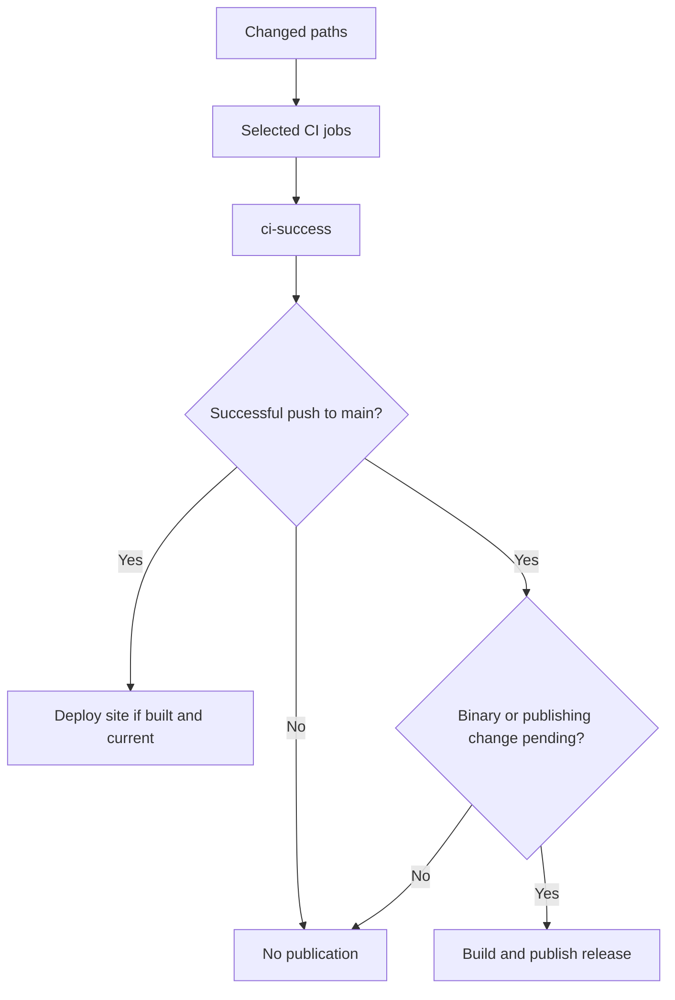

# CI and releases

When CI passes on a push to `main`, documentation publishing and CLI binary
releases are decided independently. GitHub Pages deploys only if that run built
the site and its commit is still the tip of `main`, so a docs-only push updates
the website without cutting a new binary release.

For local validation commands, see [Testing](testing.md). When modifying
automation, treat the workflow files and
[path classifier](https://github.com/sneivandt/dotfiles/blob/main/.github/workflows/scripts/linux/classify-ci-changes.py)
as the source of truth.

## Reading a run

[ci.yml](https://github.com/sneivandt/dotfiles/blob/main/.github/workflows/ci.yml)
triggers on pushes to `main`, pull requests targeting `main`, and manual
dispatch, with no workflow-level path filters that could leave required checks
stuck pending.

Only successful, same-repository **push** runs on `main` can publish a site
update or binary release; pull request runs never publish.

Every run executes always-on checks (Markdown links, skill metadata,
actionlint, workflow contracts, and classifier tests), while site builds,
browser suites, Rust builds, and integration jobs run only when their inputs
change. The `ci-success` gate always runs at the end and verifies that every
selected gating job succeeded and every unselected job was skipped, failing on
missing outputs, cancellations, unexpected skips, or classifier errors.

Always inspect the run for the **exact pushed SHA** before treating a push as
complete (coverage uploads are informational, and mutation testing runs in a
separate workflow). Include both the commit SHA and run URL when sharing a
result so it can't be confused with a later push.

## Change-aware scheduling

The classifier chooses jobs by changed input, platform, linter, and
application. A push diffs against the previous tip only when that tip's push CI
succeeded; if the prior run failed, was cancelled, or can't be verified, CI
falls back to full coverage so earlier changes don't slip through untested.

| Changed input | Typical additional coverage |
|---|---|
| `docs/`, Pages workflow, or site tooling | Site build, npm audit, and browser regressions; published guides also select Rust documentation contracts |
| Skills, Markdown outside the site, known editor/repository metadata | Always-on checks only |
| Rust source, embedded assets, Cargo/build/toolchain configuration | Both platform builds, Rust checks, documentation contracts, profiles, round-trips, wrappers, and applications |
| Standalone Rust integration tests/fixtures | Both platform builds and Rust checks, not unrelated application/wrapper jobs |
| Cargo manifests/lockfiles | Dependency audit and deny in addition to Rust checks |
| `cli/deny.toml` or formatting policy | Dependency-policy or formatting check respectively |
| `conf/` | Validation, drift, and profile/round-trip checks; `conf/system-files.toml` and `conf/chmod.toml` also select Rust checks, `conf/systemd-units.toml` selects lock-script checks, and package/Git/symlink manifests select applications |
| `system/` | Linux Rust checks, configuration validation/drift, and profile/round-trip checks |
| `packages/` recipes | Linux build/Rust checks, config validation/drift, and ShellCheck |
| Managed application files | Configuration checks and the affected application/script fixtures; Rust-tested files (`symlinks/config/git/templates/`, `symlinks/local/bin/code-insiders`, and `symlinks/config/systemd/user/dotfiles-first-login.service`) also select Rust checks |
| Quickshell | Python fixtures on both platforms and Linux offscreen QML |
| Wrappers | The affected platform's build and wrapper integration |
| Hooks | Hook and staged-input fixtures; hook-only edits do not request CLI builds |
| Shell/PowerShell files | The matching linter in addition to other selected work |
| CI workflow/shared orchestration, manual dispatch, or unknown inputs | Conservative full CI |
| Release workflow/selection | Publication eligibility without unrelated CI compilation |

Deletions and both sides of renames count. Invalid Git ranges fail loudly, a
valid empty diff runs always-on checks, and unavailable ranges fall back to
full CI (though full CI alone doesn't trigger a release).

Cargo jobs run with `--locked --profile ci`, and downstream integration jobs
reuse the uploaded binaries from that run rather than downloading an older
release. Config-only Linux runs execute `config_drift` instead of the entire
Rust test suite unless full Rust coverage was also selected.

## Platform coverage

Each row runs only when the classifier selects that job:

| Check | Linux | Windows |
|---|---|---|
| Rust build, Clippy, tests | Native | Native |
| Profile previews and config checks | Both roles | Both roles |
| Public APM packages | Pack checks, local skill redeployment, frozen install, and audit in a disposable home | No native APM run |
| Update/remove round-trip | Yes | Yes |
| Wrappers | POSIX | PowerShell |
| Application integration | Git, Zsh, Vim, Neovim | Git |
| Managed script fixtures | Yes | Yes |
| Quickshell | Offscreen QML tests and startup under headless Sway | No |
| Arch package, system-file, and offline systemd acceptance | Disposable Arch container | No |
| Full commit-hook suite | Yes | No |
| Coverage reports | Yes | Yes |

Keep the limits in mind: the Arch container tests package installs, a
system-file merge, denied elevation, offline user-unit drop-ins, redirected
directory rejection, and repeat runs, while Quickshell startup runs under
headless Sway rather than native Hyprland. There is no Git-for-Windows full
hook suite, profile previews skip VS Code, profile `check` omits external APM
and script analyzers, and Windows app integration skips APM, packages, and VS
Code. Coverage uploads are informational only.

## Scheduled mutation testing

[mutation.yml](https://github.com/sneivandt/dotfiles/blob/main/.github/workflows/mutation.yml)
runs nightly at 08:37 UTC and on manual dispatch, independently of `ci-success`,
releases, and Pages deployment.

It diffs against the last successful scheduled mutation run on `main` (so
failed or cancelled runs keep pending changes in scope; without a verified
baseline it scans all source, and API or history errors fail loudly).

On Linux, changed Rust files are mutated in full (including production code
beside inline tests), and module-local tests or tracked inputs read by Rust
tests (`conf/*.toml`, Arch recipe descriptors, `system/` fragments, managed
systemd units, Git templates, and contract-tested docs) recheck their owning
modules. Changes to `cli/tests/`, shared test helpers, embedded assets,
Cargo/build/toolchain files, or mutation scripts recheck all source. Unless
changes are strictly Linux-only, the fixed two-shard Windows suite also runs
for registry, PATH encoding, elevation, file placement, and locks; unrelated
docs and config changes skip both suites.

To replay a range manually, dispatch **Mutation Testing** and optionally pass
an ancestor SHA as `mutation_base` (manual runs never advance the nightly
baseline). Reports stay available as artifacts for seven days. Linux splits
mutants across library (`linux-lib`, `--lib`) and CLI/integration (`linux-app`)
shards plus a consolidated `focused` shard, running with `[profile.mutants]`
and `cargo-nextest` fail-fast execution. The job summary lists tested ranges,
counts, missing reports, and copy-paste replay commands; survivors, timeouts,
tool errors, and incomplete coverage fail the workflow.

Enable GitHub Actions failure notifications for this workflow and confirm the
schedule stays enabled, since passing push CI doesn't cover nightly mutations.
For local runs before pushing, see
[Focused mutation testing](testing.md#focused-mutation-testing).

## Scheduled dependency checks

[dependency-security.yml](https://github.com/sneivandt/dotfiles/blob/main/.github/workflows/dependency-security.yml)
runs `cargo audit`, `cargo deny check all`, and a docs `npm audit` weekly and
on manual dispatch (with `cargo deny` still running if `cargo audit` finds an
advisory). The docs CI job also runs `npm audit` before building the site;
advisories at any severity fail the run.

This workflow doesn't gate `ci-success` or trigger releases. Enable Actions
failure notifications and Dependabot alerts separately, and watch that GitHub
hasn't disabled the schedule on an inactive repo.

## Documentation publishing

Selected docs jobs gate `ci-success`, including on docs-only commits. After a
passing push CI run on `main`, **Publish documentation** deploys that exact
run's artifact whenever a site build ran and its commit is still current.
Code-only pushes skip site builds and deploys once the latest docs are live,
while failed or superseded deploys remain eligible on later pushes. See
[Configure publishing](https://github.com/sneivandt/dotfiles/blob/main/docs/README.md#configure-publishing)
for site setup and troubleshooting.

## Release selection

[release.yml](https://github.com/sneivandt/dotfiles/blob/main/.github/workflows/release.yml)
triggers after passing same-repository push CI on `main`. Its read-only
selection job compares that exact tested SHA against the latest published,
non-draft, non-prerelease GitHub release.

A release is cut whenever binary or publishing-pipeline inputs changed (or no
release exists yet). Docs, ordinary config, wrappers, standalone tests, and
lint configs do not trigger a release on their own, whereas any edit under
`cli/src/` (including inline tests and embedded assets) or an unknown path
conservatively selects publication.

**Because the baseline is the last published release rather than the previous
push**, a docs-only push can still finish an earlier binary release whose
publish step failed. Older or already-released commits skip; API errors,
missing tags, or diverged release history fail loudly.

When selected, the workflow:

1. Resolves the version and commit SHA once for every build job.
2. Builds Linux x86-64/AArch64 and Windows x86-64 binaries without dependency
   caches.
3. Generates SHA-256 checksums and build provenance attestations with scoped
   publishing permissions.
4. Verifies every attestation is retrievable before publishing the release.

Release runs serialize without cancelling an active publisher. Tags follow
`vYYYY.MM.DD-N` (UTC date plus daily sequence number), independent of the crate
version in `Cargo.toml`.

Always verify the published tag, commit, and assets before reporting a release
as live. For client-side verification, see
[Release downloads](../guides/security-and-trust.md#release-downloads).

## Changing automation

Keep job conditions, classifier outputs, and `ci-success` dependencies in sync,
and mark every new job clearly as gating or informational. Keep workflow
permissions narrow, pin external Actions to full commit SHAs, and reuse shared
helpers in
[workflow scripts](https://github.com/sneivandt/dotfiles/tree/main/.github/workflows/scripts/).

Validate changes with the local `ci` stage, the affected job's command, and
[CI selection fixtures](testing.md#ci-selection-fixtures) (covering affected
and unaffected paths, renames, deletions, and unexpected skips).
