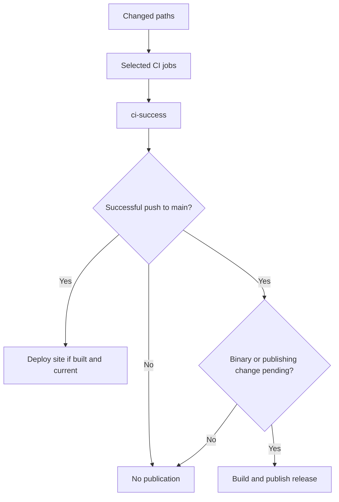

# CI and releases

After CI passes for a push to `main`, the site and CLI have separate
publication decisions. Pages deploys only if that run built the site and
its commit is still current. A docs-only change can update the website
without triggering a binary release of its own.

For local commands, use [Testing](testing.md). Workflow files and the
[path classifier](https://github.com/sneivandt/dotfiles/blob/main/.github/workflows/scripts/linux/classify-ci-changes.py)
are authoritative when changing automation.

## Reading a run

[ci.yml](https://github.com/sneivandt/dotfiles/blob/main/.github/workflows/ci.yml) runs for pushes and pull requests to
`main`, and manual dispatch. It does not use workflow-level path filters that
could leave required checks pending.

The last step applies only to successful, same-repository **push** CI on `main`.
Pull request CI cannot publish a release.

Always-on work includes repository links, skill metadata, actionlint, workflow
contracts, and classification regressions. Site builds, browser regressions,
and Rust documentation contracts are selected by their inputs. The `ci-success`
job runs even after an earlier failure and verifies that every selected gating
job succeeded and every unselected job was skipped. Missing outputs, cancellation, unexpected
skips, and classification failure fail the gate.

After a push, inspect the run for the **exact pushed SHA**. Mutation testing
runs separately and does not participate in the aggregate gate. Coverage
reports remain informational.

Wait for the pushed commit's run and inspect failures before relying on its
result. When sharing a result, include the commit and run link so another
contributor can distinguish that patch from a later successful push.

## Change-aware scheduling

Checks are selected by input, platform, linter, and application. The table is a
guide, not a replacement for the classifier's exact rules. A push uses the
previous tip as its comparison base only when that tip's push CI succeeded.
If the preceding run failed, was cancelled, or cannot be verified, the new push
runs full CI so earlier changes still receive coverage.

| Changed input | Typical additional coverage |
|---|---|
| `docs/`, Pages workflow, or site tooling | Site build, npm audit, and browser regressions; published guides also select Rust documentation contracts |
| Skills, Markdown outside the site, known editor/repository metadata | Always-on checks only |
| Rust source, embedded assets, Cargo/build/toolchain configuration | Both platform builds, Rust checks, documentation contracts, profiles, round-trips, wrappers, and applications |
| Standalone Rust integration tests/fixtures | Both platform builds and Rust checks, not unrelated application/wrapper jobs |
| Cargo manifests/lockfiles | Dependency audit and deny in addition to Rust checks |
| `cli/deny.toml` or formatting policy | Dependency-policy or formatting check respectively |
| `conf/` | Validation, drift, and profile/round-trip checks; some files also select applications |
| `system/` | Linux configuration and profile/round-trip checks |
| `packages/` recipes | Linux build/Rust checks, config validation/drift, and ShellCheck |
| Managed application files | Configuration checks and the affected application/script fixtures |
| Quickshell | Python fixtures on both platforms and Linux offscreen QML |
| Wrappers | The affected platform's build and wrapper integration |
| Hooks | Hook and staged-input fixtures; hook-only edits do not request CLI builds |
| Shell/PowerShell files | The matching linter in addition to other selected work |
| CI workflow/shared orchestration, manual dispatch, or unknown inputs | Conservative full CI |
| Release workflow/selection | Publication eligibility without unrelated CI compilation |

Deletions and both sides of renames count. Invalid Git ranges fail; a valid
empty diff runs the always-on checks. Unavailable comparison ranges use
conservative full CI instead. Full CI alone does not request publication.
Mutation testing is not part of push, pull request, or manual CI runs.

Cargo verification uses the CI build profile and `--locked`. Downstream integration
jobs reuse uploaded binaries rather than downloading an unrelated release.
Configuration-only Linux checks use `config_drift` instead of the full Rust suite
when full Rust coverage was not selected.

## Platform coverage

Coverage below is conditional on the relevant job being selected.

| Check | Linux | Windows |
|---|---|---|
| Rust build, Clippy, tests | Native | Native |
| Profile previews and config checks | Both roles | Both roles |
| Public APM packages | Pack checks, local skill redeployment, frozen install and audit in a disposable home | No native APM run |
| Update/remove round-trip | Yes | Yes |
| Wrappers | POSIX | PowerShell |
| Application integration | Git, Zsh, Vim, Neovim | Git |
| Managed script fixtures | Yes | Yes |
| Quickshell | Offscreen QML tests and startup under headless Sway | No |
| Arch package, system-file and offline systemd acceptance | Disposable Arch container | No |
| Full commit-hook suite | Yes | No |
| Coverage reports | Yes | Yes |

These jobs do not cover every architecture, existing user configuration, or
network/authentication setup. The Arch acceptance fixture covers package
installation, a system-file merge, denied elevation, offline user-unit drop-ins,
redirected-directory rejection, and repeat runs. The
Quickshell startup check uses Sway. Hyprland session behavior, focus, networking,
and locking need separate runtime checks. There is no native Git-for-Windows
full hook suite. Coverage reports are informational; a
coverage percentage does not establish correctness.

Profile previews skip VS Code, and profile `check` runs omit external APM and
script analyzers. Windows application integration skips APM, packages, and VS
Code. Separate jobs or local checks cover some of those concerns; do not call
the profile matrix a full clean-machine installation test.

## Scheduled mutation testing

[mutation.yml](https://github.com/sneivandt/dotfiles/blob/main/.github/workflows/mutation.yml)
runs nightly at 08:37 UTC and on manual dispatch. It does not block `ci-success`,
releases, or documentation publishing. Ordinary Windows builds, Clippy, tests,
and integration checks remain in normal CI.

The workflow compares its selected commit with the last successful scheduled
mutation run on `main`, not the preceding push. Failed or cancelled runs leave
pending changes in scope. For migration, it can inherit a successful legacy CI
run only if every Linux and Windows mutation shard passed; without a verified
baseline it selects all source. API or invalid-history errors fail selection
rather than silently skipping coverage.

Linux mutates whole changed Rust source files, including production functions
beside edited inline tests. Tests and fixtures with an explicit owner recheck
that module. Unmapped standalone tests, shared test helpers, embedded assets,
Cargo/build/toolchain inputs, and changes to the mutation workflow or selector
recheck all source. The same applies to other tracked inputs to Rust tests,
including configuration, package recipes, and executable documentation examples.
Selected changes also run the existing fixed Windows suite for
registry values, PATH encoding, elevation dispatch, file placement, and locks;
there is no fine-grained Windows dependency classifier. Unrelated docs and
configuration changes skip both suites. Exact filters live in the workflow.

For manual replay, dispatch **Mutation Testing** and optionally supply the
original full ancestor SHA as `mutation_base`. Manual runs never advance the
nightly baseline, so a narrow replay cannot discard pending coverage. Reports
and selected Linux inputs are retained as artifacts for seven days. Linux
shards are sized from the selected mutant count. The results summary gives
the tested range, counts per platform, missing reports, and focused replay
commands for survivors and timeouts. The mutation-summary artifact contains
the complete report. Survivors, timeouts, tool errors, and incomplete coverage
fail this separate workflow.

If a runner shuts down during a shard before publishing results, recovery can
retry one shard on the original commit and recompute the summary. It runs
once per failed run on `main`, and does not retry reported survivors, mutant
timeouts, or a run you cancelled. Other missing reports still fail the run.

Enable Actions failure notifications for this workflow and investigate red
runs; successful push CI does not mean nightly mutations passed. Check that the
schedule remains enabled in repository settings. For focused checks before
pushing or a survivor fix, use [local mutation testing](testing.md#focused-mutation-testing).

## Scheduled dependency checks

[dependency-security.yml](https://github.com/sneivandt/dotfiles/blob/main/.github/workflows/dependency-security.yml)
runs `cargo audit`, `cargo deny check all`, and a separate npm audit of the docs
lockfile weekly and on manual dispatch, independently of changed paths. The
Rust policy check still runs after an advisory failure unless the workflow is
cancelled. The docs CI job also runs `npm audit` before building the site;
advisories at any severity fail these audits.

This separate workflow neither satisfies `ci-success` nor triggers a release.
Enable Actions failure notifications and configure Dependabot alerts/security
updates in repository settings separately. Check that the schedule remains
enabled; GitHub can disable schedules in inactive repositories.

## Documentation publishing

Selected documentation jobs participate in `ci-success`, including on docs-only
changes. After successful push CI on `main`, the Pages workflow deploys that
run's verified artifact when a site build was selected. A code-only push can
skip the site build and deployment once the site inputs have been published;
failed or superseded publications remain eligible on subsequent pushes.
Site-specific checks, publication rules, and troubleshooting live in
[docs/README.md](https://github.com/sneivandt/dotfiles/blob/main/docs/README.md#configure-publishing).

## Release selection

[release.yml](https://github.com/sneivandt/dotfiles/blob/main/.github/workflows/release.yml) starts after successful
same-repository push CI on `main`. A read-only selection job compares that exact
tested SHA with the latest published, non-draft, non-prerelease release.

Publication is selected for binary or publishing-pipeline changes, or when no
release exists. Docs, ordinary configuration, wrappers, standalone test fixtures,
and lint-policy files do not by themselves require a new binary. Changes inside
`cli/src/`, including inline tests and embedded assets, are conservatively
treated as binary inputs. Unknown inputs also select publication.

**The baseline is the last published release, not the previous push.** If a
binary change passed CI but publication failed, a later docs-only push can
finish that pending release. If there is nothing unpublished, it skips instead.
Older/already-released commits skip; API errors, missing release tags, and
divergent release history fail explicitly.

Once selected, the workflow:

1. Resolves the version and source commit once for all builds.
2. Builds Linux x86_64/aarch64 and Windows x86_64 assets without dependency caches.
3. Generates checksums and build attestations with publishing permissions scoped
   to the publishing job.
4. Verifies attestations are retrievable, then publishes.

Release runs are serialized without cancelling an active publisher. Tags use
`vYYYY.MM.DD-N`, where `N` counts releases on that UTC day; the package version
in `Cargo.toml` is not the release version.

When reporting a release, verify the published tag, commit, and expected assets.
A successful CI gate or a running release workflow is not publication. See
[download verification](../guides/security-and-trust.md#release-downloads) for the client side.

## Changing automation

Keep job conditions, classifier outputs, and aggregate dependencies aligned.
Make a new job's gating or informational status explicit. Use least-privilege
permissions, pin Actions to full commit SHAs, and reuse shared helpers under
[workflow scripts](https://github.com/sneivandt/dotfiles/tree/main/.github/workflows/scripts/).

Run the local `ci` stage and the affected job's focused command. The
[selection fixtures](testing.md#ci-selection-fixtures) use temporary Git
repositories and mocked release APIs; they do not publish. Preserve tests for
both affected and unaffected paths, deletions/renames, and unintended skips.
