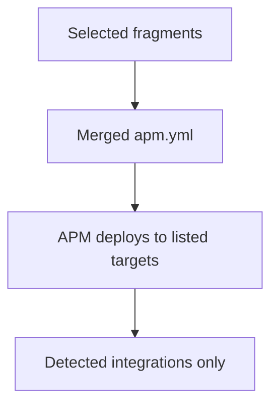

# Agent configuration

To change how GitHub Copilot or OpenAI Codex behaves, start with the source
that owns the change. Setting a model does not require redeploying skills,
and guidance for one checkout does not require changing your home directory.

## Choose what to change

- **Model, permissions, memory, or UI:** Edit
  [conf/agent-settings.toml](https://github.com/sneivandt/dotfiles/blob/main/conf/agent-settings.toml)
  and [preview the preference change](#agent-preferences).
- **A skill to use across projects:** [Add it to a local plugin](#add-a-skill-to-a-local-plugin)
  under [symlinks/apm/plugins/](https://github.com/sneivandt/dotfiles/tree/main/symlinks/apm/plugins/).
- **External package or MCP server:** [Declare the dependency](#add-a-package-or-configuration-fragment)
  in a [configuration fragment](https://github.com/sneivandt/dotfiles/tree/main/symlinks/apm/config/).
  For private or employer-specific content, use the same layout in a
  [private overlay](private-overlays.md). Keep credentials out of both checkouts.
- **Instructions for one repository:** Edit its `AGENTS.md` or `.agents/skills/`.
  The agent reads them there; skip the deployment steps.

## How the setup fits together

Your [profile and categories](profiles-and-categories.md) select preference
keys for `agent-settings` and YAML fragments for `agent-packages`. The latter
task merges the fragments into `~/.apm/apm.yml` and invokes
[Microsoft APM](https://github.com/microsoft/apm) (Agent Package Manager).
Edit the selected sources, not that generated manifest, the lockfile, or the
copies deployed to a harness (the application that runs the agent).

A plugin can bundle skills (instructions with optional supporting files),
hooks, or other reusable content. MCP servers provide tools the agent can call.



## What is in this setup

The [base fragment](https://github.com/sneivandt/dotfiles/blob/main/symlinks/apm/config/base.yml)
selects two local plugins: [dot-skill](https://github.com/sneivandt/dotfiles/tree/main/symlinks/apm/plugins/dot-skill/)
for deciding where customization belongs, and [dot-workflow](https://github.com/sneivandt/dotfiles/tree/main/symlinks/apm/plugins/dot-workflow/)
for the `ship` and `audit` skills. These are skills you invoke, not scheduled
Copilot App workflows. The [Arch fragment](https://github.com/sneivandt/dotfiles/blob/main/symlinks/apm/config/arch.yml)
adds an external Arch Linux triage skill on Arch hosts.

## Deployment targets

Keep the base fragment's explicit targets. Without them, APM auto-detects any
harness directory present in your home directory and can deploy into tools you
did not intend to manage. The primary dotfiles deployment uses the targets in
the generated manifest:

| Manifest target | Destination |
|---|---|
| `agent-skills` | Shared skills in `~/.agents/skills`, read by Copilot CLI, the Copilot App, and other harnesses using the shared skills directory |
| `copilot` | MCP configuration in `~/.copilot/mcp-config.json` |

Beyond the primary manifest-driven deployment, dotfiles adds two integrations
when their host applications are detected:

- **GitHub Copilot App** (the desktop app): if `~/.copilot/data.db` exists, APM
  installs workflow packages and dotfiles enables them in autopilot.
- **Microsoft 365 Copilot Cowork** (experimental skills target): if a Cowork
  skills path is configured or detected, dotfiles copies selected shared skills
  into it without replacing Cowork's protected skill directories.

These are not ordinary entries in the base target list. Removing a manifest
target does not disable them. See [Detected integrations](#detected-integrations)
for their selection and cleanup rules.

## Agent preferences

The `agent-settings` task edits only declared keys in these documents, leaving
unmanaged keys and TOML comments intact:

| Application | User settings |
|---|---|
| `copilot` | `~/.copilot/settings.json` |
| `codex` | `$CODEX_HOME/config.toml`, defaulting to `~/.codex/config.toml` |

Use the same `CODEX_HOME` when running dotfiles and Codex; a nonempty override
must be an absolute path and does not move the old default file. Removing a
declaration stops managing the key without deleting the stored value.

For example, `[base]` sets model and reasoning effort for both harnesses,
`[desktop]` connects Copilot CLI to the editor, and `autoUpdate` is off for
Copilot on Linux and on for Windows. Edit the applicable section in
`conf/agent-settings.toml`. With dotfiles installed and a profile selected,
preview just the preference changes:

```sh
dotfiles update --only agent-settings --dry-run
```

Review the changed documents, then remove `--dry-run` to apply. See
[Agent settings](../reference/agent-settings.md) for the schema, conflict and
malformed-file safeguards, and overlay override rules.

## Add a skill or package

First choose the audience: repository-only guidance belongs in `.agents/skills/`,
reusable public content in a local plugin, and private content in an overlay.

### Add a skill to a local plugin

Use `example-tools` as a fictional plugin name in this walkthrough. Replace it
with a name that describes your reusable content; a plugin can contain one
skill or several related kinds of content.

Create the skill in the plugin's directory:
`symlinks/apm/plugins/example-tools/.apm/skills/change-summary/SKILL.md`:

```markdown title="symlinks/apm/plugins/example-tools/.apm/skills/change-summary/SKILL.md"
---
name: change-summary
description: Use when asked to summarize a code change for a reviewer.
---

Explain the user-visible change first, then the reason for it.
Separate remaining limitations from completed work.
```

For a new plugin, also create `symlinks/apm/plugins/example-tools/apm.yml`.
Use an [existing local package manifest](https://github.com/sneivandt/dotfiles/blob/main/symlinks/apm/plugins/dot-skill/apm.yml)
as a template, changing its name and description for your content. Keep
`includes: auto` to discover skills and other content beneath `.apm/`.
Then add the plugin dependency as described below. Adding a skill to an
already-selected plugin needs no new dependency or symlink declaration.

Validate the package and preview deployment before applying it, as described
[below](#validate-preview-and-apply). Packing checks the package's structure;
it does not prove the instructions are useful or compatible with every target.

### Add a package or configuration fragment

This illustrative fragment selects the example plugin and the two base
deployment targets:

```yaml title="Example APM configuration fragment"
targets:
  - agent-skills
  - copilot

dependencies:
  apm:
    - ~/.apm/plugins/example-tools
```

For the walkthrough, add the dependency under `dependencies.apm` in the existing
[base.yml](https://github.com/sneivandt/dotfiles/blob/main/symlinks/apm/config/base.yml);
preserve its other dependencies and explicit targets. This snippet shows the
shape of the configuration, not a replacement for that file.

The current base symlink declaration, `apm/plugins/*` in
[conf/symlinks.toml](https://github.com/sneivandt/dotfiles/blob/main/conf/symlinks.toml),
already covers a new plugin directory here. Its installed link makes the
source available at `~/.apm/plugins/example-tools`. Apply new links before a
scoped deployment, following [Validate, preview, and apply](#validate-preview-and-apply).
A link makes a local plugin available; the manifest dependency selects it for
APM installation.

To add another package:

1. Add its dependency to the narrowest applicable fragment. Choose the
   dependency's version or revision rule deliberately; normal updates can
   fetch newer revisions when that rule allows them.
2. For a new local plugin, provide its `apm.yml` and content below `.apm/`.
   Use forward slashes in local dependency paths on both platforms.
3. If adding a fragment, declare its link in `conf/symlinks.toml`. Keep its
   category selection compatible with the local plugins it requires.
4. Confirm the package fits your [Deployment targets](#deployment-targets),
   then follow [Validate, preview, and apply](#validate-preview-and-apply).

Keep self-defined MCP servers as direct dependencies unless you intentionally
trust another package to declare them for you. Dependency-level `targets`
restrict a whole package. Split packages if their content needs different
destinations.

## Validate, preview, and apply

On a machine with dotfiles, a selected profile, and APM on PATH:

```sh
dotfiles check --only config-diagnostics,symlink-sources,apm-plugins
dotfiles update --only agent-packages --dry-run
```

The checks verify source and link configuration and run
`apm pack --dry-run --verbose` in local plugin directories. If APM is missing,
the APM check is skipped. Private plugins need validation in their own
source context too.

A scoped agent run does not install prerequisites. If you added plugin links,
apply the symlink task first; for a first setup, use the normal
[update walkthrough](getting-started.md). A normal update coordinates agent
deployment with symlink and package installation. APM can come from any
installation method as long as `apm` is on PATH.

### What a preview can show

A dry run requires APM on PATH. What it can show depends on whether the
generated manifest matches your source fragments:

- **Manifest matches:** dotfiles runs `apm update -g --dry-run` and summarizes
  APM's plan.
- **Manifest is missing or would change:** dotfiles describes the write and
  update/install commands. It cannot list individual removals from the new
  manifest without writing it first.

Neither path deploys content, writes the generated manifest, or changes the
Copilot App or Cowork integrations. APM's preview may contact upstream services.

### Apply the reviewed changes

::: warning Packages can do more than provide text
Review package sources and destinations before applying. Packages can contain
executable hooks, MCP servers, and scheduled workflows. When the Copilot App
is detected, dotfiles enables its managed workflows in **autopilot** mode.
:::

When you intend to deploy to your home, apply the reviewed changes:

```sh
dotfiles update --only agent-packages
```

Dotfiles writes the merged manifest if needed, updates dependencies within
their version rules, then installs the result even if no revision advanced.
This deploys local skill edits too. It then applies the detected integrations.
For the example above, check for `~/.agents/skills/change-summary/SKILL.md`,
not just the source link under `~/.apm/plugins/`.
Upgrading the [APM executable](package-management.md#custom-arch-packages)
is separate from deploying content.

## Configuration fragments

The symlink configuration selects source fragments that appear under
`~/.apm/config/`. Names ending in `.yml` or `.yaml` are supported. A filename
such as `arch.yml` does not select a platform: its symlink category does.

Dotfiles reads the selected source fragments directly, so previews use your
edits even if a fragment's home link is missing or broken. Other YAML files
already in `~/.apm/config/` also contribute unless a selected source maps to
the same entry. Links still pointing to a declared but inactive source are
ignored and left in place.

If `~/.apm/apm.yml` is your own manifest rather than one generated by
dotfiles, dotfiles will not replace it.
Back it up outside `~/.apm/config/`, move the settings you want to keep into
a fragment, and move the original manifest aside before retrying.

Fragments merge in filename order. A private fragment has no special priority:
`private.yml` sorts after `base.yml`, but `90-private.yml` sorts before it.
This differs from the
[TOML overlay merge](private-overlays.md#merge-rules).

### Fragment merge rules

Each nonempty fragment must contain a YAML mapping. An empty list does not clear
entries from another fragment. Merge behavior is:

| Input | Result |
|---|---|
| `name`, `version` | Always generated as `dotfiles`, `1.0.0` |
| `dependencies`, `devDependencies` | Groups append in filename order |
| Named MCP entries within a dependency group | First entry for a name wins |
| Other dependency entries, including unnamed MCP entries | Identical serialized entries deduplicate; first wins |
| Other mappings | Merge recursively |
| Other sequences, including `targets` | Append unique values |
| Other scalar values or differing value types | Later value replaces earlier value |

Keep each named MCP server in one fragment; later declarations cannot override
it. Exact merge examples and regressions live in
[fragments.rs](https://github.com/sneivandt/dotfiles/blob/main/cli/src/domains/ai/apm/fragments.rs).

## Detected integrations

These are additional dotfiles integrations around APM. They depend on the
host, not just the manifest's target list; the base deployment does not imply
that every harness receives every kind of content.

### Copilot App workflows

When the App database exists, dotfiles enables APM's experimental `copilot-app`
support and installs workflow packages after the primary deployment. It does
not send manifest-wide MCP dependencies to this workflow-only integration.

Local workflow prompts can set `cron_expression` in their YAML frontmatter.
It uses five fields: minute, hour, day of month, month, and day of week.
Month and weekday fields accept case-insensitive three-letter names, including
lists, ranges, and numeric steps. For example, `0 9 * JAN-DEC MON-FRI` runs at
09:00 on weekdays in the machine's local time.

You can update agent packages while the Copilot App is open. If the App still
shows an old schedule after the update, reopen it to reload the scheduler.
If the update reports a database lock, close the App and retry the update.

::: warning Disabling a managed workflow in the App is temporary
Dotfiles restores its managed workflows to **enabled, autopilot** state and
repairs their next-run schedules. The next agent-package update can enable a
workflow you disabled in the App. Change the package source or dependency
selection for a lasting change.
:::

Workflow repair needs Python and database access. A failed repair fails the task
even when APM succeeded. Missing prerequisites are reported as unmet work and
fail strict runs (`--fail-on-skip` or CI). If deployment itself fails, dotfiles
still attempts repair without replacing the original failure.

### Cowork skills

Cowork is experimental and receives **skills only**. Those skills must remain
useful without MCP servers, hooks, prompts, agents, commands, or instructions.
The destination is the first available value in this order:

1. Nonempty `APM_COPILOT_COWORK_SKILLS_DIR`.
2. `copilot_cowork_skills_dir` in `~/.apm/config.json`.
3. On Windows, `ONEDRIVECOMMERCIAL`, then `ONEDRIVE`, with
   `Documents/Cowork/skills` appended.

Set `APM_COPILOT_COWORK_SKILLS_DIR` to choose a destination explicitly,
including on Linux. Dotfiles copies selected skills from `~/.agents/skills`
while preserving the destination directories and their Windows permissions.
If a package restricts its targets, include `copilot-cowork` to send its skills
here.

Keep the destination separate from `~/.agents/skills`, keep each skill's assets
self-contained inside its directory, and leave `.dotfiles-apm-skills.json` and
`.dotfiles-apm-files.json` intact. Dotfiles removes unchanged owned files when
they leave the selected set and stops with a conflict if a destination file has
local edits or changes from a regular file to a symlink.

<details>
<summary>Cowork safety checks and ownership records</summary>

- **Path separation:** Neither `~/.agents/skills` nor the Cowork destination
  can be inside the other, including through a directory link or a Linux bind
  mount. On Linux, dotfiles verifies directory identities across the shared
  skill tree (including unselected skills) without following symlinks or
  reading unselected files; unreadable, cyclic, or oversized trees stop the
  sync.
- **Portable links inside skills:** Cowork copies symlinks as links, so a
  relative link like `docs/entry.md` works when its target is included with the
  same spelling, while absolute or cross-skill links are not portable. Missing
  targets, cycles, or links that escape the skill directory stop reconciliation
  before copying or pruning; bundle the referenced content in the skill and
  retry.
- **Regular file replaced by symlink:** Cowork stops before copying or pruning
  when an update turns a regular file into a symlink, because the link would
  inherit its referent's permissions. Move the reported destination file aside
  and retry. Existing managed links can be updated in place.
- **Ownership and conflict tracking:** Dotfiles records deployed file hashes in
  `.dotfiles-apm-skills.json` and `.dotfiles-apm-files.json`. It adopts
  matching destination files, leaves unowned files alone, and stops if a
  destination file differs from both the source and its recorded hash (or if a
  stale file has local edits or lacks a verified hash from an older
  deployment). Move conflicting or unverified files aside before retrying.

</details>

## Removing packages and targets

Remove a dependency from its source fragment, then run the agent packages
task while a valid fragment remains. Native APM handles stale deployments;
Cowork uses the narrower inventory-based cleanup described above.

To remove a normal target, remove it from every contributing fragment because
target lists combine. The detected Copilot App and Cowork integrations are
controlled separately.

**Deleting the last fragment is not an uninstall.** With no managed or unmanaged
fragments, the task does not run. It leaves the generated manifest, lockfile,
and deployments alone. Keep a valid fragment while applying the intended empty
dependency set.

To remove all declared dependencies while retaining the base targets, keep a
selected fragment with:

```yaml
targets:
  - agent-skills
  - copilot

dependencies:
  apm: []
```

Remove dependencies from every other selected source and unmanaged home fragment
too, including `mcp`, `lsp`, and `devDependencies` groups. Lists combine, so an
empty list cannot clear another fragment's entries. Keep the retained fragment's
symlink declaration active.

Preview with `dotfiles update --only agent-packages --dry-run`,
then remove `--dry-run` after reviewing the source changes and destinations.
When the manifest needs changing, preview describes delegated commands rather
than enumerating removals. Check the run log and affected targets before deleting
the retained fragment. See [preview behavior](#what-a-preview-can-show).

## Troubleshoot deployment

| Symptom | Next step |
|---|---|
| `apm` unavailable | Install it deliberately for the platform; a scoped agent task cannot bootstrap its own prerequisites |
| Authentication prerequisite unmet | Authenticate outside the run, for example with `gh auth login`, then retry |
| Unexpected dependency or target | Inspect effective fragment names and merge rules |
| Workflow repair warning | Check Python, App database access, and the managed prompt sources |
| Cowork path/copy failure | Check destination precedence, directory/link conflicts, and the ownership inventory |
| Package edits did not deploy | Confirm source links and inspect verbose native install output |

Inspect failures with `dotfiles log --id <run-id> --task agent-packages --verbose`.
APM subprocesses cannot open interactive Git credential prompts: recognized
authentication errors are reported as unmet prerequisites, while other native
errors fail the task. Keep tokens out of fragments and diagnostic excerpts.

A failed run can already have changed the manifest or some targets without
rolling back. Fix the reported cause and rerun rather than deleting lockfiles,
whole deployment trees, or App data.

To keep work-specific skills, MCP servers, or machine overrides out of the
public repository, continue to [Private overlays](private-overlays.md).
