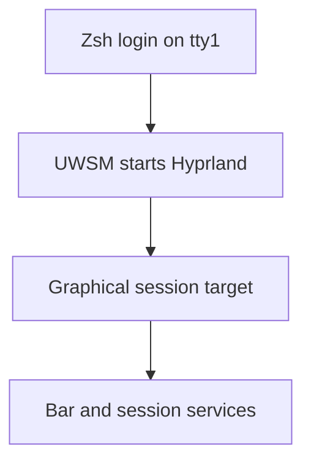

# Arch desktop

On Arch Linux, choose `desktop` in [Getting started](getting-started.md) to
install the Hyprland Wayland session and Quickshell bar. If the profile is
already applied, log in on `tty1` to start the desktop, or go straight to the
[shortcuts](#everyday-shortcuts) or [customization files](#where-to-customize).

## Start the desktop

Save your work and log in as your normal user through Zsh on `tty1`. The
managed login profile asks UWSM (Universal Wayland Session Manager) whether
it can start Hyprland. Opening a terminal inside the desktop does not launch
a second session.

If you stay at a prompt, check that this is an interactive login on `tty1`,
`~/.zprofile` and `~/.config/shell/profile-arch-desktop.sh` are readable,
and `uwsm` is installed. If a previous session is still stopping, the profile
waits up to 15 seconds, then checks again. If Hyprland starts but the bar
doesn't, [inspect the Quickshell service](#diagnose-a-desktop-problem) rather
than adding another autostart command.

<details>
<summary>Upgrading from an older checkout that activated graphical-session.target early</summary>

If an older update already activated `graphical-session.target` without a
compositor, applying the fix will not stop it automatically. Save your work
and start a fresh login after rebooting rather than stopping session targets
under running applications.

</details>

## Everyday shortcuts

`Super` is the Windows/logo key. See
[binds.lua](https://github.com/sneivandt/dotfiles/blob/main/symlinks/config/hypr/conf/binds.lua)
for the complete mapping.

| Shortcut | Action |
|---|---|
| Super + Return | Open Alacritty |
| Super + E | Open your home folder in Thunar |
| Super + P | Open the application launcher |
| Super + O / V | Choose a browser / editor |
| Super + G / C | Open GitHub Copilot / ChatGPT |
| Super + Q | Close the focused window |
| Super + J / K | Focus the next / previous window in the layout |
| Super + Shift + J / K | Swap the window with the next / previous layout position |
| Super + T | Toggle floating mode |
| Super + F | Toggle fullscreen mode |
| Super + 1–9 | Change workspace |
| Super + Shift + 1–9 | Move the window to a workspace without following it |
| Super + End | Lock the session |
| Super + Shift + S | Select an area for a screenshot |

With Super + Shift + S, `slurp` lets you select an area; cancelling saves
nothing. **Without `slurp`, the shortcut captures the whole screen.** The PNG
stays in `~/screenshots` even if copying to the clipboard fails. Move captures
you want to keep out of that directory: the daily
[cleanup timer](https://github.com/sneivandt/dotfiles/blob/main/symlinks/config/systemd/user/clean-screenshots.service)
deletes files and symlinks after 31 full days since their last modification
(`find -mtime +30`), along with old empty directories.

Thunar is the default file manager, styled with the shared Tokyo Night GTK
colors. At login, the session configures Thunar for Compact View, hidden files
shown, and the shortcuts side pane hidden. Press **Ctrl + H** to toggle hidden
files and **Ctrl + B** to toggle the shortcuts pane while browsing. GVFS
handles trash and removable drives.

Opening files from Thunar launches `imv` for PNG, JPEG, and WebP images, `mpv`
for MP4, WebM, and Matroska videos, File Roller for ZIP and common tar
archives, and Chromium for PDFs. Edit
[the default file handlers](https://github.com/sneivandt/dotfiles/blob/main/symlinks/config/mimeapps.list)
if you want different defaults.

### Media keys

Media bindings use standard `XF86` symbols rather than physical F-key
positions, so your keyboard's Fn mode controls which keys send them. Fallback
shortcuts are always available:

| Shortcut | Action |
|---|---|
| Super + F1 | Toggle output mute |
| Super + F2 / F3 | Lower / raise output volume by 5% |
| Super + F4 | Toggle microphone mute |
| Super + F5 / F6 | Lower / raise display brightness by 5% |

Volume follows the default output via `wpctl` (and can go above 100%), while
media playback uses `playerctl`. Dedicated hardware media keys also work on the
lock screen; the `Super + F*` fallbacks do not. Volume and brightness changes
appear in Quickshell's bottom-center OSD when the shell is running, falling back
to Mako progress notifications otherwise.

[brightness.sh](https://github.com/sneivandt/dotfiles/blob/main/symlinks/config/hypr/scripts/brightness.sh)
adjusts display backlights (never keyboard LEDs), keeps brightness above zero,
and exits cleanly if no backlight is exposed. External monitors usually require
separate DDC/CI setup unless their driver exposes a standard backlight device.

## Bar and menus

Click a workspace on the left to switch to it. The controls on the right
include network, media, volume, [Markets](#markets), battery status when
available, and a calendar under the clock.

- **Network:** Open the menu to choose a saved network or enter a Wi-Fi
  password. Right-click for the connection editor, including enterprise Wi-Fi.
- **Volume:** Scroll the icon to adjust the default output or middle-click to
  mute. In the menu, choose an output or set its volume up to 150%.
- **Media:** Click to play or pause, middle-click for the previous track, or
  right-click for the next. A playing player takes precedence over a paused
  one; Spotify wins ties.
- **Power:** Lock immediately, or confirm logout, restart, or shutdown.

Only one popup opens at a time, even across monitors. The bar reserves space
for tiled windows and sits behind floating and fullscreen windows.

Network status follows live events from `nmcli monitor`, falling back to
ten-second polling if the monitor or NetworkManager is temporarily unavailable.
Opening the network menu scans nearby Wi-Fi networks and lists saved profiles
(disambiguating multiple profiles on one adapter by profile name, pinned AP
address, or UUID; hover or tab to read truncated labels).

### Tray applications

GitHub Copilot, ChatGPT, and Spotify display monochrome brand icons in the
regular tray whenever those apps expose tray items; all other apps keep their
own icons. Context menus, middle-click, and scrolling work normally.

Left-click any tray icon to activate its app or open its menu. Copilot uses a
dedicated launcher script whose failures appear in both its tooltip and log.

### Markets

The Markets menu fetches quotes at startup and every five minutes, plus on
demand via its refresh button. If a fetch fails for a symbol, the menu keeps
the last good quote and timestamp and marks it stale instead of blanking out
everything. Configure tracked symbols in
[stocks.py](https://github.com/sneivandt/dotfiles/blob/main/symlinks/config/hypr/scripts/stocks.py).

## Screen locking and suspend

[hypridle.conf](https://github.com/sneivandt/dotfiles/blob/main/symlinks/config/hypr/hypridle.conf)
locks the screen after **10 minutes** of inactivity and turns displays off
after **15 minutes** (idle inhibitors can postpone both). Turning off displays
leaves the machine awake rather than suspending it.

Before suspend, Hypridle requests a lock and waits for Hyprland to confirm it.
Because systemd enforces a finite sleep-inhibit timeout, **if locking fails,
the machine may still suspend**. Waking turns the displays back on; it does
not unlock a successfully locked session. If locking is unreliable, use
Super + End and confirm the lock screen appears before suspending.

Hyprlock uses a solid Tokyo Night background with animations disabled in
[hyprlock.conf](https://github.com/sneivandt/dotfiles/blob/main/symlinks/config/hypr/hyprlock.conf).

## Where to customize

Edit the tracked files under
[symlinks/config/](https://github.com/sneivandt/dotfiles/tree/main/symlinks/config/)
rather than installed copies. The link exposes new contents immediately, but
when they take effect [depends on the component](#reloading-changes). To vary settings across machines, use a
[private overlay](private-overlays.md) to replace the linked file whole.

| Change | Start here |
|---|---|
| Monitor arrangement | [monitors.lua](https://github.com/sneivandt/dotfiles/blob/main/symlinks/config/hypr/conf/monitors.lua) |
| Keyboard, mouse, and touchpad | [input.lua](https://github.com/sneivandt/dotfiles/blob/main/symlinks/config/hypr/conf/input.lua) |
| Window and application shortcuts | [binds.lua](https://github.com/sneivandt/dotfiles/blob/main/symlinks/config/hypr/conf/binds.lua) |
| Window appearance | [appearance.lua](https://github.com/sneivandt/dotfiles/blob/main/symlinks/config/hypr/conf/appearance.lua) |
| Bar colors, typography, spacing, and motion | [Theme.js](https://github.com/sneivandt/dotfiles/blob/main/symlinks/config/quickshell/Theme.js) |
| Bar contents and layout | [Bar.qml](https://github.com/sneivandt/dotfiles/blob/main/symlinks/config/quickshell/Bar.qml) |
| Popup placement, focus, dismissal, and scrolling | [ShellPopup.qml](https://github.com/sneivandt/dotfiles/blob/main/symlinks/config/quickshell/ShellPopup.qml) |
| Notification spacing | [mako/config](https://github.com/sneivandt/dotfiles/blob/main/symlinks/config/mako/config) |
| Qt 5 and Qt 6 widget theme | [Kvantum settings](https://github.com/sneivandt/dotfiles/blob/main/symlinks/config/Kvantum/kvantum.kvconfig) |

Qt Widgets applications use Kvantum's KvArcDark theme unless you already set a
different `QT_STYLE_OVERRIDE`. After updating an existing machine, log out and
back in so UWSM exports the style to newly launched apps. Quickshell manages
its own styling independently.

[hyprland.lua](https://github.com/sneivandt/dotfiles/blob/main/symlinks/config/hypr/hyprland.lua)
loads the Lua modules in `hypr/conf/`. Stick to that Lua format rather than
pasting plain `hyprland.conf` snippets.

## Reloading changes

Quickshell watches its linked sources and reloads automatically when you save,
keeping the last valid shell running if a reload hits an error.

For manual reloads, use `hyprctl reload config-only` (and `hyprctl
configerrors` to check for issues) for Hyprland, and `makoctl reload` for
notifications. Fuzzel reads its config each time it launches, while already
open GTK applications may need a restart to pick up theme changes.

## Session and services

The managed [zprofile](https://github.com/sneivandt/dotfiles/blob/main/symlinks/zprofile)
starts `hyprland-uwsm.desktop`. Before a graphical session starts, dotfiles
enables the selected graphical services meant to run, without starting them.
UWSM activates
`graphical-session.target` when the session launches and exports shared
Wayland and toolkit environment variables from
[uwsm/env-hyprland.d/session.sh](https://github.com/sneivandt/dotfiles/blob/main/symlinks/config/uwsm/env-hyprland.d/session.sh),
backed by matching fallbacks in
[conf/env.lua](https://github.com/sneivandt/dotfiles/blob/main/symlinks/config/hypr/conf/env.lua)
for direct Hyprland launches.



Long-running desktop daemons run as systemd user services rather than Hyprland
`exec-once` lines: Quickshell, Hypridle, Hyprpaper, Mako, Gammastep, the
keyring, and the polkit authentication agent. On the system side, dotfiles
enables NetworkManager and disables the standalone network tray applet. Audio
is handled by PipeWire and WirePlumber.

<details>
<summary>Migrating an existing installation off dhcpcd.service</summary>

The default service config leaves `dhcpcd.service` untouched so a failed
NetworkManager startup can't cut off your network. Perform the cutover from a
local session: after updating, verify `nmcli device status` shows `connected`
for your interface and confirm connectivity, then run
`sudo systemctl disable --now dhcpcd.service` and recheck connectivity.

</details>

Unit declarations live in
[conf/systemd-units.toml](https://github.com/sneivandt/dotfiles/blob/main/conf/systemd-units.toml),
and custom user units live under
[config/systemd/user/](https://github.com/sneivandt/dotfiles/tree/main/symlinks/config/systemd/user/).
See the [Systemd units task](../reference/systemd-units.md) for how units are
selected and how to disable one before removing its entry. Preserve the
graphical-session lifetime and safety directives when editing custom units.

For XDG desktop portals, Hyprland handles screen sharing and GTK handles file
choosers, configured in
[hyprland-portals.conf](https://github.com/sneivandt/dotfiles/blob/main/symlinks/config/xdg-desktop-portal/hyprland-portals.conf).

## Diagnose a desktop problem

Inspect the affected component before restarting the whole session:

```sh
hyprctl configerrors
systemctl --user status quickshell.service
journalctl --user -u quickshell.service -b
```

Swap `quickshell.service` for whichever unit is misbehaving, and review
journal logs for private paths or details before sharing them.

See [Service changes are not visible](troubleshooting.md#service-changes-are-not-visible)
for inactive units and keyring issues, or read
[Windows and WSL](windows-and-wsl.md) if you also run dotfiles on Windows.
Contributors can exercise desktop helpers and UI logic in isolation with the
[desktop shell tests](../development/testing.md#desktop-shell) without
restarting their session.
