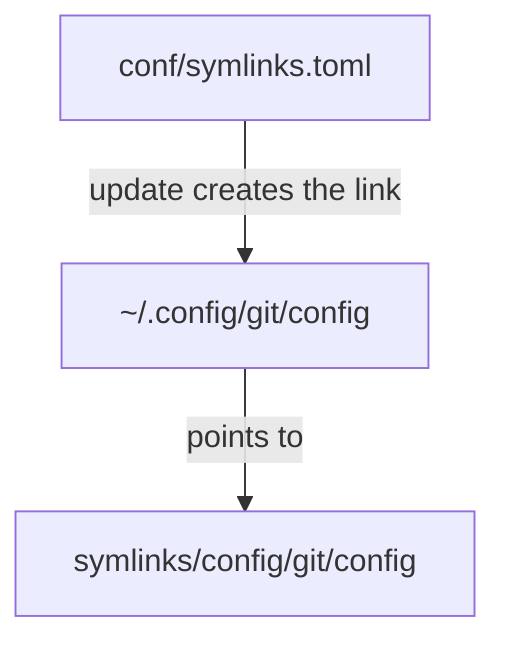

# Configuration basics

Dotfiles splits configuration into two places: files under `conf/` declare
**what dotfiles manages**, while files under
[symlinks/](https://github.com/sneivandt/dotfiles/tree/main/symlinks/) and
[system/](https://github.com/sneivandt/dotfiles/tree/main/system/) hold the
actual settings. For example, an entry in `conf/symlinks.toml` tells `update`
to link `~/.config/git/config` into your home directory, whereas changing your
default Git branch happens inside `symlinks/config/git/config`. Once that link
exists, Git reads the tracked file directly, so you don't need to re-run
`dotfiles update` after editing it.



For administrator-owned files under `/etc`, dotfiles merges structured
fragments from `system/` instead of creating symlinks. To jump straight to the
tracked files for common tools, see
[Application settings](application-settings.md).

## Files

Every main configuration file below must exist in the checkout, even on
platforms where its task does not run (unused files can be empty):

| File | Purpose |
|---|---|
| [symlinks.toml](https://github.com/sneivandt/dotfiles/blob/main/conf/symlinks.toml) | [Home symlinks](../reference/home-symlinks.md) |
| [packages.toml](https://github.com/sneivandt/dotfiles/blob/main/conf/packages.toml) | [System packages](../reference/system-packages.md) and [AUR packages](../reference/aur-packages.md) |
| [git-config.toml](https://github.com/sneivandt/dotfiles/blob/main/conf/git-config.toml) | [Global Git settings](../reference/global-git-settings.md) |
| [agent-settings.toml](https://github.com/sneivandt/dotfiles/blob/main/conf/agent-settings.toml) | [Agent settings](../reference/agent-settings.md) |
| [chmod.toml](https://github.com/sneivandt/dotfiles/blob/main/conf/chmod.toml) | [File permissions](../reference/file-permissions.md) |
| [registry.toml](https://github.com/sneivandt/dotfiles/blob/main/conf/registry.toml) | [User registry settings](../reference/user-registry-settings.md) |
| [systemd-units.toml](https://github.com/sneivandt/dotfiles/blob/main/conf/systemd-units.toml) | [Systemd units](../reference/systemd-units.md) |
| [system-files.toml](https://github.com/sneivandt/dotfiles/blob/main/conf/system-files.toml) | [System configuration files](../reference/system-configuration-files.md) |
| [vscode-extensions.toml](https://github.com/sneivandt/dotfiles/blob/main/conf/vscode-extensions.toml) | [VS Code extensions](../reference/vs-code-extensions.md) |

Private overlays can also supply
[conf/scripts.toml](private-overlays.md#overlay-scripts) for custom setup
scripts. A `conf/scripts.toml` in the main repository is ignored.

## Making a configuration change

1. Find the owning TOML file in the table above and check its task page for the
   exact schema.
2. Pick the right category section so related packages, symlinks, and services
   stay aligned.
3. Verify the [path conventions](#path-conventions): shorthand symlink entries
   add a leading dot to the home path, whereas explicit `target` values do not.
4. Validate your edits and preview the affected
   [task](../reference/task-reference.md) before applying.
5. Back up any existing target files you want to keep before applying, since
   removing a declaration later stops management without undoing earlier
   changes.

All TOML examples in these docs are excerpts rather than full files. Extend
the existing section instead of adding a duplicate table with the same name.

For instance, after editing `conf/symlinks.toml`, validate and preview with:

```sh
dotfiles check --only config-diagnostics,symlink-sources,config-files
dotfiles update --only symlinks --dry-run
```

Fix any failed or skipped checks before applying. The preview lists planned
destinations under Home symlinks (pass `--verbose` to include unchanged links).
Swap in the appropriate task selector for other configuration domains.

If dotfiles is not installed yet, start with
[Getting started](getting-started.md). Contributors changing the Rust loader or
configuration schemas should also run
[CLI validation](../development/testing.md#cli-validation).

## Category sections

Aside from `conf/registry.toml`, configuration files group entries under
category headings:

```toml title="conf/symlinks.toml (excerpt)"
[base]
symlinks = ["config/git/config"]

[windows]
symlinks = ["wslconfig"]

[arch-desktop]
symlinks = ["config/hypr/hyprland.lua"]
```

Valid tags are `base`, `desktop`, `linux`, `windows`, `arch`, and `wsl`. A
hyphen acts as **AND**, so `[arch-desktop]` applies only when both `arch` and
`desktop` are active. Unknown or misspelled tags fail validation.

`base` is always active, the `desktop` profile adds `desktop`, and the CLI
detects the platform tags automatically. See
[Profiles and categories](profiles-and-categories.md) for how profiles resolve
and combine with platform categories.

## Path conventions

Source paths are resolved relative to the declaring repository: `symlinks/` for
home symlinks, `system/` for system-file fragments, and the overlay root for
overlay scripts. An overlay declaration always reads from the overlay's own
tree, not the main checkout.

- A shorthand symlink `"config/git/config"` maps to `~/.config/git/config`
  (with a leading dot added).
- An explicit `target = "Documents/file"` maps to `~/Documents/file` (no
  leading dot added).
- A permission `path = "ssh/config"` refers to `~/.ssh/config`.
- A system-file `source = "pacman.conf"` defaults to `/etc/pacman.conf` unless
  you set `target`.

Always use `/` as the path separator for portability, and write home-relative
paths without a leading `~/`.

## Private overlays

Keep personal, work, or machine-specific configuration in a separate
[private overlay](private-overlays.md). Overlays layer cleanly on top of a
valid main configuration without hiding conflicts or invalid entries in the
base files.

## Removing configuration

Deleting a declaration tells dotfiles to **stop managing it**, not to **undo
it**. Already-installed packages, Git and agent settings, registry values,
systemd units, and merged system files remain untouched.

For managed symlinks or overlay scripts, keep the declaration in place while
you run the matching [remove task](../reference/task-reference.md#remove-tasks),
then delete the declaration afterward. Remember that symlink removal replaces
live links with standalone copies of their current sources rather than
restoring pre-install backups; see
[Home symlinks removal](../reference/home-symlinks.md#removal) and
[Removing agent packages](agent-configuration.md#removing-packages-and-targets).

## Loading and reload behavior

Standard `update`, `remove`, and `check` runs load every required TOML file
before selecting tasks, so `--only` cannot skip past syntax errors or
declaration conflicts elsewhere in `conf/`.

The one recovery exception is `dotfiles update --only repository` (with no
other selectors or skips), which can sync the checkout without loading TOML
configuration first. Use it to pull down an upstream fix for broken
configuration while still preserving Git's readiness and safety checks (see
[Dotfiles repository](../reference/dotfiles-repository.md#what-it-does)).

When a normal update pulls new commits during repository sync, the CLI restarts
automatically to reload the updated configuration before running later tasks;
see the [restart boundary](../development/architecture.md#repository-updates-are-a-restart-boundary).

### Unknown keys are errors

Strict schema parsing rejects unrecognized keys rather than silently ignoring
them (`symlink` instead of `symlinks`, or `targett` instead of `target`, fails
loading). Keys and value types are validated across inactive categories too, so
a typo under `[windows]` is still caught on Linux.

## Validation

`dotfiles check` runs configuration diagnostics, required-file checks,
symlink-source checks, and available static analyzers. Its `config-diagnostics`
task treats warnings as failures so configuration problems are caught early.

For contributors, the Rust `config_drift` test suite verifies relationships
between real declarations and tracked files across category combinations. See
[Choosing coverage](../development/testing.md#choosing-coverage) for what to
run after editing configuration or schemas.

## Application preferences

The files above control what dotfiles installs and links; they do not define
each application's own settings syntax. Next, explore
[Package management](package-management.md) to manage installed software, or
jump to [Application settings](application-settings.md) and
[Arch desktop](arch-desktop.md) to customize shell, Git, editor, and desktop
behavior.
