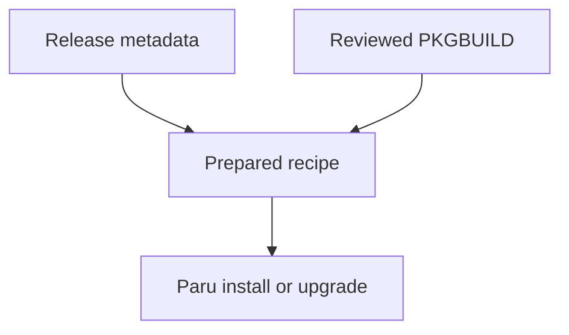

# Package management

Dotfiles ensures the software declared for your profile is installed, using
pacman and Paru on Arch Linux or WinGet on Windows. It checks what is already
present and installs only what is missing. Keeping existing applications up to
date is a separate maintenance step, though installing a missing package on
Arch can also upgrade the system.

Installing a package and configuring it are managed separately: use
[Application settings](application-settings.md) for linked dotfiles and
preferences, and [Agent configuration](agent-configuration.md) for AI agent
content. Updating the dotfiles CLI itself is also independent of system
packages.

## Choose packages

Add or review declarations in
[conf/packages.toml](https://github.com/sneivandt/dotfiles/blob/main/conf/packages.toml).
Put packages in the matching category section: `[arch]` and `[windows]` apply
to both profiles, while `[arch-desktop]` and `[windows-desktop]` add desktop
applications (see [Profiles and categories](profiles-and-categories.md)).

| Package source | Declaration |
|---|---|
| Arch official repositories, through pacman | Package name |
| AUR (Arch User Repository), through Paru | Package name with `aur = true` |
| Dotfiles-managed Arch recipe, through Paru | Custom package name with `aur = true` |
| Windows, through WinGet | Exact WinGet ID |

For example, these excerpts select a native Arch tool, an AUR application, and
Git for Windows:

```toml title="conf/packages.toml"
[arch]
packages = ["ripgrep"]

[arch-desktop]
packages = [{ name = "visual-studio-code-bin", aur = true }]

[windows]
packages = ["Git.Git"]
```

Always extend the existing arrays rather than duplicating TOML section headers,
and use exact package identifiers rather than display names. A
[private overlay](private-overlays.md) can add personal packages or override a
matching declaration (see [Merge rules](private-overlays.md#merge-rules) and
the [System packages reference](../reference/system-packages.md#configuration)).

Other Linux distributions can still use shared configuration from dotfiles, but
dotfiles does not install packages through `apt`, `dnf`, or other managers;
install those prerequisites directly with your distribution's package manager.

## Install and upgrade

For an initial setup or after adding new prerequisites, preview a full update:

```sh
dotfiles update --dry-run
```

Review the active profile, package names, and planned actions before removing
`--dry-run`. The `packages` task installs native Arch or Windows packages,
while `aur-packages` handles Arch entries marked `aur = true`. If querying the
installed inventory fails, the task stops with an error rather than assuming
everything is missing.

On an already configured machine, you can preview just the native package task:

```sh
dotfiles update --only packages --dry-run
```

Remember that `--only packages` covers **all active native packages**, not a
single package and not the AUR list (use `aur-packages` on Arch for AUR and
custom recipes). Scoped runs assume prerequisites are already installed; if you
want dependencies pulled in, check the dependency graph before adding
`--with-deps`, since it can also include Paru bootstrap and custom recipe
preparation (see [Select tasks](commands-and-usage.md#select-tasks)).

### Arch Linux

Both the weekly Reflector timer and the `update-mirrors` Zsh helper read
`/etc/xdg/reflector/reflector.conf` for mirror filters and sorting. Include
`--protocol https` there if you use the helper: if a generated mirrorlist is
empty or contains a non-HTTPS mirror, `update-mirrors` leaves your current
mirrorlist untouched even if those same filters work for the timer.

::: warning Installing a missing package can upgrade the system
Pacman runs `pacman -Syu --needed --noconfirm`, which refreshes package
databases and can upgrade already-installed packages while installing missing
ones. Dry-run warns about this once per batch; its list names only the missing
packages, not every package pacman may upgrade.
:::

When every declared native package is already installed, dotfiles skips pacman
entirely rather than running a full system upgrade just because the command is
called `update`.

After a pacman or Paru install finishes (or fails or times out), dotfiles
rechecks which requested packages are now present. Missing packages and
timeouts still fail the task, while a retry requests only what is still absent.
Investigate any failed install hook separately.

Paru builds and installs AUR packages, and the `paru` task bootstraps the
helper or rebuilds it if a library upgrade breaks it. Keep the main dotfiles
run under your normal user account so Paru runs without an extra `sudo`
wrapper, and always review AUR recipes and upstream sources before trusting
them.

Because dotfiles checks presence rather than upgrading installed software, run
a normal dotfiles update followed by a full Paru upgrade when you want to
refresh everything on Arch:

```sh
dotfiles update
paru -Syu
```

Review Paru's transaction before confirming, since `paru -Syu` upgrades
official, AUR, and custom packages across the whole machine. Running
`dotfiles update` first ensures Paru sees refreshed snapshots for any
[custom Arch packages](#custom-arch-packages).

The weekly `paccache.timer` keeps two cached versions of each package. On an
existing machine, apply the retention drop-in with
`dotfiles update --only system-files`, reload systemd with
`sudo systemctl daemon-reload`, and preview what would be pruned with
`paccache -d -k2`.

### Windows

WinGet installs missing packages using exact IDs. If an installer requires a
reboot to finish, dotfiles calls out that package in the summary so you can
reboot before retrying tasks that depend on it. Dotfiles never runs
`winget upgrade --all`; use WinGet directly when you want to review and apply
application upgrades.

Installations try user scope first and fall back to machine scope only when no
user-scope installer exists. Interactive prompts are suppressed and agreements
accepted, though an individual installer can still trigger a UAC prompt.

If an install requires Administrator rights, is cancelled, or is blocked by
policy, the task fails even if other packages installed cleanly. Responses
indicating a package is already installed or has no applicable upgrade count as
current, whereas a failed or unparseable WinGet inventory query fails even
during a preview.

Keep your main dotfiles run unelevated, and read
[Windows elevation](windows-and-wsl.md#elevation) before retrying a package
that needs Administrator rights. Installing Windows applications does not
install Linux equivalents inside WSL; manage each environment separately.

## Remove a package

Removing a line from `conf/packages.toml` tells dotfiles to stop ensuring that
package is installed; neither deleting the entry nor running `dotfiles remove`
uninstalls software.

1. Remove the declaration from every contributing source, including any private
   overlay.
2. Uninstall the package directly with pacman, Paru, or WinGet after reviewing
   any dependent packages it would remove.
3. Check for related symlinks, extensions, or services, since they are declared
   separately and may remain after uninstalling the application.

If an uninstalled package gets pulled back in on the next update, check your
active categories and overlays for another declaration. Switching profiles
likewise leaves previously installed packages in place.

## Logs and troubleshooting

Start by inspecting the failing task's log using the `<run-id>` printed after
the failure (or listed by `dotfiles log --list`):

```sh
dotfiles log --id <run-id> --task packages --verbose
dotfiles log --id <run-id> --task aur-packages --verbose
```

Use `aur-packages` for Arch AUR and custom-recipe installs. Fix the reported
package-manager error before retrying; packages that already installed earlier
in the batch stay installed.

| Symptom | Check next |
|---|---|
| An expected package is absent from the plan | Active profile and categories, spelling, overlay declarations, and task filters |
| Installed-package discovery fails | The pacman or WinGet error (never treated as an empty installed list) |
| Pacman work is skipped for privileges | The reported elevation prerequisite; see [Elevation is unavailable](troubleshooting.md#elevation-is-unavailable) |
| Paru cannot start or build | Helper health and [Rust/Cargo prerequisites](troubleshooting.md#paru-cannot-build-or-start) |
| WinGet installation fails | Exact ID, installer scope, cancellation, or policy restrictions |
| A custom package has no newer version | Refresh recipes first, then inspect `version.sh`, `.SRCINFO`, and `paru -Sl --pkgbuilds` |
| Recipe preparation fails | The `custom-package-versions` or `custom-package-repository` log; existing pins survive a failed refresh |
| A custom package is excluded from installation | Release metadata, snapshot ownership, and the generated repository section (never silently falls back to remote AUR) |

See [Packages do not install](troubleshooting.md#packages-do-not-install) for
broader recovery steps. If an ownership check rejects a snapshot cache
directory, investigate what owns it instead of deleting unfamiliar directories.

## Custom Arch packages

Dotfiles maintains several custom Arch recipes under
[packages/](https://github.com/sneivandt/dotfiles/tree/main/packages/) to
package upstream binary releases cleanly. Using one only requires adding its
`aur = true` declaration in `conf/packages.toml`; you don't need to edit the
recipe itself.

| Package | Recipe |
|---|---|
| `apm-dotfiles` | [APM](https://github.com/sneivandt/dotfiles/tree/main/packages/apm/) |
| `github-copilot-app-dotfiles` | [Copilot App](https://github.com/sneivandt/dotfiles/tree/main/packages/github-copilot-app/) |
| `powershell-dotfiles` | [PowerShell](https://github.com/sneivandt/dotfiles/tree/main/packages/powershell/) |
| `github-copilot-cli-dotfiles` | [Copilot CLI](https://github.com/sneivandt/dotfiles/tree/main/packages/github-copilot-cli/) |
| `openai-codex-dotfiles` | [Codex CLI](https://github.com/sneivandt/dotfiles/tree/main/packages/openai-codex/) |

During a normal Arch update, dotfiles checks upstream releases and prepares
local Git snapshots for every managed recipe in the checkout, regardless of
whether your current profile installs all of them. **Preparing a recipe does
not upgrade an already-installed application**: follow up with
[Arch Linux upgrades](#arch-linux) (`paru -Syu`) afterward. Running Paru on its
own builds from the last prepared snapshot, not directly from edits in this
checkout.



These packages use distinct `*-dotfiles` names and may replace or conflict with
older upstream packages; review Paru's replacement prompt carefully. The
PowerShell recipe's install script adds `/usr/bin/pwsh` to `/etc/shells` when
absent, and uninstalling removes only the marked entry it added while leaving
existing or unmarked entries for you to review.

::: warning Preparation executes recipes and replaces Paru preferences
A normal Arch update prepares every managed recipe, not just selected packages.
Metadata generation executes PKGBUILD code, and preparation replaces the entire
Paru configuration without merging or backing up existing preferences. Review
the recipes and preserve any Paru settings you want to keep before applying.
:::

For release-descriptor details, see
[Custom package versions](../reference/custom-package-versions.md#configuration).
To prepare snapshots on their own or customize the tracked Paru base config,
see [Custom package repository](../reference/custom-package-repository.md).

Once your tools are installed, head to
[Application settings](application-settings.md) to configure Git, your shell,
and your editors.
