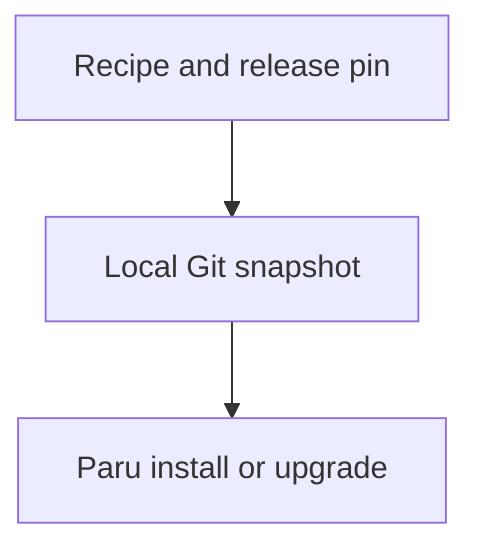

# Package management

Add a package to your profile to have dotfiles install it when missing. To
**upgrade** software already installed, use [Paru on Arch Linux](#arch-linux)
or [WinGet on Windows](#windows). To **uninstall** it, [remove the declaration
and uninstall the package](#remove-a-package). None of these steps configures
the application or updates the dotfiles CLI.

## Choose packages

Add or review declarations in
[conf/packages.toml](https://github.com/sneivandt/dotfiles/blob/main/conf/packages.toml).
Put packages in the matching category section: `[arch]` and `[windows]` apply
to both profiles, while `[arch-desktop]` and `[windows-desktop]` add desktop
applications (see [Profiles and categories](profiles-and-categories.md)).

Use a package name for the official Arch repositories. For an Arch User
Repository (AUR) package or a [dotfiles-managed recipe](#custom-arch-packages),
add `aur = true` so Paru handles it. On Windows, use the exact WinGet ID.
This illustrative example selects ripgrep, the stable VS Code AUR package,
and Git for Windows; the tracked desktop list selects VS Code **Insiders**.

```toml title="conf/packages.toml"
[arch]
packages = ["ripgrep"]

[arch-desktop]
packages = [{ name = "visual-studio-code-bin", aur = true }]

[windows]
packages = ["Git.Git"]
```

Always extend the existing arrays rather than duplicating TOML section headers,
and use exact package identifiers rather than display names. A
[private overlay](private-overlays.md) can add personal packages or override a
matching declaration (see [Merge rules](private-overlays.md#merge-rules) and
the [System packages reference](../reference/system-packages.md#configuration)).

Other Linux distributions can still use shared configuration from dotfiles, but
dotfiles does not install packages through `apt`, `dnf`, or other managers;
install those prerequisites directly with your distribution's package manager.

## Install and upgrade

For an initial setup or after adding new prerequisites, preview a full update:

```sh
dotfiles update --dry-run
```

Review the active profile, package names, and planned actions before removing
`--dry-run`. The `packages` task installs native Arch or Windows packages,
while `aur-packages` handles Arch entries marked `aur = true`. If querying the
installed inventory fails, the task stops with an error rather than assuming
everything is missing.

On an already configured machine, you can preview just the native package task:

```sh
dotfiles update --only packages --dry-run
```

`--only packages` covers **all active native packages**, not one ID. For AUR
and custom packages, select `aur-packages` instead. A scoped run assumes its
prerequisites are ready. Before adding `--with-deps` to an AUR run, [inspect
the dependency graph](commands-and-usage.md#select-tasks): it can bring in
Paru bootstrap and custom recipe preparation.

### Arch Linux

::: warning Installing a missing package can upgrade the system
Pacman runs `pacman -Syu --needed --noconfirm`, which refreshes package
databases and can upgrade already-installed packages while installing missing
ones. Dry-run warns about this once per batch; its list names only the missing
packages, not every package pacman may upgrade.
:::

When every declared native package is already installed, dotfiles queries the
inventory but does not run a pacman installation or upgrade.

After a pacman or Paru install finishes (or fails or times out), dotfiles
rechecks which requested packages are now present. Missing packages and
timeouts still fail the task. A nonzero exit also remains a failure if every
requested package is now present: a post-transaction hook may have failed. A
retry requests only missing packages; it won't replay a hook for a package
that is already installed.

Paru builds and installs AUR packages, and the `paru` task bootstraps the
helper or rebuilds it if a library upgrade breaks it. Keep the main dotfiles
run under your normal user account so Paru runs without an extra `sudo`
wrapper, and always review AUR recipes and upstream sources before trusting
them.

To upgrade installed packages, refresh the dotfiles recipes first, then review
Paru's transaction. The first command is a **full dotfiles update**, not just
a package refresh.

::: warning Preparation executes recipes and replaces Paru preferences
A normal Arch update prepares every managed recipe, not just packages your
profile installs. Metadata generation executes PKGBUILD code. Preparation
replaces the entire Paru configuration without merging or backing up your
preferences. Review the recipes and preserve settings you need before applying.
:::

1. Run `dotfiles update`. Check that recipe preparation succeeded, not just
   that the command exited successfully. Resolve any skips or failures first.
2. Run `paru -Syu` and review its transaction before confirming. The upgrade
   covers official, AUR, and custom packages, not just your declarations.

### Arch mirrors and package cache

Both the weekly Reflector timer and the `update-mirrors` Zsh helper read
`/etc/xdg/reflector/reflector.conf` for mirror filters and sorting. Include
`--protocol https` there if you use the helper: if a generated mirrorlist is
empty or contains a non-HTTPS mirror, `update-mirrors` leaves your current
mirrorlist untouched even if those same filters work for the timer.

The default `paccache.timer` policy keeps two cached versions of each package.
On an existing machine, review `dotfiles update --only system-files --dry-run`
before applying: this scope includes **all selected system files**, not just
the retention drop-in. Its two retention files are create-only; a differing
file is a conflict to review, not something dotfiles overwrites. Check the
effective `PACCACHE_ARGS`, reload systemd with `sudo systemctl daemon-reload`
after installing a drop-in, and use `paccache -d -k2` to preview the
two-version policy without pruning.

### Windows

WinGet installs missing packages using exact IDs. If an installer requires a
reboot to finish, dotfiles calls out that package in the summary so you can
reboot before retrying tasks that depend on it. Dotfiles never runs
`winget upgrade --all`; use WinGet directly when you want to review and apply
application upgrades.

Installations use `--exact --no-upgrade` and try `--scope user` first. Only
when WinGet reports no applicable installer does dotfiles retry **without a
scope**, allowing WinGet to choose a machine installer rather than forcing
one. WinGet's own prompts are suppressed and agreements accepted; an installer
can still raise its own UAC prompt.

If an install requires Administrator rights, is cancelled, or is blocked by
policy, the task fails even if other packages installed cleanly. Responses
indicating a package is already installed or has no applicable upgrade count as
current, whereas a failed or unparseable WinGet inventory query fails even
during a preview.

Keep your main dotfiles run unelevated, and read
[Windows elevation](windows-and-wsl.md#elevation) before retrying a package
that needs Administrator rights. Installing Windows applications does not
install Linux equivalents inside WSL; manage each environment separately.

## Remove a package

Removing a line from `conf/packages.toml` tells dotfiles to stop ensuring that
package is installed; neither deleting the entry nor running `dotfiles remove`
uninstalls software.

1. Remove the declaration from every contributing source, including any private
   overlay.
2. Uninstall the package directly with pacman, Paru, or WinGet after reviewing
   any dependent packages it would remove.
3. Check for related symlinks, extensions, or services, since they are declared
   separately and may remain after uninstalling the application.

If an uninstalled package gets pulled back in on the next update, check your
active categories and overlays for another declaration. Switching profiles
likewise leaves previously installed packages in place.

## Logs and troubleshooting

Start by inspecting the failing task's log using the `<run-id>` printed after
the failure (or listed by `dotfiles log --list`):

```sh
dotfiles log --id <run-id> --task packages --verbose
dotfiles log --id <run-id> --task aur-packages --verbose
```

Use `aur-packages` for Arch AUR and custom-recipe installs. Fix the reported
package-manager error before retrying; packages that already installed earlier
in the batch stay installed.

- **Missing from the plan:** check inventory, active categories, spelling,
  overlays, and task filters. An inventory query error stops planning; it
  doesn't mean nothing is installed.
- **Installer refused:** check pacman's [elevation prerequisite](troubleshooting.md#elevation-is-unavailable)
  or WinGet's exact ID, installer scope, cancellation, and policy message.
- **Paru won't start or build:** check [helper health and Rust/Cargo prerequisites](troubleshooting.md#paru-cannot-build-or-start).
- **Custom package missing or out of date:** check the `custom-package-versions`
  and `custom-package-repository` logs, then `version.sh`, `.SRCINFO`, and
  `paru -Sl --pkgbuilds`. A failed release refresh preserves the existing
  pin. If a recipe is excluded, inspect its release metadata, snapshot
  ownership, and generated repository section; dotfiles won't silently
  substitute a remote AUR package.

See [Packages do not install](troubleshooting.md#packages-do-not-install) for
broader recovery steps. If an ownership check rejects a snapshot cache
directory, investigate what owns it instead of deleting unfamiliar directories.

## Custom Arch packages

Dotfiles maintains several custom Arch recipes under
[packages/](https://github.com/sneivandt/dotfiles/tree/main/packages/) to
package upstream binary releases cleanly. Using one only requires adding its
`aur = true` declaration in `conf/packages.toml`; you don't need to edit the
recipe itself.

| Package | Recipe |
|---|---|
| `apm-dotfiles` | [APM](https://github.com/sneivandt/dotfiles/tree/main/packages/apm/) |
| `github-copilot-app-dotfiles` | [Copilot App](https://github.com/sneivandt/dotfiles/tree/main/packages/github-copilot-app/) |
| `powershell-dotfiles` | [PowerShell](https://github.com/sneivandt/dotfiles/tree/main/packages/powershell/) |
| `github-copilot-cli-dotfiles` | [Copilot CLI](https://github.com/sneivandt/dotfiles/tree/main/packages/github-copilot-cli/) |
| `openai-codex-dotfiles` | [Codex CLI](https://github.com/sneivandt/dotfiles/tree/main/packages/openai-codex/) |

During a normal Arch update, dotfiles checks upstream releases and prepares
local Git snapshots for every managed recipe in the checkout, regardless of
whether your current profile installs all of them. **Preparing a recipe does
not upgrade an already-installed application**: follow up with
[Arch Linux upgrades](#arch-linux) (`paru -Syu`) afterward. Running Paru on its
own builds from the last prepared snapshot, not directly from edits in this
checkout.



These packages use distinct `*-dotfiles` names and may replace or conflict with
older upstream packages; review Paru's replacement prompt carefully. The
PowerShell recipe's install script adds `/usr/bin/pwsh` to `/etc/shells` when
absent, and uninstalling removes only the marked entry it added while leaving
existing or unmarked entries for you to review.

For release-descriptor details, see
[Custom package versions](../reference/custom-package-versions.md#configuration).
To prepare snapshots on their own or customize the tracked Paru base config,
see [Custom package repository](../reference/custom-package-repository.md).

Once your tools are installed, head to
[Application settings](application-settings.md) to configure Git, your shell,
and your editors.
