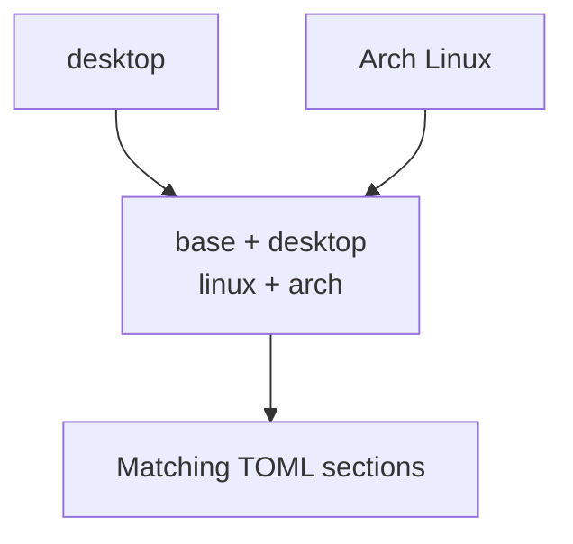

# Profiles and categories

A profile sets a machine's role (`base` or `desktop`), while categories are
tags such as `linux`, `arch`, or `windows` that select matching sections in
`conf/*.toml`. Dotfiles combines your chosen profile with the categories it
detects for the operating system to decide which declarations apply. When you
want to run only a subset of those declarations, use task filters alongside the
profile.

## Built-in role profiles

| Profile | Use it for |
|---|---|
| `base` | Core shell tools and terminal configuration, without desktop additions |
| `desktop` | A workstation: everything in `base`, plus desktop applications and graphical configuration |

For example:

```bash
dotfiles list --profile base
dotfiles list --profile desktop
```

Profile names must be lowercase (`base` or `desktop`). Operating-system names
like `linux`, `arch`, `windows`, and `wsl` are detected categories rather than
profiles you select.

::: warning Profiles are roles, not safety levels
`base` does not mean unprivileged or home-directory-only. Platform tasks can
still install packages, change your login shell, or merge system files under
`/etc`. Always review a [preview](commands-and-usage.md#dry-run-scope) before
applying either profile.
:::

## Automatic categories

Every profile activates `base`, and `desktop` adds `desktop` on top of it.
Dotfiles then adds the categories detected for the current host:

| Where the CLI runs | Automatic categories |
|---|---|
| Windows | `windows` |
| Non-Arch Linux | `linux` |
| Arch Linux | `linux`, `arch` |
| Non-Arch WSL | `linux`, `wsl` |
| Arch WSL | `linux`, `arch`, `wsl` |

Arch detection checks for `/etc/arch-release`, and WSL detection checks the
Linux kernel release string. Because Windows and Linux inside WSL detect
different environments, each side manages its own configuration even on the
same machine.



## Section matching

Active categories decide which TOML sections are loaded. A hyphen in a section
name acts as **AND**, meaning every listed tag must be active. This excerpt
from [conf/packages.toml](https://github.com/sneivandt/dotfiles/blob/main/conf/packages.toml)
illustrates how sections stack:

```toml title="conf/packages.toml (excerpt)"
[arch]
packages = ["git"]

[arch-desktop]
packages = ["quickshell"]
```

On an Arch Linux workstation using the `desktop` profile, the active categories
are `base`, `desktop`, `linux`, and `arch`. Both `[arch]` and `[arch-desktop]`
match, so both package lists are included. On the same machine with `base`,
only `[arch]` matches.

Tag order does not matter (`[arch-desktop]` and `[desktop-arch]` are
equivalent), and all matching sections combine rather than the more specific
one replacing the rest. When editing a config file, add to the existing section
instead of declaring a duplicate table header.

Not every TOML file uses category sections: `conf/registry.toml`, for instance,
uses named settings groups that apply on every Windows run regardless of role.
See [Category sections](configuration-basics.md#category-sections) for
file-specific rules and overlay merging.

Keep in mind that categories only select declarations; they do not supply
unsupported tools. Choosing `desktop` on Ubuntu can select shared Linux
application settings, but it will not install packages through `apt` because
Linux package installation in dotfiles requires `pacman`.

## Resolution priority

Dotfiles resolves the active profile in this order:

1. `--profile <name>` on the command line.
2. A nonempty `DOTFILES_PROFILE` environment variable.
3. The repository-local Git setting `dotfiles.profile`.
4. An interactive prompt, when the command supports one.

Passing `--profile` overrides the role for that single run without updating the
saved default. Answering an interactive prompt saves the chosen profile once
configuration loads cleanly, even during `check` or `--dry-run`.

To inspect or change the saved default directly from your checkout:

```bash
git config --local --get dotfiles.profile
git config --local dotfiles.profile base
```

The first command exits nonzero with no output if no default is saved yet. The
second writes to local Git config rather than a tracked file. Because linked
worktrees share repository-local Git config, use `--profile` whenever a
specific worktree needs a different role for one run.

### When there is no prompt

`list`, `explain`, and unattended commands require a profile from a flag,
environment variable, or saved setting, whereas help, version, and log commands
need none. See [Unattended runs](commands-and-usage.md#unattended-runs) for
automation flags, or
[No profile selected](troubleshooting.md#no-profile-selected) if you run into a
selection error.

## Changing profiles or categories

A profile controls what dotfiles manages going forward, not what it deletes.
**Switching from `desktop` to `base` does not uninstall desktop
configuration.** Existing desktop packages, services, links, and settings stay
in place so you can decide what to keep. Removing a declaration from TOML
behaves the same way: it stops future management without undoing past runs.

### Preview a different role

You can test another role without changing your saved default:

```bash
dotfiles list --profile desktop
dotfiles update --profile desktop --dry-run
```

If you want to retire desktop configuration and move a machine back to `base`,
handle cleanup before switching the saved role:

1. While `desktop` is still active, set unwanted services to `enabled = false`,
   preview the `systemd` task, and apply the change before removing their
   declarations. Save open work before stopping services tied to your live
   session.
2. Decide which desktop links to detach. Preview
   `dotfiles remove --profile desktop --only symlinks --dry-run`, keeping in
   mind that this detaches **all desktop-selected links, including `base`
   links**, turning them into standalone copies of their current sources.
   Review the plan before applying and keep the source checkout intact until
   it finishes.

   Next, preview `dotfiles update --profile base --only symlinks --dry-run`.
   The copied `base` files now conflict with link installation because `update`
   refuses to overwrite ordinary files. Inspect each reported target, keep any
   edits you care about, and move only the files you want re-linked aside into
   a backup folder. Re-run the `base` preview until it is clean, then apply it.

   Keep any desktop-only copies you still want, and avoid deleting an entire
   config directory just to clear conflicts. On Arch Linux, move
   `~/.config/shell/profile-arch-desktop.sh` aside if you no longer want tty1
   to start Hyprland automatically.
3. Remove unwanted package declarations and uninstall those packages directly
   with your native package manager after reviewing their dependencies. Handle
   registry keys, system files, and other persistent settings manually.
4. Save the new default in your checkout with
   `git config --local dotfiles.profile base`, make sure `DOTFILES_PROFILE` is
   not overriding it, and preview `dotfiles update --profile base --dry-run`.

Keep your original overlay active throughout cleanup. Dotfiles has no automatic
profile migration or desktop-only uninstall; see
[Remove tasks](../reference/task-reference.md#remove-tasks) for what `remove`
does cover.

### Distinguish profiles from task filters

Profiles and task filters answer different questions. In
`dotfiles update --profile base --only symlinks`, `--profile base` decides
which symlink declarations are active, while `--only symlinks` tells the CLI to
run only the symlink task and skip everything else. Filtering never changes
which configuration sections match.

If expected work does not show up, double-check your active categories, task
filters, and tool prerequisites, and remember that unchanged tasks are hidden
unless you pass `--verbose` (see
[Task is missing or skipped](troubleshooting.md#task-is-missing-or-skipped)).

### Extend the built-in model

Custom profiles and category tags cannot be invented in TOML: an unrecognized
section header fails validation. Use the built-in categories together with a
[private overlay](private-overlays.md) for machine-specific additions; adding a
new built-in role requires changing the CLI itself.

Now that you know how profiles select sections, head to
[Configuration basics](configuration-basics.md) to see where each configuration
file lives and how declarations map to files on disk.
