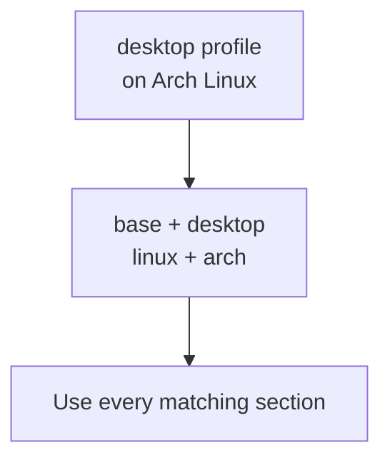

# Profiles and categories

Choose a profile for the kind of machine you're setting up. You choose its
role, not its operating system: dotfiles detects the platform and combines it
with the role to select entries from `conf/`.

## Built-in role profiles

- Use `base` for core shell tools and terminal configuration.
- Use `desktop` for everything in `base` plus workstation applications and graphical settings.

Compare the tasks available for each profile without changing your saved choice:

```bash
dotfiles list --profile base
dotfiles list --profile desktop
```

::: warning Profiles are roles, not safety levels
`base` does not mean unprivileged or home-directory-only. Platform tasks can
still install packages, change your login shell, or merge system files under
`/etc`. Always review a [preview](commands-and-usage.md#dry-run-scope) before
applying either profile.
:::

## Automatic categories

A *category* is a tag used in configuration section names. Both profiles
activate `base`, and the workstation profile also activates `desktop`.
The remaining tags depend on where you run the CLI:

| Where the CLI runs | Automatic categories |
|---|---|
| Windows | `windows` |
| Non-Arch Linux | `linux` |
| Arch Linux | `linux`, `arch` |
| Non-Arch WSL | `linux`, `wsl` |
| Arch WSL | `linux`, `arch`, `wsl` |

Arch detection checks for `/etc/arch-release`, and WSL detection checks the
Linux kernel release string. Because Windows and Linux inside WSL detect
different environments, each side manages its own configuration even on the
same machine.



## Section matching

Active categories decide which TOML entries apply. A hyphen in a section
name acts as **AND**, meaning every listed tag must be active. This excerpt
from [conf/packages.toml](https://github.com/sneivandt/dotfiles/blob/main/conf/packages.toml)
illustrates how sections stack:

```toml title="conf/packages.toml (excerpt)"
[arch]
packages = ["git"]

[arch-desktop]
packages = ["quickshell"]
```

On an Arch Linux workstation using the `desktop` profile, the active categories
are `base`, `desktop`, `linux`, and `arch`. Both `[arch]` and `[arch-desktop]`
match, so both package lists are included. On the same machine with `base`,
only `[arch]` of these two sections matches.

Tag order does not matter (`[arch-desktop]` and `[desktop-arch]` are
equivalent), and all matching sections combine rather than the more specific
one replacing the rest. When editing a config file, add to the existing section
instead of declaring a duplicate table header.

Not every TOML file uses category sections: `conf/registry.toml`, for instance,
uses named settings groups that apply on every Windows run regardless of role.
See [Category sections](configuration-basics.md#category-sections) for
file-specific rules and overlay merging.

Choosing `desktop` on Ubuntu selects shared Linux application settings, but
doesn't add an `apt` integration. Install the applications themselves with
Ubuntu's package manager.

### Distinguish profiles from task filters

In `dotfiles update --profile base --only symlinks`, the profile decides
**which links** belong on this machine. The task filter says **only manage
links** this time. It doesn't change which TOML sections match. If something
you expected is missing, check the [task's availability and prerequisites](troubleshooting.md#task-is-missing-or-skipped).

## Resolution priority

Dotfiles resolves the active profile in this order:

1. `--profile <name>` on the command line.
2. A nonempty `DOTFILES_PROFILE` environment variable.
3. The repository-local Git setting `dotfiles.profile`.
4. An interactive prompt, when the command supports one.

Passing `--profile` overrides the role for that single run without updating the
saved default. Answering an interactive prompt saves the chosen profile once
configuration loads cleanly, even during `check` or `--dry-run`.

To inspect or change the saved default directly from your checkout:

```bash
git config --local --get dotfiles.profile
git config --local dotfiles.profile base
```

The first command exits nonzero with no output if no default is saved yet. The
second writes to local Git config rather than a tracked file. Because linked
worktrees share repository-local Git config, use `--profile` whenever a
specific worktree needs a different role for one run.

### When there is no prompt

`list`, `explain`, and unattended commands require a profile from a flag,
environment variable, or saved setting, whereas help, version, and log commands
need none. See [Unattended runs](commands-and-usage.md#unattended-runs) for
automation flags, or
[No profile selected](troubleshooting.md#no-profile-selected) if you run into a
selection error.

## Changing profiles or categories

A profile controls what dotfiles manages going forward, not what it deletes.
**Switching from `desktop` to `base` does not uninstall desktop
configuration.** Existing desktop packages, services, links, and settings stay
in place so you can decide what to keep. Removing a declaration from TOML
behaves the same way: it stops future management without undoing past runs.

### Preview a different role

You can test another role without changing your saved default:

```bash
dotfiles list --profile desktop
dotfiles update --profile desktop --dry-run
```

### Retire desktop configuration

Keep the original overlay and checkout in place. Handle any cleanup you want
before changing the saved role:

1. While `desktop` is still active, set unwanted services to `enabled = false`,
   preview the `systemd` task, and apply the change before removing their
   declarations. Save open work before stopping services tied to your live
   session.
2. If you want to detach the links, run
   `dotfiles remove --profile desktop --only symlinks --dry-run`. This selects
   **shared links as well as desktop-only links**. Review which links would
   become standalone copies of their current sources. If that's what you
   want, repeat without `--dry-run`. Keep the sources in place.
3. Restore the shared links you want to keep live. Start with
   `dotfiles update --profile base --only symlinks --dry-run`. Ordinary files
   left by removal block new links. Inspect each conflict, preserve any edits,
   and move only the copies you want re-linked to a backup directory. Preview
   again, then apply when the planned links point to the intended sources.
   Leave desktop-only copies you still want in place. On Arch Linux, move
   `~/.config/shell/profile-arch-desktop.sh` aside if you no longer want tty1
   to start Hyprland automatically.
4. Remove unwanted package declarations and uninstall those packages directly
   with your native package manager after reviewing their dependencies. Handle
   registry keys, system files, and other persistent settings manually.
5. Save the new default in your checkout with
   `git config --local dotfiles.profile base`, make sure `DOTFILES_PROFILE` is
   not overriding it, and preview `dotfiles update --profile base --dry-run`.

### Extend the built-in model

Custom profiles and category tags cannot be invented in TOML: an unrecognized
section header fails validation. Use the built-in categories together with a
[private overlay](private-overlays.md) for machine-specific additions; adding a
new built-in role requires changing the CLI itself.

See [Configuration basics](configuration-basics.md) to find the file for a
particular setting.
