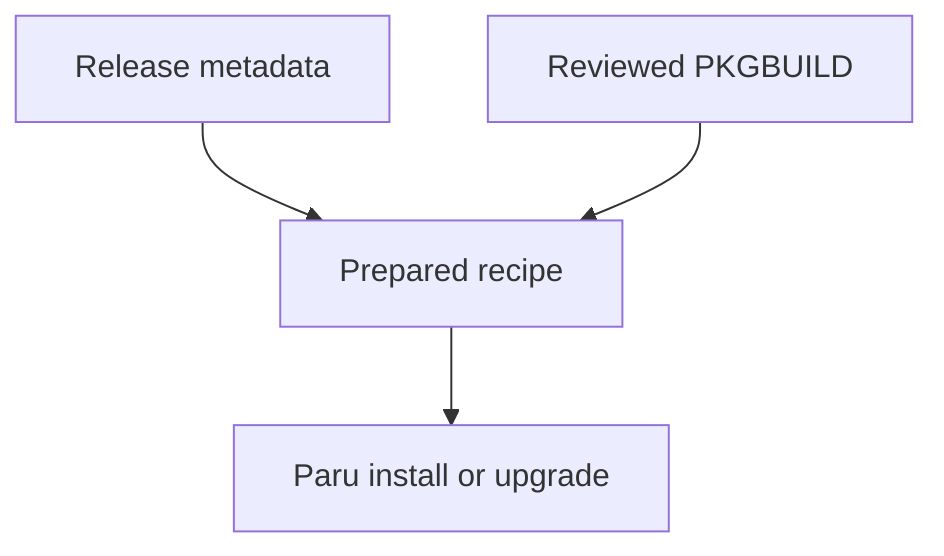

# Package management

Dotfiles installs packages selected by your profile using pacman and Paru on
Arch Linux, or winget on Windows. It checks what is installed and requests
missing packages. Full application upgrades are a separate maintenance action,
although installing a missing Arch package can also upgrade the system.

Installing an application does not configure it. Use
[Application settings](application-settings.md) for preferences and linked files,
and [Agent configuration](agent-configuration.md) for agent content. Updating
the dotfiles CLI is also separate from updating these applications.

## Choose packages

Edit [conf/packages.toml](https://github.com/sneivandt/dotfiles/blob/main/conf/packages.toml).
Use the appropriate existing category: `[arch]` and `[windows]` apply across
roles, while `[arch-desktop]` and `[windows-desktop]` add desktop applications.
Category names select environments, not package managers on other distributions.
See [Profiles and categories](profiles-and-categories.md) for selection rules.

| Package source | Declaration |
|---|---|
| Arch repositories, through pacman | Package name |
| AUR (Arch User Repository), through Paru | Package name with `aur = true` |
| Dotfiles-managed Arch recipe, through Paru | Custom package name with `aur = true` |
| Windows, through winget | Exact winget ID |

For example, these entries select a native Arch tool, an AUR application, and
the Windows Git package:

```toml title="conf/packages.toml"
[arch]
packages = ["ripgrep"]

[arch-desktop]
packages = [{ name = "visual-studio-code-bin", aur = true }]

[windows]
packages = ["Git.Git"]
```

Add entries to existing arrays rather than creating duplicate TOML sections.
Use package identifiers rather than display names. A
[private overlay](private-overlays.md) can add personal packages or replace a
matching declaration; the [System packages reference](system-packages.md#configuration)
explains the shared declaration format. [Private overlays](private-overlays.md#merge-rules)
explains how matching entries are combined.

Other Linux distributions can use shared configuration, but dotfiles does not
install their system packages. Install the tools with that distribution's own
package manager.

## Install and upgrade

For first setup or after adding prerequisites, use a normal preview:

```sh
dotfiles update --dry-run
```

Check the selected profile, package names, and planned actions before removing
`--dry-run`. The `packages` task handles native Arch or Windows packages;
`aur-packages` handles Arch entries marked `aur = true`. If querying the installed
package list fails, the task fails rather than assuming everything is missing.
After a pacman or Paru batch finishes successfully, dotfiles checks the installed
list again. Requested packages still absent count as failures; a successful
package-manager exit alone does not mark them installed. If that verification
query fails, the task fails and the next run inspects the installed state again.

On an already configured machine, preview just the native package task:

```sh
dotfiles update --only packages --dry-run
```

`--only packages` selects all native packages for the active categories, not a
single package and not the AUR list. Use `aur-packages` for that list on Arch.
Scoped runs assume prerequisites are installed. If you need to include them,
inspect the dependency graph before adding `--with-deps`; it can bring in
helper setup and recipe preparation. See
[Task selection](commands-and-usage.md#select-tasks).

### Arch Linux

::: warning Installing a missing package can upgrade the system
Pacman installation uses `pacman -Syu --needed --noconfirm`. It can synchronize
databases and upgrade other installed packages as well as install missing ones.
Review the transaction's possible system effects before applying.
:::

When every selected native package is already installed, dotfiles does not run
a system upgrade solely because the command is named `update`.

Paru builds and installs AUR packages. The `paru` task prepares the helper and
can repair a detected broken helper after library changes. Dotfiles runs Paru
without an extra sudo wrapper; keep the main invocation under your normal user.
Review AUR recipes and upstream sources before trusting them.

Already-installed AUR packages are not requested merely to upgrade them.
For normal dotfiles maintenance followed by a full Arch package upgrade:

```sh
dotfiles update
paru -Syu
```

The second command upgrades repository, AUR, and custom packages across the
machine, including packages absent from this checkout's declarations. Review
its transaction. For [custom packages](#custom-arch-packages), run dotfiles
first so Paru sees the refreshed recipe snapshots.

### Windows

Winget uses exact IDs and installs missing packages. Dotfiles does not run
`winget upgrade --all`; use winget separately to review and upgrade installed
applications. A declaration is an installation requirement, not a version pin.

Installation first requests user scope. It retries without that scope only
when no suitable user-scope installer exists. Prompts are disabled and agreements
accepted, but an application's installer can still request UAC consent.

Administrator-required, cancelled, and policy-blocked installs count as failures.
Other packages may still install, but the task fails overall. An already-installed
or no-applicable-upgrade response counts as current. A failed or unparseable
`winget list` fails even during preview.

Keep the main run unelevated. Consult [Windows elevation](windows-and-wsl.md#elevation)
before retrying an application that requires Administrator rights. Installing
Windows applications does not install their Linux equivalents inside WSL;
configure each environment separately.

## Remove a package

Deleting a declaration stops selecting the application; it does **not** uninstall
it. `dotfiles remove` also leaves packages installed.

1. Remove the entry from every contributing source, including an overlay.
2. Use the native package manager for a deliberate uninstall and review any
   dependent packages it proposes removing.
3. Review linked settings, extensions, and services separately. They have their
   own declarations and may remain after the application is gone.

If a package keeps returning, inspect active categories and overlays for a
remaining declaration. Changing profiles alone does not uninstall packages
selected by the previous profile.

## Logs and troubleshooting

Start with the failing task's log. Replace `<run-id>` with the stable ID in the
failure message or `dotfiles log --list`, and choose the relevant task:

```sh
dotfiles log --id <run-id> --task packages --verbose
dotfiles log --id <run-id> --task aur-packages --verbose
```

The second command is for Arch AUR and custom-package installation. Follow the
reported package-manager error before rerunning; earlier successful installs
are not rolled back when a later package fails.

| Symptom | Check next |
|---|---|
| An expected package is absent from the plan | Active profile/categories, spelling, overlay declarations, and task filters |
| Installed-package discovery fails | The pacman or winget error; do not treat it as an empty installed list |
| Pacman work is skipped for privileges | The reported elevation prerequisite; see [skipped elevation](troubleshooting.md#elevation-is-unavailable) |
| Paru cannot start or build | Helper health and [Rust/Cargo prerequisites](troubleshooting.md#paru-cannot-build-or-start) |
| Winget installation fails | Exact ID, installer scope, cancellation, or policy restrictions |
| A custom package has no newer version | Refresh recipes first, then inspect `version.sh`, `.SRCINFO`, and `paru -Sl --pkgbuilds` |
| Recipe preparation fails | The `custom-package-versions` or `custom-package-repository` log; old pins survive a failed refresh |
| A custom package is excluded from installation | Release metadata, snapshot ownership, and the generated repository section; do not force an AUR fallback |

See [Package troubleshooting](troubleshooting.md#packages-do-not-install) for
broader recovery guidance. Preserve unrelated cache directories when an ownership
check rejects them, rather than deleting them to force preparation.

## Custom Arch packages

These recipes package upstream binary releases using reviewed sources under
[packages/](https://github.com/sneivandt/dotfiles/tree/main/packages/).
Selecting one needs only its package declaration; you do not need to edit a recipe.

| Package | Recipe |
|---|---|
| `apm-dotfiles` | [APM](https://github.com/sneivandt/dotfiles/tree/main/packages/apm/) |
| `github-copilot-app-dotfiles` | [Copilot App](https://github.com/sneivandt/dotfiles/tree/main/packages/github-copilot-app/) |
| `powershell-dotfiles` | [PowerShell](https://github.com/sneivandt/dotfiles/tree/main/packages/powershell/) |
| `github-copilot-cli-dotfiles` | [Copilot CLI](https://github.com/sneivandt/dotfiles/tree/main/packages/github-copilot-cli/) |
| `openai-codex-dotfiles` | [Codex CLI](https://github.com/sneivandt/dotfiles/tree/main/packages/openai-codex/) |

A normal Arch update discovers release versions and prepares snapshots for all
managed recipes in the checkout, independently of the selected package list.
The package list selects which missing applications to install; removing an
entry does not exclude its recipe from discovery or preparation.
**Preparing a recipe does not upgrade an installed application.**
Follow the [Arch upgrade workflow](#arch-linux) afterward.
Paru alone uses the last prepared snapshot, not your latest source edits.



These packages use distinct `*-dotfiles` names and can replace/conflict with
their former packages. Review Paru's replacement prompt. PowerShell's lifecycle
script also adds `/usr/bin/pwsh` to `/etc/shells` on install/upgrade and removes
it on uninstall. Review lifecycle scripts as part of the package transaction.

::: warning Preparation executes recipes and replaces Paru preferences
A normal Arch update prepares every managed recipe, not just selected packages.
Metadata generation executes PKGBUILD code, and preparation replaces the whole
Paru configuration without merging or backing up existing preferences.
Review the recipes and preserve the Paru preferences you need before applying.
:::

To add or change a recipe, prepare snapshots separately, or maintain the Paru
defaults, use [Arch package recipes](arch-package-recipes.md).
