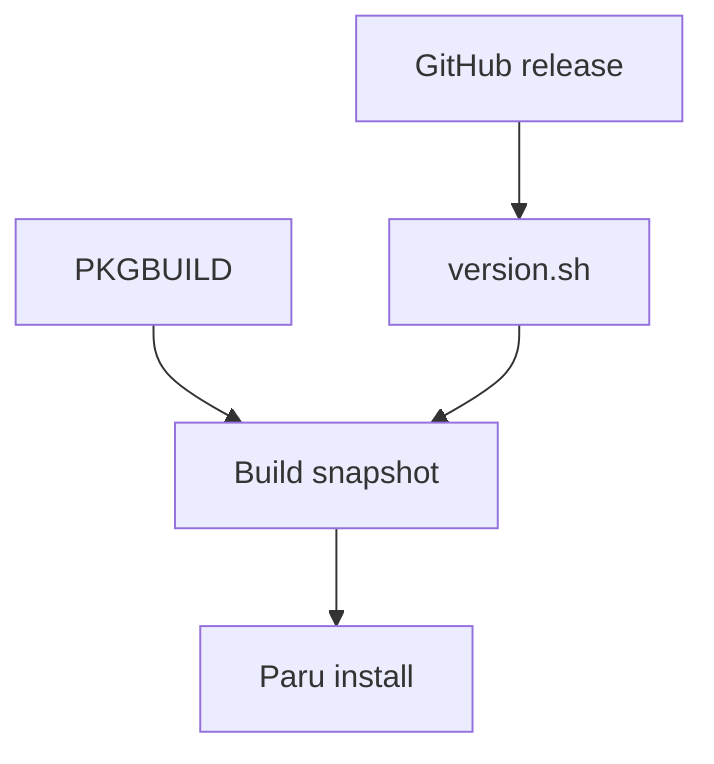

# Package management

Dotfiles uses pacman, Paru, or winget to install packages selected by your
profile. It normally installs missing packages; use your package manager
for full application upgrades. The Arch installation command can also upgrade
the system, as described below. Updating the dotfiles CLI is a separate step.

## Choose packages

Edit [conf/packages.toml](https://github.com/sneivandt/dotfiles/blob/main/conf/packages.toml).
[Categories](profiles-and-categories.md) select entries for the current machine.
The AUR (Arch User Repository) provides community-maintained Arch packages;
Paru is the helper that builds and installs them.

| Source | Declaration | Installer |
|---|---|---|
| Arch repositories | Package name in an Arch category | pacman |
| AUR | `{ name = "spotify", aur = true }`, for example | Paru |
| Maintained local Arch recipe | Its package name with `aur = true` | Paru's prepared local repository |
| Windows | Exact winget ID, such as `Git.Git` | winget |

For example:

```toml title="conf/packages.toml"
[arch]
packages = ["ripgrep"]

[windows]
packages = ["Git.Git"]
```

Use the appropriate existing category rather than adding duplicate sections.
A [private overlay](private-overlays.md) can add packages or replace a matching
entry. See [Package declarations](configuration-reference.md#packages) for the
complete format.

Other Linux distributions can use shared configuration, but dotfiles does not
install their system packages. Provide the needed tools with that distribution's
package manager.

## Install and upgrade

Use the normal update preview to include package prerequisites:

```sh
dotfiles update --dry-run
```

Review the package actions and the platform-specific behavior below, then
remove `--dry-run` to apply. The `packages` task handles regular packages;
Arch's `aur-packages` task handles entries marked `aur = true`. Both read the
installed package list first. If that query fails, the task fails rather than
assuming every package is missing.

### Arch Linux

:::caution[Installing a missing package can upgrade the system]
Pacman installation uses `pacman -Syu --needed --noconfirm`, so it can also
synchronize databases and upgrade other installed packages. This is not an
add-only operation.
:::

If all selected native packages are already installed, dotfiles does not run
a system upgrade just because the command is named `update`.

The `paru` task prepares a working AUR helper, including repairing a detected
broken helper after library changes. AUR installation runs without an extra
sudo wrapper around Paru.

Some declarations use [dotfiles-managed recipes](#custom-arch-packages) instead of the AUR.
Review those tracked recipes before applying: preparation runs recipe code,
and Paru skips its normal recipe review for these local repositories.

Dotfiles does not request already-installed AUR packages merely to upgrade
them. For normal dotfiles maintenance followed by a full package upgrade:

```sh
dotfiles update
paru -Syu
```

The second command upgrades repository, AUR, and custom packages, not only the
ones declared in this checkout. Review its transaction.

### Windows

Winget uses exact IDs and installs missing packages; dotfiles does not run
`winget upgrade --all`. Use winget separately when you intend to upgrade
already-installed applications.

For each missing package, installation first requests user scope. It retries
without a scope only when no suitable user-scope installer exists. Winget
prompts are disabled and agreements accepted, but an installer can still
request UAC consent.

Administrator-required, cancelled, and policy-blocked installs count as
**failed installations**. Other packages may still install, but the task fails
overall. An "already installed" or "no applicable upgrade" response
counts as current. A failed or unparseable `winget list` fails even in preview.

Keep the main run unelevated. See [Windows elevation](windows-and-wsl.md#elevation)
before retrying an installer that genuinely requires Administrator rights.

## Remove a package

Deleting an entry stops selecting it; it does **not** uninstall the application.
`dotfiles remove` leaves packages installed too.

First remove the declaration from every contributing configuration source,
including an overlay if applicable. Then use the native package manager for
a deliberate uninstall. Otherwise a later dotfiles update can install the
package again. Review dependent packages and any linked application settings
separately.

## Custom Arch packages

Custom Arch packages use recipes maintained in this repository to package
upstream binary releases. These PKGBUILDs are dotfiles-managed recipes,
rather than recipes fetched from the AUR. A normal update discovers available
versions, prepares copies of the reviewed recipes for Paru, and installs missing
selected packages.

| Package | Recipe | Upstream |
|---|---|---|
| `apm-dotfiles` | [packages/apm/](https://github.com/sneivandt/dotfiles/tree/main/packages/apm/) | Microsoft APM |
| `github-copilot-app-dotfiles` | [packages/github-copilot-app/](https://github.com/sneivandt/dotfiles/tree/main/packages/github-copilot-app/) | GitHub Copilot App |
| `powershell-dotfiles` | [packages/powershell/](https://github.com/sneivandt/dotfiles/tree/main/packages/powershell/) | Microsoft PowerShell |
| `github-copilot-cli-dotfiles` | [packages/github-copilot-cli/](https://github.com/sneivandt/dotfiles/tree/main/packages/github-copilot-cli/) | GitHub Copilot CLI |
| `openai-codex-dotfiles` | [packages/openai-codex/](https://github.com/sneivandt/dotfiles/tree/main/packages/openai-codex/) | OpenAI Codex CLI |

**A refreshed recipe is not an upgraded application.** Run the
[Arch upgrade workflow](#arch-linux) to upgrade packages that are already
installed. Paru alone uses the last prepared recipe snapshot; it does not
discover a newer release or read your latest source edits.

You do not need to edit a recipe just to select one of these packages.

To maintain a recipe, continue to [Arch package recipes](#arch-package-recipes).
For preparation failures, use the [troubleshooting table](#logs-and-troubleshooting).

### Package replacements and system effects

The Arch category selects APM, PowerShell, Copilot CLI, and Codex. The desktop
Arch category additionally selects the Copilot App. These recipes use distinct
`*-dotfiles` names and declare replacements/conflicts with their former
packages. Review Paru's replacement prompt on first install.

PowerShell's package lifecycle script adds `/usr/bin/pwsh` to `/etc/shells` on
install/upgrade and removes that entry on uninstall. Review package lifecycle
scripts as well as the package transaction.

## Arch package recipes

This section is for maintainers changing recipes under
[packages/](https://github.com/sneivandt/dotfiles/tree/main/packages/).
For routine installation and upgrades, use the workflows above.

A PKGBUILD is a shell recipe that tells Arch's `makepkg` how to produce a
package. Each dotfiles-managed recipe has a release descriptor, `release.json`,
that tells dotfiles where to find the upstream binary release. Dotfiles saves
the selected version and checksums in `version.sh`, then copies them with the
recipe into a disposable build snapshot for Paru. This guide calls those saved
values pins.

The source recipe, prepared snapshot, and installed application are separate.
Changing or preparing a recipe does not by itself upgrade an installed package.

:::caution[Review recipes before preparing packages]
**PKGBUILDs execute shell code**, even when dotfiles only generates metadata
with `makepkg --printsrcinfo` and does not build or install a package.
Review new or changed recipes before running preparation without `--dry-run`.
Temporary copies are **not a sandbox**, and Paru skips its usual recipe review
for local `Path` repositories.
:::

### Adding a recipe

Each recipe needs a `PKGBUILD` defining how to package the application and a
`release.json` describing its upstream releases. Use an
[existing recipe](https://github.com/sneivandt/dotfiles/tree/main/packages/)
as a reference; the same format applies to every application.

1. Create `packages/<recipe>/PKGBUILD` and `release.json`. Give the custom package
   a distinct name where necessary to avoid an AUR recipe taking its place.
2. Make `package_base`, optional `packages`, and `assets` agree with makepkg's
   actual package base, package names, and architectures.
3. Point the descriptor at stable GitHub releases with published SHA-256 asset
   digests. Arbitrary version commands and VCS recipes are not supported.
4. Source `./version.sh` in the PKGBUILD. Keep `pkgrel` tracked and construct
   archive URLs using the upstream tag convention.
5. Keep extra inputs within the [supported snapshot list](#why-there-is-a-disposable-git-snapshot).
   Use `install=package.install` for lifecycle hooks.
6. For automatic installation, add `{ name = "<package-name>", aur = true }`
   to the appropriate category in
   [conf/packages.toml](https://github.com/sneivandt/dotfiles/blob/main/conf/packages.toml).
7. Run [offline checks](#ci-and-validation), review a preparation preview, and
   verify the build on Arch in an isolated environment before installing.

### Prepare recipes

Use an Arch Linux environment with a configured dotfiles checkout and selected
profile. Version discovery needs access to GitHub release metadata, or usable
cached metadata. Applying preparation needs makepkg and the recipe's shell
inputs; it executes the reviewed PKGBUILD to generate metadata. The checkout,
build-cache directory, and generated Paru configuration must be writable.

Paru is needed for the later listing, build, and installation commands, not
for the preparation preview. This scoped run does not install missing tools.
Use [Getting started](getting-started.md) for an initial machine setup.

To inspect only recipe preparation:

```bash
dotfiles update --only custom-package-versions,custom-package-repository --dry-run
```

After reviewing the recipes and plan, remove `--dry-run` to prepare them.
This scoped command does **not** install packages or bootstrap missing tools.
On an already prepared machine, inspect Paru's repository listing without
upgrading:

```bash
paru -Sl --pkgbuilds
```

Once preparation succeeds, use the
[package installation and upgrade workflow](#arch-linux).
Running Paru alone uses the **last prepared snapshot**; it does not discover a
newer GitHub release or read your latest source edits.

On a fresh checkout, preview can describe snapshot work before pins exist.
Applying `custom-package-repository` needs pins, so refresh versions first.

### Preparation lifecycle



| Task | Changes | Does not do |
|---|---|---|
| `custom-package-versions` | Refreshes successful recipes' version/checksum pins | Download archives, execute recipes, or install packages |
| `custom-package-repository` | Validates recipe metadata, prepares snapshots, and writes available repositories into Paru config | Install or upgrade packages |
| `aur-packages` | Installs missing selected packages whose inputs are ready | Upgrade every already-installed package |

Preparation waits for version discovery, but can use retained pins after an
upstream failure. Installation requires healthy Paru and ready inputs. A missing
custom package whose inputs are unavailable is counted as a failure and omitted
from install requests; unrelated AUR packages can continue. It is **not** silently
installed from the AUR instead.

### Files and ownership

| Edit or inspect | Purpose | Tracked? |
|---|---|---|
| `packages/<recipe>/PKGBUILD` | Names, dependencies, URLs, packaging steps, and `pkgrel` | Yes |
| `packages/<recipe>/release.json` | GitHub source, asset names, and owned package names | Yes |
| Optional `package.install`, `LICENSE`, `NOTICE` | Lifecycle hooks and reviewed legal files | Yes |
| `packages/<recipe>/version.sh` | Discovered version and SHA-256 arrays | No |
| [paru.conf.base](https://github.com/sneivandt/dotfiles/blob/main/symlinks/config/paru/paru.conf.base) | Shared Paru options, including `CleanAfter` | Yes |
| Effective `paru.conf` | Generated machine-specific options and repository paths | No |
| `<CloneDir>/<package_base>/` | Disposable Git snapshot and Paru build output | No |

Edit tracked sources, not generated pins or cached recipes. Snapshot commits
are local cache state: they do not commit pins to the dotfiles repository,
create a remote, or publish anything.

Keep `pkgrel` in the PKGBUILD and bump it when a packaging-only change should
produce a newer Arch package. Release discovery manages `pkgver`, not `pkgrel`.

Preserve the application's required runtime files, completions, and licenses
when changing packaging.

#### Packaging details

The Copilot App recipe extracts the official Debian package. PowerShell
includes its .NET runtime, and Codex keeps the full upstream bundle, including
helper/runtime files. CLI recipes also install completions and licenses.
Preserve lifecycle hooks when changing these recipes; PowerShell's
`/etc/shells` integration is described under
[package system effects](#package-replacements-and-system-effects).

### Version discovery

A descriptor names a stable GitHub release source and one asset per architecture.
This illustrative descriptor is for a hypothetical `example-tool` recipe;
replace its repository and asset names with the application's real release data:

```json title="Example release.json" {5-6}
{
  "package_base": "example-tool-dotfiles",
  "repository": "example/tool",
  "assets": {
    "aarch64": "tool-linux-arm64.tar.gz",
    "x86_64": "tool-linux-x86_64.tar.gz"
  }
}
```

| Field | Meaning |
|---|---|
| `package_base` | Actual makepkg `pkgbase`, or `pkgname` when no explicit base exists; not necessarily the source directory name |
| `repository` | GitHub `owner/repo` queried through `/releases/latest` |
| `assets` | Exact release asset names keyed by makepkg architecture |
| `packages` (optional) | All actual package names for split packages or names differing from the base; defaults to the base |
| `tag_prefix` (optional) | Exact prefix to strip before validating a release version |

Discovery scans immediate directories under `packages/` in sorted order.
It is independent of `conf/packages.toml`: maintaining a recipe does not
automatically select it for installation. A directory with neither descriptor
nor PKGBUILD is ignored; a PKGBUILD without `release.json` is an error.
Package bases and owned package names must be unique across descriptors.

For each recipe, dotfiles rejects drafts/prereleases, validates the version,
and requires a valid `sha256:` digest for **every configured architecture**.
It reads GitHub's metadata rather than downloading archives or executing a
version command. Only after all assets validate can that recipe's pins change.
The PKGBUILD sources `./version.sh`; makepkg later verifies the downloads
against those generated checksum arrays.

Without `tag_prefix`, a leading `v` is stripped. Set an explicit prefix, such as
`"tag_prefix": "rust-v"`, when upstream uses a different convention; an unexpected
prefix fails. Asset names can contain `{version}`, substituted with the
validated version after prefix removal.

Tracked license/notice files are not release metadata. Review and refresh them
separately when upstream terms change.

#### Authentication, caching, and failures

GitHub requests prefer `GH_TOKEN`, then `GITHUB_TOKEN`, then an active
noninteractive `gh` login for github.com. Without credentials, public releases
can be queried anonymously. Rejected credentials are reported rather than
silently retried anonymously; tokens are not logged, cached, or passed as
subprocess arguments.

Validated metadata is cached for ten minutes in `bin/.github-releases-v1/`,
scoped by repository and credentials. Cache reuse still checks the current
descriptor and asset digests. Expired entries can use conditional requests.
Requests are serialized, even in parallel mode, and share rate-limit cooldowns
so one quota failure does not trigger a burst of requests.

A failed refresh retains that recipe's existing pins and remains a failure in
the summary. Other recipes can still succeed. Fresh cache entries remain usable
during cooldown; stale metadata is not presented as a successful refresh.
Cache-write problems produce warnings without invalidating otherwise valid pins.

Dry-run may read caches or query GitHub, but does not write caches, cooldowns,
pins, snapshots, or Paru config. It also does not execute PKGBUILDs.

### How Paru sees the recipes

The `custom-package-repository` task combines the tracked base options with generated local
repository sections. It writes a regular file, replacing a former config
symlink atomically without overwriting that symlink's source.

| Path | Precedence |
|---|---|
| Generated config | `PARU_CONF`, then `$XDG_CONFIG_HOME/paru/paru.conf`, then `~/.config/paru/paru.conf` |
| Build root (`CloneDir`) | Nonempty `AURDEST`, then an absolute `$XDG_CACHE_HOME/paru/clone`, otherwise `~/.cache/paru/clone` |

Config overrides and `AURDEST` must be absolute. Empty config overrides are
invalid. Dotfiles creates the selected config destination when absent, so Paru
does not fall back to a different existing config.

The generated repository `Path` points to `<CloneDir>/<package_base>`. Use the
same environment for dotfiles and Paru; a later `--clonedir` override can break
that alignment. Paths allow internal spaces, but not surrounding whitespace,
newlines, carriage returns, or `#`.

Local repositories take priority over the AUR and skip normal recipe review.
Dotfiles publishes validated `.SRCINFO` itself because `GenerateSrcinfo` alone
does not guarantee Paru refreshes local-only repositories.

### Why there is a disposable Git snapshot

Paru's `CleanAfter` resets and cleans `<CloneDir>/<package_base>`. Each snapshot
is a separate, dotfiles-owned cache repository, so cleanup cannot reset source
edits or generated pins in the main checkout. It commits only these supported inputs:

- `PKGBUILD` and generated `version.sh`.
- Optional `package.install`, `LICENSE`, and `NOTICE`.
- Validated, generated `.SRCINFO`.

Recipes needing patches or other inputs require extending the snapshot format.
Before publication, `makepkg --printsrcinfo` evaluates separate copies of the
reviewed recipe and verifies package base, names, and architectures against the
descriptor. These copies are **not a sandbox**.

Unchanged inputs can reuse successful validation after ownership, working files,
and committed files are checked. Stale metadata and damaged inputs are repaired;
failed validation is never cached. Unmanaged directories, linked worktrees,
symlinked snapshot directories, and repositories pointing elsewhere are rejected.

A failed recipe is omitted from generated repositories and retains its previous
cached inputs. Other recipes can proceed. Installation requires current validated
inputs and the published repository section; invalid ownership never authorizes
an AUR fallback. See the source and regression links below for implementation details.

### Logs and troubleshooting

| Symptom or output | Meaning / next step |
|---|---|
| `Custom package versions: write .../version.sh` | Available version/checksum pins changed; nothing was installed |
| `Custom package repository: refresh custom package snapshot ...` | Cached build inputs or metadata changed |
| `Custom package repository: write .../paru.conf` | Available repository paths/options changed |
| Paru reports no upgrade after refresh | Inspect snapshot `version.sh` and `.SRCINFO`; rerun preparation and check `paru -Sl --pkgbuilds` |
| Missing release asset/digest or rate limit | Fix the descriptor or retry after the reported cooldown; old pins survive |
| Pins missing | Apply version discovery before snapshot preparation |
| Unmanaged cache directory | Inspect and preserve it before moving it; dotfiles will not claim an unrelated repository |
| `git reset --hard HEAD: No such file or directory` | Check `CloneDir`, repository `Path`, `package_base`, and environment/command-line overrides agree |
| Custom package install excluded | Inspect descriptor ownership, metadata validation, and the published repository section; do not force an AUR fallback |

Implementation and focused regressions live in
[arch_recipes.rs](https://github.com/sneivandt/dotfiles/blob/main/cli/src/domains/packages/arch_recipes.rs),
[snapshots.rs](https://github.com/sneivandt/dotfiles/blob/main/cli/src/domains/packages/arch_recipes/snapshots.rs), and
[tests.rs](https://github.com/sneivandt/dotfiles/blob/main/cli/src/domains/packages/arch_recipes/tests.rs).

### CI and validation

Recipe-only changes select offline Linux Rust checks, configuration
validation/drift, and ShellCheck. They do not request a CLI binary release or
Windows package integration. Rust implementation changes retain the normal
cross-platform rules.

Offline coverage checks real descriptors without generated pins, shell inputs,
mocked release failures, independent refreshes, retained-pin recovery, preview
safety, package readiness, and snapshot ownership/cleanup isolation.
ShellCheck includes tracked PKGBUILDs and install scripts, not downloaded files
or build outputs.

Choose local commands from [Testing](testing.md#choosing-coverage), using the
pinned Rust toolchain. A recipe edit needs more than a successful docs check.

CI does **not** establish current release availability, archive download
checksums, native Arch builds/installation, or Paru's full cleanup lifecycle.
Ubuntu and Windows profile jobs do not perform native Arch package operations.
For those gaps, use a disposable Arch build/home/cache with controlled config
and installation blocked. Build-only Paru (`paru -B`) is appropriate for cleanup
tests; verify that source edits and cached pins both survive.
