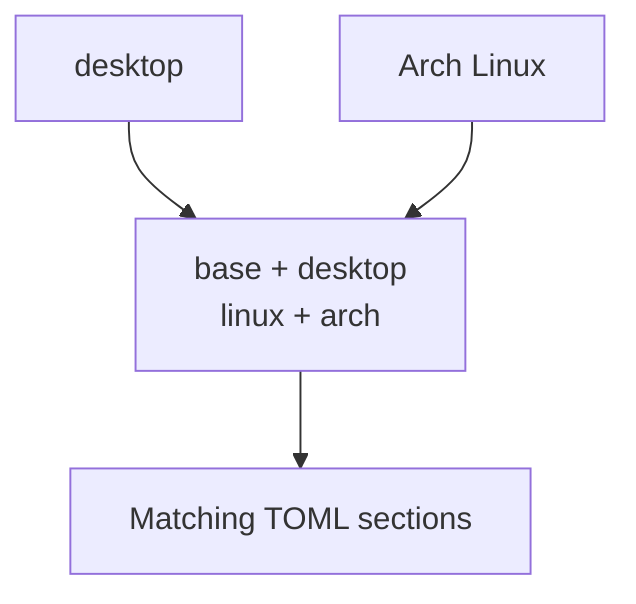

# Profiles and categories

A profile chooses the machine's role: base or desktop. Categories are labels
such as `linux` and `arch` that select matching sections in configuration files.
Dotfiles combines the profile's categories with those it detects for the
operating system. Task filters let you run only part of the selected work.

The examples assume an installed dotfiles launcher. Before installation, use
your checkout's `./dotfiles.sh` on Linux or `.\dotfiles.ps1` on Windows;
[Getting started](getting-started.md) explains bootstrap and the first run.

## Built-in role profiles

| Profile | Includes | Best fit |
|---|---|---|
| `base` | Core shell configuration and tools | Servers, shell-focused machines, minimal WSL setups |
| `desktop` | Everything in `base`, plus desktop configuration and tools | Workstations |

For example:

```bash
dotfiles list --profile base
dotfiles list --profile desktop
```

Names are exactly `base` and `desktop`, in lowercase. `linux`, `arch`, `windows`,
and `wsl` describe the environment; they are not valid profile names.

:::caution[Profiles are roles, not safety levels]
Base does not mean harmless or unprivileged. Platform settings can still
install packages, change the login shell, or manage system files. Review the
[preview](commands-and-usage.md#dry-run-scope) before applying either role.
:::

## Automatic categories

Every profile activates `base`. The desktop profile also activates `desktop`.
Dotfiles then adds the detected platform categories:

| Where the CLI runs | Automatic categories |
|---|---|
| Windows | `windows` |
| Non-Arch Linux | `linux` |
| Arch Linux | `linux`, `arch` |
| Non-Arch WSL | `linux`, `wsl` |
| Arch WSL | `linux`, `arch`, `wsl` |

Arch detection uses `/etc/arch-release`; WSL detection uses the Linux kernel
release. Windows and Linux inside WSL select different environments, even
when they run on the same computer.



## Section matching

The active categories select TOML sections. A hyphen in a section name means
**AND**: every category in the name must be active. This excerpt from
[conf/packages.toml](https://github.com/sneivandt/dotfiles/blob/main/conf/packages.toml)
shows two matching sections:

```toml title="conf/packages.toml" {4-5}
[arch]
packages = ["git"]

[arch-desktop]
packages = ["quickshell"]
```

Choose the desktop role on Arch Linux and the active categories are `base`,
`desktop`, `linux`, and `arch`. Both sections match, so both package lists
contribute. Choose `base` on the same machine and only `[arch]` matches this
example.

`[arch-desktop]` and `[desktop-arch]` mean the same thing. All matching sections
contribute; the most specific one is not a replacement for the rest. When
editing the file, extend its existing sections rather than duplicating them.

Not every table is a category. For example, registry tables are named settings
groups and are not filtered by role. See
[Category sections](configuration-reference.md#category-sections) for the
file-specific rules and overlay merging.

Selecting desktop on Ubuntu can select shared application settings, but it
does not enable package installation through apt. Linux package installation
requires pacman; categories do not install missing package managers.

## Resolution priority

Dotfiles looks for a profile in this order:

1. `--profile <name>`.
2. Nonempty `DOTFILES_PROFILE`.
3. Repository-local Git setting `dotfiles.profile`.
4. An interactive profile prompt, when the command allows one.

An explicit flag is a **one-run override**; it does not save a new default.
Only an interactive prompt saves its answer automatically. That prompt can
also occur during `check` or `--dry-run`.

To inspect or deliberately change the saved default, run these from the
intended checkout:

```bash
git config --local --get dotfiles.profile
git config --local dotfiles.profile base
```

The first command returns no value and a nonzero status if the setting is
absent. The second writes local Git configuration, not a tracked file.
Linked worktrees can share that setting; use `--profile` when you need a
specific role for one invocation.

### When there is no prompt

`list` and unattended commands need a profile supplied by a flag, environment
variable, or saved setting. Help, version, and log viewing need none.
For automation, see
[Unattended runs](commands-and-usage.md#unattended-runs); for an unexpected
selection error, see [Profile troubleshooting](troubleshooting.md#no-profile-can-be-selected).

## Changing profiles or categories

### Preview a different role

```bash
dotfiles list --profile desktop
dotfiles update --profile desktop --dry-run
```

Neither command changes the saved profile. The preview still has the
[bookkeeping and external-tool effects](commands-and-usage.md#dry-run-scope) of any dry run.

**Switching from desktop to base does not uninstall desktop configuration.**
It stops selecting desktop-only entries. Their packages, services, links, and
settings remain. Removing a declaration has the same limitation.

If you need cleanup, plan it while the original profile and sources are still
available. `remove` uses the current selection and supports only the limited
[remove tasks](task-reference.md#remove-tasks); it is not a general migration command.

### Distinguish profiles from task filters

With `--profile base --only symlinks`, the profile chooses which link
declarations apply and the filter runs only the symlinks task. Other base
tasks do not run. The filter does not change which configuration sections match.

If expected work is missing, check the categories, task filters, and required
tools. Tasks with nothing to change are hidden unless you
use `--verbose`. See [A task does not run](troubleshooting.md#a-task-does-not-run).

### Extend the built-in model

Custom profiles and category tags are not supported in configuration alone.
An invented heading is an error, not a new machine role. Use the existing
categories and a [private overlay](private-overlays.md) for personal
configuration; adding a new built-in role requires a CLI change.
