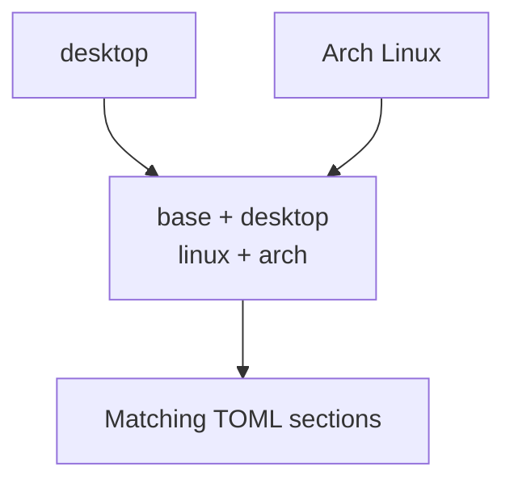

# Profiles and categories

Choose a **profile** for the machine's role. Dotfiles adds **categories** for
the operating environment, then uses those categories to select configuration.
Use **task filters** separately when you want to run only part of that work.

## Built-in role profiles

| Profile | Includes | Best fit |
|---|---|---|
| `base` | Core shell configuration and tools | Servers, shell-focused machines, minimal WSL setups |
| `desktop` | Everything in `base`, plus desktop configuration and tools | Workstations |

For example:

```bash
dotfiles list --profile base
dotfiles list --profile desktop
```

Names are exactly `base` and `desktop`, in lowercase. `linux`, `arch`, `windows`,
and `wsl` describe the environment; they are not valid profile names.

:::caution[Profiles are roles, not safety levels]
Base does not mean harmless or unprivileged. Platform settings can still
install packages, change the login shell, or manage system files. Review the
[preview](commands-and-usage.md#dry-run-scope) before applying either role.
:::

## Automatic categories

Every profile activates `base`. The desktop profile also activates `desktop`.
Dotfiles then adds the detected platform categories:

| Where the CLI runs | Automatic categories |
|---|---|
| Windows | `windows` |
| Non-Arch Linux | `linux` |
| Arch Linux | `linux`, `arch` |
| Non-Arch WSL | `linux`, `wsl` |
| Arch WSL | `linux`, `arch`, `wsl` |

Arch detection uses `/etc/arch-release`; WSL detection uses the Linux kernel
release. Windows and Linux inside WSL select different environments, even
when they run on the same computer.



Categories choose configuration; they do not add support for missing tools.
For example, a desktop profile on Ubuntu does not provide an apt package
adapter. The Linux package task looks for pacman.

## Resolution priority

Dotfiles takes the first available selection:

1. `--profile <name>`.
2. Nonempty `DOTFILES_PROFILE`.
3. Repository-local Git setting `dotfiles.profile`.
4. An interactive profile prompt, when the command allows one.

An explicit flag is a **one-run override**; it does not save a new default.
Only an interactive prompt saves its answer automatically. That prompt can
also occur during `check` or `--dry-run`.

To inspect or deliberately change the saved default, run these from the
intended checkout:

```bash
git config --local --get dotfiles.profile
git config --local dotfiles.profile base
```

The first command returns no value and a nonzero status if the setting is
absent. The second writes local Git configuration, not a tracked file.
Linked worktrees can share that setting; use `--profile` when you need a
specific role for one invocation.

### When there is no prompt

`list` requires a flag, environment value, or saved choice. It never prompts
for or saves a profile. Update, remove, and check also require an existing
selection with non-terminal stdin, `--non-interactive`, JSON Lines output, or
any present `CI` variable. Help, version, and log viewing need no profile.

A selected value must be valid. `DOTFILES_PROFILE=unknown` does not fall back
to a saved `base`, and `" base "` is not trimmed. Invalid text encoding is
also an error. An explicit valid `--profile` overrides the bad environment value.

## Section matching

For category-based TOML sections, hyphens mean **AND**:

```toml
[base]
packages = ["git"]

[arch-desktop]
packages = ["quickshell"]
```

An Arch desktop selects both sections. An Arch base machine selects only
`[base]`. `[arch-desktop]` and `[desktop-arch]` mean the same thing. All matching
sections contribute; the most specific one is not a replacement for the rest.

Not every table is a category. For example, registry tables are named settings
groups and are not filtered by role. See
[Category sections](configuration-reference.md#category-sections) for the file-specific
rules and overlay merging.

## Changing profiles or categories

### Preview a different role

```bash
dotfiles list --profile desktop
dotfiles update --profile desktop --dry-run
```

Neither command changes the saved profile. The preview still has the
[bookkeeping and external-tool effects](commands-and-usage.md#dry-run-scope) of any dry run.

**Switching from desktop to base does not uninstall desktop configuration.**
It stops selecting desktop-only entries. Their packages, services, links, and
settings remain. Removing a declaration has the same limitation.

If you need cleanup, plan it while the original profile and sources are still
available. `remove` uses the current selection and supports only the limited
[remove tasks](task-reference.md#remove-tasks); it is not a general migration command.

### Distinguish profiles from task filters

`--profile base --only symlinks` means “link the base role's active sources.”
It does not install every base task, and `--only` does not change which
configuration sections match.

If expected work is missing, check the category selection, task filters, and
runtime capabilities separately. Already-current tasks are hidden unless you
use `--verbose`. See [A task does not run](troubleshooting.md#a-task-does-not-run).

### Extend the built-in model

Custom profiles and category tags are not supported in configuration alone.
An invented heading is an error, not a new machine role. Use the existing
categories and a [private overlay](private-overlays.md) for personal
configuration; adding a new built-in role requires a CLI change.
