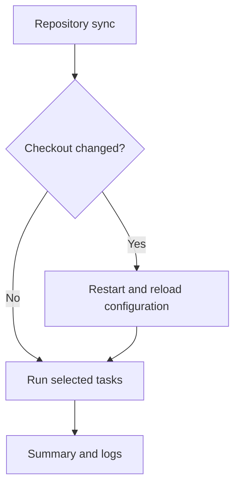

# Update lifecycle

`dotfiles update` does more than copy configuration files. It can update the
CLI, synchronize the configuration repositories, and then bring your machine
into the selected state. These are separate steps with different controls.

For routine use, start with a preview:

```sh
dotfiles update --dry-run
```

Review the plan, then remove `--dry-run` to apply. Before the launcher is
installed, use `./dotfiles.sh` or `.\dotfiles.ps1` instead.

## What happens in a normal update

### 1. Obtain a usable CLI

The wrapper uses its cached binary, downloading and verifying a release when
needed. This happens **before** the CLI processes the command, including help
or dry-run. An installed launcher delegates to that checkout's wrapper.

This is bootstrap, not the regular self-update check. See
[Wrapper bootstrap](commands-and-usage.md#wrapper-bootstrap) for source builds,
verification, and choosing a publisher.

### 2. Check the CLI release

Eligible release binaries check for a newer release before `update` and
`remove`, before task selection. `check`, `list`, `log`, help, and version
do not trigger that check.

The binary must run from the selected checkout's `bin/` directory and carry
an embedded release publisher. Development builds do not self-update.
Changing Git `origin` does not redirect an existing binary to another publisher.

If a newer release is available, an applying run downloads it, verifies
checksum and provenance, replaces the executable, and tests it with `--version`.
It then restarts using the new code. Failed verification is an error, not
permission to run the download. A failed smoke test attempts to restore the
previous binary and reports any rollback failure.

A release-lookup failure is reported but leaves the existing binary usable.
Fresh results can be cached for ten minutes, so every invocation need not
contact GitHub. A preview can report an available version but does not install
it or write release caches.

### 3. Synchronize configuration repositories

The `repository` task considers the main checkout and an active overlay that
is itself a Git checkout. Both must be ready before synchronization proceeds.
It fetches and fast-forwards the current branches to their configured upstreams.
It does not switch branches, commit edits, stash, reset, or rebase your work.

Tracked local changes block synchronization. Detached HEAD, missing upstreams,
divergence, and remote failures are reported instead of being repaired behind
your back. Ordinary untracked files do not themselves block the readiness check.

If a checkout changes, dotfiles restarts and reloads configuration before
continuing with the selected work. This ensures new declarations and task
definitions are used rather than the old in-memory configuration. The parent
keeps the run lock across the restart.



A dry run can compare remote refs, but does not fetch, merge, or preview the
contents of commits it has not downloaded. A later apply may therefore load
new configuration. To review a fixed checkout, use `--no-repo-update` for both
the preview and the applying run.

### 4. Apply the selected state

Tasks inspect the machine and change what is needed for the profile and
overlay. Independent tasks may run in parallel, so their output does not
necessarily match the order in a configuration file.

Some update tasks also advance dependencies:

| Area | What update means |
|---|---|
| Native and AUR packages | Install missing selected packages; see the upgrade distinctions in [Package management](package-management.md#install-and-upgrade) |
| Local Arch recipes | Discover upstream releases and prepare reviewed build snapshots; Paru upgrades already-installed packages |
| Agent packages | Update dependencies when their declared version rules allow it, then apply package content; see [AI agent configuration](ai-agent-configuration.md) |
| VS Code extensions | Install missing IDs, not pin or upgrade every existing extension |
| Neovim plugins | Managed by lazy.nvim in the editor, not by the dotfiles task graph |

An updated repository can also affect applications immediately through existing
symlinks. A task does not need to rewrite a link for its source content to change.

### 5. Read the result

The summary counts tasks, not files or packages. Successful earlier changes are
not rolled back if later work fails. Skipped or blocked work means something
remains incomplete; exit status 0 alone is not proof of a complete installation.
Use `--fail-on-skip` when automation requires all applicable work to finish.

Each restarted or elevated process has its own log linked to its parent.
Follow those links if the first process only reports a restart or delegation.
The failure message prints a stable run ID and a command to inspect it.

```sh
dotfiles log
dotfiles log --list
```

The [Logs reference](commands-and-usage.md#logs) explains IDs, task filtering,
verbosity, raw records, retention, and storage locations.
[Troubleshooting](troubleshooting.md) starts with how to diagnose a partial run
before retrying.

## Control what advances

Ordinary updates need no extra switches. Use these only when you deliberately
want a narrower operation:

| Intent | Control | Important limit |
|---|---|---|
| Keep the CLI version | `DOTFILES_SKIP_SELF_UPDATE=1` | Does not disable wrapper bootstrap or repository/task network access |
| Keep checkout contents fixed | `--no-repo-update` | Does not disable the CLI release check |
| Run specific configuration work | `--only <selectors>` | Filters tasks, not startup; prerequisites require `--with-deps` |
| Leave agent deployments alone | `--skip agent-packages` | Does not stop other tasks or update the APM executable |
| Keep local recipe version pins | `--skip local-package-versions` | Existing pins can still be used by recipe preparation |

See [Task selection](commands-and-usage.md#select-tasks) for filter combinations.
There is no blanket “offline” switch. Dry-run still writes logs and may save
selections, inspect the host, and execute cooperative overlay scripts; read
[Dry-run scope](commands-and-usage.md#dry-run-scope).
